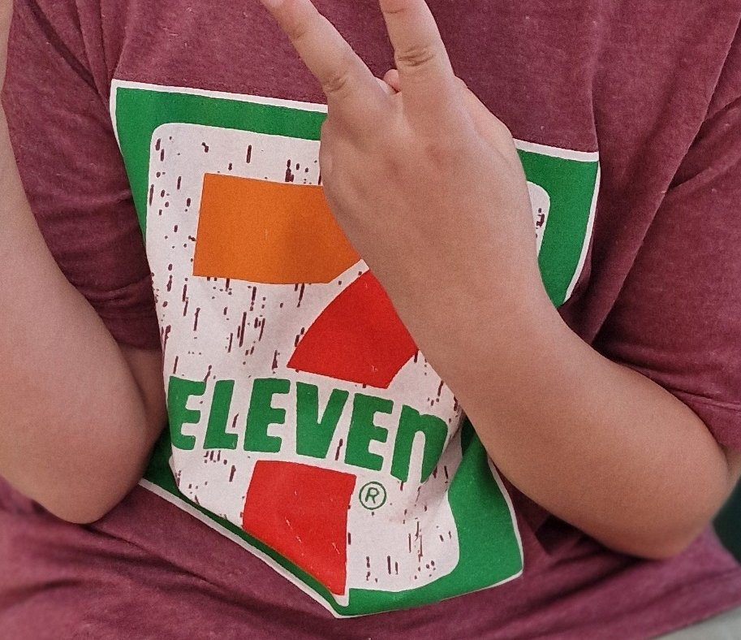

Wer schon einmal in Thailand war, kennt ihn mit ziemlicher Sicherheit: 7-Eleven. Egal ob mitten in Bangkok, an einer Tankstelle oder irgendwo auf Koh Samui – das grün-orange-rote Logo begegnet einem praktisch überall. Manchmal sogar mehrfach innerhalb weniger Meter.

Was auf den ersten Blick aussieht wie ein etwas besser ausgestatteter Tankstellenshop, ist in Thailand längst eine Institution. Hier bekommt man fast alles, was man im Alltag spontan brauchen könnte. Und das rund um die Uhr.

Ich mag 7-Eleven wirklich gerne. Inzwischen besitze ich sogar ein T-Shirt mit dem Logo. Und damit bin ich nicht allein. Rund um diese Supermarktkette ist ein regelrechter Kult entstanden, der weit über Lebensmittel und gekühlte Getränke hinausgeht.

Dabei wusste ich bis vor Kurzem erstaunlich wenig über das Unternehmen. Zum Beispiel, dass 7-Eleven ursprünglich gar nicht aus Asien kommt. Oder warum die Läden überhaupt so heißen, obwohl sie längst 24 Stunden geöffnet haben.

Und dann gibt es noch dieses winzige Detail im Logo, das mir all die Jahre nicht aufgefallen ist.

## Mehr als ein Supermarkt: Was 7-Eleven in Thailand so besonders macht

Um das Konzept zu verstehen, muss man wissen, dass 7-Eleven ein sogenannter Convenience Store ist. Ein kleiner Laden, der möglichst viele Dinge des täglichen Bedarfs an einem Ort anbietet.

In Deutschland würde ich ihn am ehesten mit einem gut sortierten Tankstellenshop vergleichen. Nur dass die Auswahl deutlich größer ist und die Läden an wirklich jeder Ecke stehen.

Neben Getränken, Snacks und Lebensmitteln findet man dort Hygieneartikel, Haushaltsprodukte und teilweise sogar Kleidung. Man kann Geld abheben, Guthaben für sein Mobiltelefon kaufen oder verschiedene Dienstleistungen nutzen.

Besonders beliebt sind die vielen fertigen Gerichte. Es gibt Reisgerichte mit Fleisch oder Gemüse, gekochte Eier, Obst, Sandwiches und natürlich jede Menge süße Snacks.

Ein echter Klassiker sind die abgepackten Sandwiches, die direkt im Laden in einem Sandwich-Toaster erwärmt werden. Wer schon einmal in Thailand unterwegs war, hat sich vermutlich irgendwann so ein warmes Sandwich geholt.

Für uns gehörten diese kleinen Einkäufe früher ganz selbstverständlich zum Urlaub dazu. Wenn wir in Thailand unterwegs waren, haben wir häufig unser Frühstück oder eine Kleinigkeit für zwischendurch im 7-Eleven gekauft. Gerade auf längeren Autofahrten ist das unglaublich praktisch.

Inzwischen leben wir dauerhaft auf Koh Samui und unser Einkaufsverhalten hat sich verändert. Den Wocheneinkauf erledigen wir meistens in größeren Supermärkten wie Lotus's oder Big C. Dort ist vieles günstiger.

7-Eleven nutzen wir eher für spontane Besorgungen. Mal einen Kaffee, eine Flasche Wasser oder etwas zu essen, wenn wir unterwegs sind.

Trotzdem möchte ich diese Läden nicht missen. Schon allein, weil man sich darauf verlassen kann, dass irgendwo in der Nähe einer ist.

## Wie aus einem Eisverkauf eine weltweite Supermarktkette wurde

Die Geschichte von 7-Eleven beginnt ausgerechnet in den USA. Genauer gesagt 1927 in Texas.

Damals gab es dort ein Unternehmen, das Eisblöcke verkaufte. Das klingt heute wenig aufregend, war aber zu einer Zeit, als elektrische Kühlschränke noch längst nicht in jedem Haushalt standen, ein wichtiges Geschäft.

Ein Mitarbeiter namens John Jefferson Green kam auf die Idee, neben den Eisblöcken auch Lebensmittel wie Milch, Eier und Brot anzubieten.

Der entscheidende Vorteil: Die Verkaufsstellen für Eis waren auch dann geöffnet, wenn andere Lebensmittelgeschäfte bereits geschlossen hatten.

Die Menschen konnten also nach Feierabend oder am Wochenende noch ein paar wichtige Dinge einkaufen. Eine ziemlich einfache Idee, die allerdings den Grundstein für ein völlig neues Einkaufskonzept legte.

Die zusätzlichen Produkte verkauften sich so gut, dass das Angebot auf weitere Verkaufsstellen ausgeweitet wurde. Zunächst hießen die Geschäfte *Tote'm Stores*.

Erst 1946 entstand der Name 7-Eleven. Damals waren die Öffnungszeiten von morgens sieben bis abends elf Uhr etwas ganz Besonderes. Die meisten anderen Läden schlossen deutlich früher.

Aus diesen Öffnungszeiten wurde schließlich der Markenname: Seven-Eleven.

Heute wirkt das beinahe komisch. Denn zumindest in Thailand sind die meisten Filialen längst rund um die Uhr geöffnet. Eigentlich müsste die Kette also 24/7 heißen.

Aber der ursprüngliche Name war inzwischen so bekannt, dass er einfach beibehalten wurde.

## Warum 7-Eleven heute ein japanisches Unternehmen ist

Obwohl 7-Eleven seinen Ursprung in den USA hat, gehört die Marke heute zu einem japanischen Konzern. Und die Geschichte dahinter finde ich besonders interessant.

1974 eröffnete die erste japanische Filiale in Tokio. Das Unternehmen hatte sich die Lizenz für das amerikanische Konzept gesichert und begann, die Idee für den japanischen Markt weiterzuentwickeln.

Dabei wurde das Angebot immer stärker an die Bedürfnisse der Kunden angepasst. Fertige Mahlzeiten, zusätzliche Dienstleistungen und besonders lange Öffnungszeiten machten die kleinen Geschäfte zu einem festen Bestandteil des japanischen Alltags.

Während das Geschäft in Japan immer erfolgreicher wurde, geriet die amerikanische Muttergesellschaft zunehmend in finanzielle Schwierigkeiten.

Schließlich übernahmen die japanischen Lizenznehmer Anfang der 1990er-Jahre die Mehrheit am amerikanischen Unternehmen. 2005 wurde die amerikanische 7-Eleven-Gesellschaft vollständig in die japanische Unternehmensgruppe integriert.

Der ehemalige Lizenznehmer hatte also seinen ursprünglichen Lizenzgeber übernommen.

Heute gehört 7-Eleven zum japanischen Konzern Seven & i Holdings. In Japan gibt es inzwischen mehr als 21.000 Filialen. Damit ist das Land einer der wichtigsten Märkte für die Kette.

Aber direkt dahinter folgt ein Land, das wir inzwischen unser Zuhause nennen: Thailand.

## Warum es in Thailand fast 16.000 Filialen gibt

Die erste thailändische 7-Eleven-Filiale eröffnete 1989 in Bangkok. Damals war keineswegs sicher, dass sich das Konzept hier durchsetzen würde.

Heute ist Thailand einer der größten Märkte der Kette. Ende 2025 gab es landesweit bereits 15.945 Filialen.

Wer schon einmal durch Bangkok gefahren ist, kann sich diese enorme Zahl wahrscheinlich gut vorstellen. Manchmal stehen zwei Filialen direkt gegenüber auf unterschiedlichen Straßenseiten. Ein paar Häuser weiter folgt dann schon die nächste.

Auch auf Koh Samui ist die Dichte beeindruckend. Selbst dort, wo eigentlich schon ausreichend Einkaufsmöglichkeiten vorhanden sind, wird gelegentlich noch ein weiterer Laden gebaut.

Dahinter steckt natürlich eine Geschäftsstrategie. Je präsenter eine Marke ist, desto wahrscheinlicher ist es, dass die Menschen dort einkaufen. Gleichzeitig macht ein so dichtes Filialnetz es für andere Anbieter schwerer, attraktive Standorte zu finden.

Aber der Erfolg in Thailand hat noch andere Gründe.

Gerade außerhalb der großen Städte gibt es nicht überall riesige Supermärkte. 7-Eleven bietet dort nicht nur Lebensmittel, sondern auch verschiedene Dienstleistungen, die in kleinen Geschäften nicht unbedingt verfügbar sind.

Hinzu kommt die Klimatisierung. Was für uns in Deutschland selbstverständlich erscheint, ist in einem tropischen Land keineswegs unwichtig.

Wenn im April die Temperaturen besonders hoch sind, kann ein kurzer Aufenthalt in einem klimatisierten Laden ausgesprochen angenehm sein. Auch die gekühlte Lagerung vieler Lebensmittel ist ein Vorteil.

Dazu kommt die gute Erreichbarkeit. Durch die Zusammenarbeit mit der thailändischen Tankstellenkette PTT findet man 7-Eleven auch an zahlreichen Tankstellen. Wer länger mit dem Auto unterwegs ist, kann dort fast alles für eine kleine Pause besorgen.

Das Konzept passt also erstaunlich gut zum Alltag in Thailand.

## Warum wir in Deutschland noch immer keinen 7-Eleven haben

Diese Frage haben Hagen und ich uns schon öfter gestellt. Warum gibt es einen Laden, der in vielen Ländern so erfolgreich ist, eigentlich nicht in Deutschland?

In Europa ist 7-Eleven durchaus vertreten, beispielsweise in Schweden, Dänemark und Norwegen. Deutschland hat dagegen bis heute keine einzige reguläre Filiale.

Ein großes Hindernis sind die Ladenöffnungszeiten. Gerade die Möglichkeit, rund um die Uhr einzukaufen, gehört zum Kern des Konzepts. In Deutschland ist das aufgrund der gesetzlichen Regelungen, insbesondere an Sonn- und Feiertagen, für normale Einzelhandelsgeschäfte nur eingeschränkt möglich.

Dazu kommt unsere ausgeprägte Discounter-Kultur.

In Deutschland kaufen viele Menschen ihre Lebensmittel bei Aldi, Lidl oder anderen großen Supermärkten ein. Für den schnellen Einkauf zwischendurch gibt es Tankstellen, Kioske und kleinere Supermärkte.

Und natürlich sind die Menschen preisbewusst.

7-Eleven müsste also einen Weg finden, sich neben diesen bestehenden Angeboten zu behaupten. Denn ein Wocheneinkauf zu Tankstellenpreisen wäre vermutlich auch in Deutschland keine besonders attraktive Sache.

Andererseits kann ich mir durchaus vorstellen, dass die Marke funktionieren könnte. Gerade in Großstädten, an Bahnhöfen oder in touristischen Gegenden.

Schließlich gibt es Marken, die Menschen nicht ausschließlich wegen ihres günstigen Preises nutzen. Starbucks ist beispielsweise auch nicht gerade dafür bekannt, den billigsten Kaffee anzubieten. Trotzdem funktioniert das Konzept.

Warum sollte das mit einem gut sortierten Convenience Store nicht ebenfalls möglich sein?

Deutschland wird jedenfalls immer wieder als möglicher Expansionsmarkt für 7-Eleven genannt. Konkrete Filialeröffnungen gibt es bislang allerdings nicht.

Ich wäre definitiv dafür.

## Wenn sogar Kühlschrankmagneten zum Kult werden

Wie beliebt 7-Eleven inzwischen ist, sieht man auch daran, dass rund um die Marke ein regelrechter Merchandise-Markt entstanden ist.

Es gibt T-Shirts, Socken, Taschen und alle möglichen anderen Dinge mit dem bekannten Logo.

Besonders lustig finde ich die kleinen 7-Eleven-Kühlschrankmagneten. Sie sehen aus wie die typischen Ladenschilder und werden so befestigt, dass sie seitlich vom Kühlschrank abstehen.

Manche Modelle spielen sogar die bekannte Melodie ab, die man beim Betreten vieler thailändischer Filialen hört.

Durch Videos in sozialen Netzwerken sind diese kleinen Magnete ziemlich beliebt geworden.

Ich habe natürlich direkt nachgeschaut, was solche Dinge kosten. In Thailand findet man sie auf Plattformen wie Lazada teilweise für etwas mehr als zwei Euro. Auf Etsy wurden vergleichbare Artikel in Deutschland für zehn bis 25 Euro angeboten.

Da kam mir sofort eine Geschäftsidee.

Einfach hundert Stück bestellen, nach Deutschland schicken und einen kleinen Etsy-Shop eröffnen.

Ganz so unkompliziert ist das wegen Importvorschriften, Zoll und möglichen Markenrechten natürlich nicht. Aber über die möglichen Gewinnmargen musste ich trotzdem kurz nachdenken.

Vielleicht wird aus meinem 7-Eleven-T-Shirt ja irgendwann doch noch ein Geschäftsmodell.

## Ein kleines Detail im Logo, das kaum jemandem auffällt

Zum Schluss noch eine Kleinigkeit, die ich selbst erst bei meiner Recherche zur Podcastfolge entdeckt habe.

Schau dir das 7-Eleven-Logo einmal genauer an.

7-ELEVEn

Fällt dir etwas auf?

Der letzte Buchstabe ist tatsächlich ein kleines „n“. Alle anderen Buchstaben sind Großbuchstaben.

Obwohl mir dieses Logo in Thailand täglich begegnet, war mir das vorher noch nie aufgefallen.

Dazu gibt es eine interessante Geschichte: Angeblich fand die Ehefrau eines früheren Unternehmenschefs den Schriftzug mit ausschließlich großen Buchstaben zu kantig und schlug deshalb vor, das letzte „N“ durch ein kleines „n“ zu ersetzen.

Ob diese Erklärung tatsächlich der historische Grund ist, lässt sich nicht eindeutig belegen. Dass das kleine „n“ bewusst Bestandteil des Logos ist, steht aber außer Frage.

Ich finde solche Details spannend, gerade weil ich beruflich selbst viel mit Marketing und Gestaltung zu tun habe. Manchmal verändern winzige Entscheidungen die gesamte Wirkung eines Designs, ohne dass wir sie bewusst wahrnehmen.

Und genau das passt eigentlich ganz gut zu 7-Eleven.

Das Unternehmen hat aus einer simplen Idee – Lebensmittel dort anzubieten, wo Menschen sie gerade brauchen – eine weltweit erfolgreiche Marke gemacht.

Vielleicht ist das auch der Grund, warum ich diese Läden so mag. Sie sind praktisch, unkompliziert und irgendwie typisch für unseren Alltag in Thailand geworden.

Einen 7-Eleven um die Ecke zu haben, ist für uns inzwischen fast selbstverständlich.

Und wenn es irgendwann tatsächlich die ersten Filialen in Deutschland gibt, bin ich gespannt, ob sie dort denselben Kultstatus erreichen.

**Kennst du 7-Eleven aus deinem Thailandurlaub?** Und würdest du dir wünschen, dass die Kette auch nach Deutschland kommt?

In der dazugehörigen Folge meines Podcasts *DLIZKFI – Das Leben ist zu kurz für irgendwann* erzähle ich noch mehr über die Geschichte von 7-Eleven, den Erfolg der Kette in Thailand und einige Besonderheiten, die mir bei meiner Recherche begegnet sind.

Du kannst die vollständige Folge auf [Spotify](https://open.spotify.com/show/0m7DHiEhXuUZJPDkmtmWb0), [Apple Podcasts](https://podcasts.apple.com/us/podcast/dlizkfi-das-leben-ist-zu-kurz-f%C3%BCr-irgendwann/id1821004400) oder [YouTube](https://www.youtube.com/@DLIZKFIPodcast) anhören.
