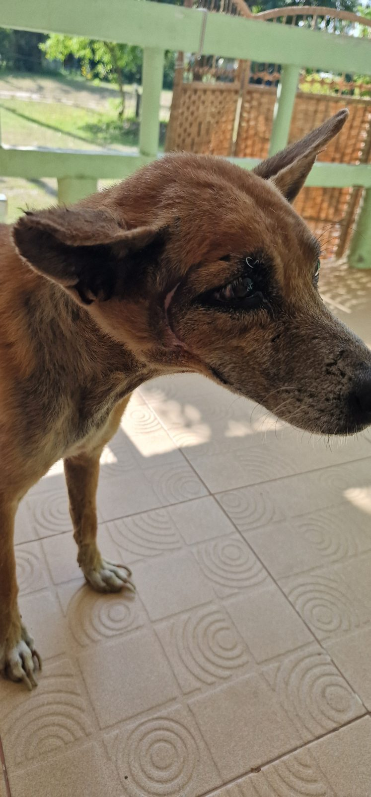

Ende 2024 habe ich mich hingesetzt und 13 Wünsche für das kommende Jahr aufgeschrieben. Das Ganze war eine vereinfachte Variante eines Rauhnachtsrituals, auf das ich aufmerksam geworden war. Ich habe weder Zettel verbrannt noch irgendwelche Räucherzeremonien veranstaltet, sondern meine Wünsche einfach in ein Buch geschrieben.

Fast ein Jahr später, kurz vor Weihnachten 2025, habe ich dieses Buch wieder hervorgeholt und mir angeschaut, was eigentlich aus meinen damaligen Wünschen geworden ist. Ich hatte die Liste zwischendurch kaum beachtet und wusste teilweise nicht einmal mehr, was genau daraufstand.

Das Ergebnis fand ich ziemlich faszinierend: Von meinen 13 Wünschen waren tatsächlich zehn oder elf in Erfüllung gegangen. Manche genauso, wie ich sie aufgeschrieben hatte, andere zumindest teilweise. Und bei einigen hatte sich im Laufe des Jahres etwas entwickelt, das ich Ende 2024 noch gar nicht auf dem Schirm hatte.

Besonders interessant fand ich dabei, dass die Erfüllung meiner Wünsche nicht immer so aussah, wie ich es mir ursprünglich vorgestellt hatte.

## 13 Wünsche und eine etwas andere Formulierung

Vielleicht hast du schon einmal von den Rauhnächten gehört. Das sind die zwölf Nächte rund um den Jahreswechsel, mit denen verschiedene Rituale verbunden sind.

Ein recht bekanntes Ritual besteht darin, 13 Wünsche für das kommende Jahr auf einzelne Zettel zu schreiben. Während der Rauhnächte wird dann jede Nacht einer dieser Zettel verbrannt, ohne dass man ihn vorher noch einmal liest. Am Ende bleibt ein Wunsch übrig, um dessen Erfüllung man sich selbst kümmern soll.

Ich bin allerdings keine Expertin für die Rauhnächte. Es gibt Menschen, die sich intensiv damit beschäftigen, räuchern und verschiedene Rituale durchführen. So weit wollte ich gar nicht gehen.

Mir gefiel einfach die Vorstellung, mich einmal bewusst hinzusetzen und aufzuschreiben, was ich mir für das kommende Jahr wünsche.

Also habe ich die Sache für mich etwas abgewandelt.

Statt 13 einzelne Zettel zu beschriften, habe ich meine Wünsche in ein Buch geschrieben. Außerdem habe ich sie bewusst nicht mit „Ich wünsche mir ...“ begonnen, sondern mit „Ich werde ...“.

Ich finde, das macht einen Unterschied. Wenn ich mir etwas wünsche, kann ich theoretisch darauf hoffen, dass es irgendwann eintritt. Wenn ich dagegen schreibe, dass ich etwas machen oder erreichen werde, übernehme ich zumindest gedanklich schon ein Stück mehr Verantwortung dafür.

Dabei habe ich mich nicht groß damit beschäftigt, wie realistisch meine Wünsche waren oder auf welchem Weg ich sie erfüllen könnte. Ich habe einfach aufgeschrieben, was mir in diesem Moment wichtig war.

## Mein größter Wunsch: Endlich auswandern

Ganz oben auf meiner Liste stand: „Ich werde 2025 endlich auswandern!“

Mit Ausrufezeichen.

Wer unsere Geschichte verfolgt hat, weiß, dass es Ende 2024 keineswegs danach aussah, dass wir im darauffolgenden Jahr tatsächlich Deutschland verlassen würden. Ganz im Gegenteil. Zu diesem Zeitpunkt gingen wir eigentlich davon aus, dass unsere Auswanderung vorerst nicht stattfinden würde.

Trotzdem habe ich diesen Wunsch aufgeschrieben.

Schließlich wollte ich schon seit vielen Jahren im Ausland leben. An diesem Wunsch hatte sich nichts geändert, nur weil unsere damalige Situation nicht besonders vielversprechend aussah.

Und dann saßen wir im September 2025 tatsächlich mit unserem gesamten Gepäck im Zug nach Frankfurt, um von dort nach Thailand zu fliegen.

Natürlich war unsere Auswanderung kein Zufall. Wir haben Entscheidungen getroffen, viel organisiert und in den Monaten davor jede Menge erledigt. Aber als ich meine Liste kurz vor Weihnachten wieder in der Hand hielt, fand ich es schon bemerkenswert, dass ausgerechnet dieser Wunsch ganz oben stand.

Zum Zeitpunkt des Aufschreibens hatte ich jedenfalls keinen konkreten Plan, wie wir das innerhalb eines Jahres schaffen würden.

## Von Hunden, Malbüchern und einer Nachricht aus Hawaii

Ein weiterer Wunsch auf meiner Liste lautete: „Ich werde einen Hund an meiner Seite haben.“

In Deutschland hatten Hagen und ich immer wieder darüber gesprochen, dass wir gerne einen Hund hätten. Gleichzeitig waren unsere langen Reisen und die mögliche Auswanderung nicht gerade die besten Voraussetzungen dafür.

Wenn wir dauerhaft in Deutschland geblieben wären, hätten wir uns vermutlich irgendwann einen Hund angeschafft und für unsere Reisen eine Betreuung organisiert.

Auf Koh Samui kannten wir dagegen bereits zwei Hunde, die bei unserer Unterkunft lebten. Wir hatten die beiden schon während unserer früheren Aufenthalte dort kennengelernt und uns bei jedem Besuch auf sie gefreut.

Mit unserer Auswanderung gehörten sie wieder zu unserem Alltag.

Wir haben uns also keinen eigenen Hund angeschafft. Trotzdem hatte ich genau das, was hinter meinem Wunsch steckte: Hunde, die mich im Alltag begleiten.

Ein anderes Beispiel finde ich fast noch kurioser.

Ich hatte aufgeschrieben: „Ich werde ein Buch schreiben.“

Warum eigentlich? Keine Ahnung.

Es war nie einer meiner großen Lebensträume gewesen, ein Buch zu schreiben. Ich hatte mich vorher auch nicht ernsthaft damit beschäftigt. Trotzdem stand dieser Satz plötzlich auf meiner Liste.

Im Laufe des Jahres bin ich dann auf eine kostenlose Challenge gestoßen, in der erklärt wurde, wie man sogenannte Low-Content-Bücher erstellt und über Amazon KDP veröffentlicht.

Ich habe daran teilgenommen und Heinrich ebenfalls.

Er hatte ein Malbuch für seine Freundin gestaltet, und ich habe ein Malbuch für Kinder gemacht, die in den Urlaub fahren. Am Ende haben wir beide jeweils ein Buch veröffentlicht.

Natürlich ist ein Malbuch etwas anderes als ein klassisches geschriebenes Buch. Und als ich den Wunsch Ende 2024 formuliert habe, meinte ich vermutlich auch etwas anderes.

Aber ich fand es schon lustig, dass ich ausgerechnet in diesem Jahr plötzlich ein Buch veröffentlicht hatte, obwohl ich das vorher überhaupt nicht geplant hatte.

Noch spannender war für mich ein Wunsch aus meinem beruflichen Bereich.

Ich hatte aufgeschrieben, dass ich 2025 in irgendeiner Form für Laura Malina Seiler arbeiten werde.

Wir hatten Laura während unseres früheren Aufenthalts auf Koh Samui kennengelernt. Sie war damals mit ihrem Team hier und wir hatten uns öfter am Strand gesehen. Irgendwann haben wir unsere Telefonnummern ausgetauscht, und ich hatte ihr auch einmal meine beruflichen Unterlagen geschickt.

Ich finde ihre Arbeit interessant und konnte mir gut vorstellen, irgendwann einmal mit ihr zusammenzuarbeiten.

Dann bekam ich im Laufe des Jahres plötzlich eine Nachricht von einer unbekannten Nummer. Die Person schrieb mir, dass sie gerade mit Laura auf Hawaii sei und eine virtuelle Assistentin suche. Laura hätte mich empfohlen.

Daraus entwickelte sich tatsächlich eine Zusammenarbeit mit einem Paar.

Die war allerdings nicht besonders erfolgreich. Wir stellten ziemlich schnell fest, dass wir auf der beruflichen Ebene überhaupt nicht zusammenpassten. Nach ungefähr zwei Wochen habe ich deshalb vorgeschlagen, die Zusammenarbeit lieber wieder zu beenden.

Für Laura selbst habe ich also nicht gearbeitet. Aber ich habe einen Auftrag durch ihre persönliche Empfehlung erhalten.

Auch diesen Wunsch habe ich deshalb als zumindest teilweise erfüllt betrachtet.

Es gab auf meiner Liste allerdings auch Ziele, die sich ganz eindeutig überprüfen ließen. Ich hatte beispielsweise einen bestimmten durchschnittlichen monatlichen Verdienst aufgeschrieben, den ich erreichen wollte. Und genau diesen Betrag habe ich im Laufe des Jahres tatsächlich erreicht.

## Warum ich heute Hyrox mache, obwohl eigentlich Pole Dance geplant war

Besonders interessant fand ich auch meinen Wunsch, 2025 sportlicher und fitter zu werden.

Als ich das aufschrieb, hatte ich vor allem Pole Dance im Kopf. Ich wollte endlich wieder regelmäßiger trainieren und dort Fortschritte machen.

Zunächst entwickelte sich das allerdings in die völlig falsche Richtung.

Durch unsere Auswanderung, die ganzen Vorbereitungen und den Umzug hatte ich immer weniger Zeit für Sport. Eine ganze Weile hatte ich eher das Gefühl, dass meine Fitness schlechter wurde.

Und dann haben wir hier auf Koh Samui mit Hyrox angefangen.

Das war ursprünglich überhaupt nicht geplant. Inzwischen trainieren Hagen und ich mehrmals pro Woche, und ich merke deutlich, dass ich fitter geworden bin.

Mein ursprünglicher Gedanke war also, im Pole Dance besser zu werden. Am Ende habe ich eine ganz andere Sportart für mich entdeckt, durch die ich das eigentliche Ziel erreicht habe.

Bei meinem Rückblick auf die 13 Wünsche fand ich gerade solche Entwicklungen besonders spannend.

Ich hatte nicht ein ganzes Jahr lang versucht, jeden einzelnen Satz auf meiner Liste abzuarbeiten. Manche Wünsche waren zwischenzeitlich komplett aus meinem Bewusstsein verschwunden. Und trotzdem konnte ich bei erstaunlich vielen am Ende des Jahres sagen, dass sich etwas in die gewünschte Richtung entwickelt hatte.

Natürlich muss man dabei unterscheiden. Ein konkretes Einkommensziel ist entweder erreicht oder nicht. Bei meinem Wunsch, ein Buch zu schreiben, oder bei der Zusammenarbeit über Laura kann man durchaus diskutieren, ob das wirklich als erfüllt zählt.

Für mich war es deshalb auch nicht entscheidend, eine möglichst hohe Trefferquote zu erreichen. Viel interessanter fand ich, welche Dinge innerhalb eines Jahres tatsächlich passiert waren und welche davon ich Ende 2024 noch gar nicht mit meinen Wünschen in Verbindung gebracht hätte.

## Warum ich trotzdem keine großen Neujahrsvorsätze mache

So sehr mir diese Wunschliste gefällt, mit den klassischen Neujahrsvorsätzen kann ich nach wie vor wenig anfangen.

Ich glaube, das größte Problem ist häufig, dass man sich viel zu viel auf einmal vornimmt.

Der Klassiker ist natürlich Sport. Wer bisher überhaupt keinen Sport macht und sich zum ersten Januar vornimmt, ab sofort dreimal pro Woche laufen zu gehen, verlangt sich ziemlich viel ab.

Schließlich geht es nicht nur darum, dreimal die Laufschuhe anzuziehen. Man muss dafür auch Zeit schaffen, möglicherweise andere Termine verschieben und seinen gesamten Alltag ein Stück weit verändern.

Vielleicht klappt das in den ersten beiden Wochen noch wunderbar. Aber dann kommt eine stressige Woche, man ist krank oder hat einfach keine Lust.

Und schon ist der erste Gedanke da: Jetzt habe ich es wieder nicht geschafft. Offenbar bin ich nicht diszipliniert genug. Dann kann ich es eigentlich auch gleich lassen.

Warum nicht erst einmal deutlich kleiner anfangen?

Wenn ich irgendwann dreimal pro Woche laufen möchte, könnte ich mir zunächst vornehmen, einmal wöchentlich laufen zu gehen. Oder einen längeren Spaziergang zu machen. Etwas, bei dem die Hürde so niedrig ist, dass ich es auch in einer stressigen Woche problemlos unterbringen kann.

Wenn das ein oder zwei Monate funktioniert, kann ich immer noch mehr machen.

Vielleicht schaffe ich es dann bis zum Sommer, tatsächlich dreimal pro Woche laufen zu gehen. Vielleicht dauert es länger. Das ist doch völlig egal.

Ähnlich sehe ich es bei der Ernährung.

Wenn ich jahrelang auf eine bestimmte Weise gegessen habe und nun plötzlich komplett auf Zucker verzichten möchte, muss ich mich vielleicht erst einmal mit dem Thema beschäftigen. Ich muss herausfinden, welche Lebensmittel ich ersetzen möchte und wie ich das in meinen Alltag integrieren kann.

Und wenn ich dann doch ein Stück Kuchen esse, ist deshalb doch nicht gleich alles gescheitert.

Vielleicht wäre es viel einfacher, erst einmal den Kaffee ohne Karamellsirup zu bestellen. Oder keine neuen Süßigkeiten mehr zu kaufen, sobald die vorhandenen aufgebraucht sind.

Solche kleinen Veränderungen wirken vielleicht nicht besonders beeindruckend. Aber ich glaube, sie lassen sich wesentlich leichter langfristig umsetzen.

Und vor allem muss ich nicht direkt wieder alles über Bord werfen, wenn es einmal nicht funktioniert.

Ich habe selbst viele Jahre geraucht und weiß, dass es nicht immer leicht ist, Gewohnheiten zu verändern. Aber wenn man etwas wirklich ändern möchte, muss man sich nicht an einen bestimmten Zeitpunkt klammern.

Wenn ich im Januar mit etwas anfange und es im Februar wieder lasse, kann ich im März einen neuen Versuch starten. Oder im September. Ich muss dafür nicht bis zum nächsten Silvester warten.

Für mich passen deshalb beide Gedanken ziemlich gut zusammen: Ich kann mir durchaus große Ziele setzen, auch solche, bei denen ich noch keine Ahnung habe, wie ich sie erreichen soll. Wenn es aber um konkrete Veränderungen in meinem Alltag geht, muss ich nicht gleich alles auf einmal umkrempeln.

Ich bin jedenfalls gespannt, was am Ende von 2026 in meinem Notizbuch stehen wird. Vielleicht werden aus den bisherigen sechs Wünschen doch noch 13. Und vielleicht entwickelt sich das eine oder andere wieder ganz anders, als ich es heute vor Augen habe.

**Wenn du wissen möchtest, was das Ganze aus meiner Sicht noch mit Manifestieren zu tun hat, dann hör unbedingt in die dazugehörige Folge von „DLIZKFI – Das Leben ist zu kurz für irgendwann“ rein.** Dort erzähle ich auch, welche Rolle unsere eigenen Gedanken dabei spielen können, ob wir unsere Wünsche und Ziele tatsächlich angehen. Die Folge findest du auf Spotify, Apple Podcasts und YouTube.
