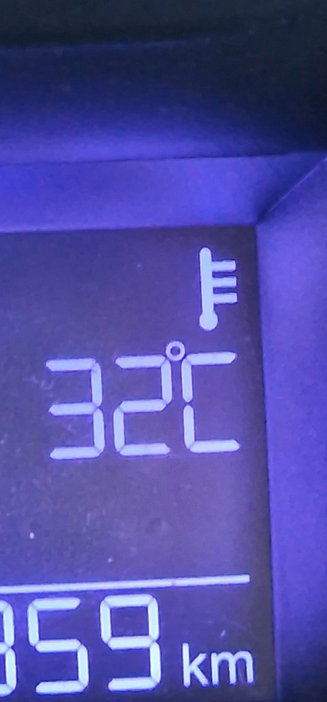
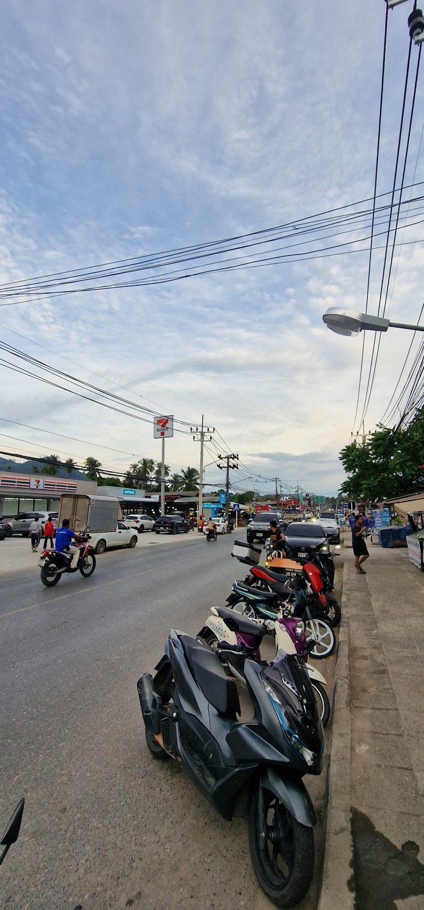
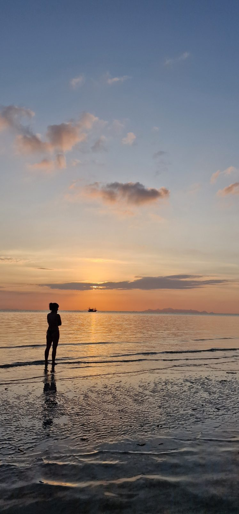

Sechs Monate leben wir inzwischen auf Koh Samui. Ein halbes Jahr! Ich finde es unglaublich, wie schnell diese Zeit vergangen ist. Und als ich darüber nachgedacht habe, wie es uns seit unserer Auswanderung eigentlich ergangen ist, wurde mir bewusst, dass es zumindest für mich ziemlich unterschiedliche Phasen gab.

Wir kannten Thailand gut und hatten sogar schon einmal ein Jahr hier gelebt. Trotzdem war die erste Zeit anders als erwartet – auch wegen meiner eigenen Vorstellungen vom Auswandern.

## Warum ich ständig wissen wollte, ob ich glücklich bin

Gerade am Anfang wurden wir häufig gefragt, wie es uns geht. Ob wir uns schon zu Hause fühlen, ob es noch wie Urlaub ist und ob wir glücklich sind. Irgendwann habe ich angefangen, mir diese Fragen selbst ständig zu stellen. Fühlt es sich jetzt anders an als vorher? Bin ich glücklich genug? Ist das wirklich so, wie ich es mir vorgestellt habe?

Ich habe mich regelrecht dabei ertappt, wie ich permanent meine Gefühle kontrolliert habe. Dabei war eigentlich alles gut: Wir waren endlich in Thailand und hatten unsere lange geplante Auswanderung umgesetzt. Aber ich hatte wohl erwartet, dass damit sofort ein völlig neues Lebensgefühl einsetzen müsste.

## Vom Auswanderungstraum direkt in den nächsten Umzug

Was mich in den ersten Wochen ziemlich überfordert hat, war der ganz normale Alltag. Wir hatten in Deutschland eine anstrengende Zeit hinter uns: Wohnung auflösen, Sachen aussortieren, zwischen verschiedenen Orten hin- und herfahren, Termine erledigen und schließlich die Reise nach Thailand organisieren. Nach Bangkok und Hua Hin kamen wir endlich auf Koh Samui an. Und was machten wir dort? Weiter umräumen.

Unsere beiden Bungalows mussten eingerichtet und geputzt werden. Wir sortierten verrostete Küchenteile aus, kauften Möbel und teilten die Räume neu auf. An einer Wand klebt übrigens bis heute eine Bahn unserer provisorischen Klebetapete. Ich müsste nur den Schrank wegziehen, um sie zu entfernen. Dazu konnte ich mich bisher nicht aufraffen. Auch die runden Klebestreifen lösen sich langsam ab.

Dazu kam der Staub. Wenn ich bei uns den Küchentisch abwische, ist der Lappen anschließend schwarz. Nicht, weil ich tagelang nicht geputzt hätte, sondern weil sich unser Leben größtenteils draußen abspielt und ständig Autos und Roller über den Sandweg nebenan fahren. Inzwischen finde ich das ziemlich normal. Am Anfang war ich einigermaßen entsetzt, wie dreckig hier alles ist. Wir waren aus unserem sehr ordentlichen Alltag in Deutschland eben doch etwas anderes gewohnt.

Und dann die Hitze. Im Thailandurlaub stört sie mich weniger, wenn ich am Pool liegen oder schwimmen gehen kann. Beim Einrichten eines Haushalts sieht das anders aus. Dazu kamen ein Kabelbrand, Probleme mit dem Auto, die Geschichte mit dem Hund und Begegnungen mit einem Skorpion und einer Schlange. Einzeln vielleicht keine großen Dramen, in dieser Häufung irgendwann einfach viel.

Gleichzeitig wollte ich endlich all das machen, worauf ich mich so lange gefreut hatte: regelmäßig Sport, Massagen, Ausflüge und möglichst viel unternehmen. Während wir gerade erst angekommen waren, recherchierte ich sogar schon Flüge für unsere erste Visa-Reise ein halbes Jahr später. Ich war also kaum in Thailand angekommen und beschäftigte mich bereits mit der nächsten Reise. Irgendwann habe ich gemerkt, dass ich ziemlich erschöpft war. Ich bin jemand, der sich gerne viel vornimmt und häufig erst hinterher feststellt, dass es vielleicht etwas zu viel gewesen ist. Genau das war hier wieder passiert.

## Wenn man seinen Traum lebt und sich trotzdem überfordert fühlt

Was die Situation für mich nicht einfacher machte, war mein eigener Anspruch, gefälligst dankbar zu sein. Schließlich hatten wir uns diesen Traum erfüllt. Andere Menschen sparen lange auf einen Urlaub in Thailand, und wir dürfen hier leben. Da kann man sich doch jetzt nicht über Kleinigkeiten beschweren. Oder darüber, dass alles so anstrengend ist. Ungefähr so liefen meine inneren Diskussionen damals ab.

Besonders beschäftigt hat mich in dieser Zeit ein Gefühl von Unsicherheit. Nicht finanziell, sondern tatsächlich im Hinblick auf unsere Sicherheit hier. Wir hatten den Kabelbrand erlebt, einen Skorpion vor dem Bungalow entdeckt und kurz darauf eine Schlange. Dazu kam der Straßenverkehr, an den ich mich erst wieder gewöhnen musste. Was wäre gewesen, wenn jemand auf den Skorpion getreten wäre? Was, wenn wir einen Verkehrsunfall hätten? Solche Gedanken waren in dieser Phase ziemlich präsent.

Einige Podcast-Hörer erinnerten mich daran, wie anstrengend schon die Monate vor unserer Auswanderung gewesen waren. Außerdem ist es ein Unterschied, ob man innerhalb Europas umzieht oder mit seiner Familie nach Asien auswandert – selbst wenn man das Land kennt.

Bis Weihnachten zog sich diese anstrengende Phase ungefähr hin. Dann waren die Kinder und ich auch noch richtig krank, so krank, wie ich es selbst kaum jemals erlebt hatte. Hagen blieb glücklicherweise verschont. Trotz allem gab es aber einen Gedanken, den ich nie hatte: dass unsere Auswanderung ein Fehler gewesen sein könnte. Ich habe unsere Entscheidung nicht bereut. Ich hatte lediglich unterschätzt, wie anstrengend die erste Zeit werden würde.

## Die Freiheit, den eigenen Alltag zu bestimmen

Inzwischen hat sich mein Gefühl zu unserem Leben hier ziemlich verändert. Ich muss mich nicht mehr daran erinnern, wie glücklich ich mich schätzen kann. Ich empfinde diese Dankbarkeit ganz von selbst, oft mehrmals am Tag. Zum Beispiel, wenn ich morgens zum Yoga fahre. Mein Weg führt fast ausschließlich am Wasser entlang, und immer wieder sehe ich das türkisfarbene Meer.

Ich kenne dieses Gefühl noch aus meiner Kindheit. Früher war ich häufig mit meinem Vater in Kroatien. Wenn wir auf der Fahrt über die Berge kamen und ich zum ersten Mal das Meer in der Ferne sehen konnte, war ich jedes Mal völlig begeistert. Später habe ich 17 Jahre in Rostock gelebt und hatte die Ostsee ebenfalls in der Nähe. Trotzdem habe ich mich immer darüber gefreut, nach der Arbeit oder am Wochenende ans Wasser fahren zu können. Hier auf Koh Samui ist das Meer noch präsenter. Von unserem Bett aus können wir es theoretisch sehen, und zum Strand brauche ich ungefähr 30 Sekunden.

Mindestens genauso wertvoll ist für mich allerdings die Freiheit, unseren Alltag selbst zu gestalten. Ich weiß manchmal nicht einmal, welcher Wochentag gerade ist. Mein Bruder meinte neulich am Telefon, dieses Problem hätte er auch gerne. Er wüsste nämlich ziemlich genau, wie viele Arbeitstage noch bis zum Wochenende vor ihm liegen.

Natürlich arbeiten wir auch hier. Wir haben Verpflichtungen, Termine und einen strukturierten Tagesablauf. Aber wir entscheiden selbst, wie diese Struktur aussieht: ob ich morgens, mittags oder abends arbeite, ob ich am Wochenende etwas erledige oder früher aufstehe. Wenn wir spontan an den Strand oder in einen Beachclub fahren möchten, kann ich meine Arbeit entsprechend verschieben. Dringende Dinge müssen trotzdem erledigt werden, dann sitze ich eben am Abend noch am Computer.

Diese Möglichkeit hatte ich durch meine Selbstständigkeit teilweise schon in Deutschland. Hagen und die Kinder waren allerdings durch Arbeit, Schule und Kindergarten wesentlich stärker an feste Zeiten gebunden. Jetzt können wir alle unseren Alltag viel freier gestalten. Wir gehen regelmäßig zum Sport, weil wir es möchten, und legen unsere Termine so, wie sie für uns passen. Manchmal bestehen unsere größeren Überlegungen tatsächlich darin, wo wir abends essen gehen oder ob wir am Samstag oder Sonntag zur Massage fahren.

## Koh Samui ist unser Zuhause – auch mit den Dingen, die nerven

Natürlich ist auch auf Koh Samui nicht alles wunderbar. Die Insel hat sich seit unserem ersten längeren Aufenthalt verändert. Damals, kurz nach Corona, war es wesentlich ruhiger. Inzwischen sind die Touristen zurück. Einerseits ist das gut für alle, die vom Tourismus leben. Andererseits kann es ziemlich nerven, wenn man hier wohnt: Strecken, für die man normalerweise eine halbe Stunde braucht, dauern plötzlich eine Stunde. Im Supermarkt laufen einem oberkörperfreie Urlauber über den Weg, und am Strand gibt es auch mal gröhlende Menschen, die offensichtlich zu viel getrunken haben.

Das kannte ich übrigens auch aus Rostock. Als Einwohner einer Urlaubsregion sieht man manche Dinge anders als jemand, der nur zwei Wochen zu Besuch ist. Trotzdem hat Koh Samui für mich etwas Besonderes. Ich habe schon lange das Gefühl, dass Thailand und vor allem diese Insel eine wichtige Rolle in meinem Leben spielen. Dass ich hier irgendwie hingehöre. Das bedeutet nicht, dass wir für immer auf Koh Samui bleiben müssen. Vielleicht entscheiden wir irgendwann, noch einmal woanders zu leben.

Die Insel ist außerdem kein besonders günstiger Ort mehr. Unsere eigene Unterkunft ist vergleichsweise preiswert, aber grundsätzlich kann das Leben hier teuer werden. Auch meine Selbstständigkeit bringt weiterhin Unsicherheiten mit sich. Im Moment decken meine Einnahmen unsere monatlichen Ausgaben, und wir haben Ersparnisse. Trotzdem kenne ich natürlich die Gedanken, die vermutlich viele Selbstständige haben: Was passiert, wenn ein Kunde wegfällt oder die Einnahmen irgendwann nicht mehr reichen? Solche Überlegungen verschwinden nicht automatisch, nur weil man unter Palmen lebt.

Was sich verändert hat, ist mein Umgang damit. Inzwischen denke ich weniger darüber nach, ob unser Traum vielleicht irgendwann platzen könnte. Falls etwas nicht mehr funktioniert, müssen wir eben eine andere Lösung finden. Vielleicht an einem anderen Ort, wenn Koh Samui auf Dauer zu teuer wird. Nach Deutschland zurückzugehen, kommt für uns jedenfalls nicht infrage, solange uns keine wirklich gravierenden Umstände dazu zwingen.

## Und wie geht es eigentlich den Kindern?

Eine Sache hatte ich vor unserer Auswanderung ziemlich fest erwartet, die bisher überhaupt nicht eingetreten ist. Ich dachte, bei den Kindern würde irgendwann der Moment kommen, in dem ihnen bewusst wird, dass wir nicht nur länger Urlaub machen. Dass wir nicht zurückfliegen, sie nicht wieder in ihre alte Schule oder Kita gehen und ihre Freunde nicht mehr wie bisher sehen. Ich hatte mich darauf eingestellt, dass es dann schwierig werden könnte.

Aber dieser Moment kam nicht. Beide sagen nach wie vor ganz deutlich, dass sie nicht wieder in Deutschland wohnen möchten. Natürlich vermissen sie manchmal einzelne Menschen. Sie sagen dann beispielsweise, dass sie gerne mit jemandem spielen würden. Aber das ist bisher einfach eine Feststellung, ohne dass sie deswegen besonders traurig werden. Darüber bin ich wirklich froh.

Nach sechs Monaten kann ich jedenfalls sagen, dass wir uns alle vier hier sehr wohlfühlen. Und trotzdem bin ich gespannt, wie sich unser Leben weiterentwickelt. Wir haben schon einmal ungefähr ein Jahr in Thailand verbracht. Interessant wird für mich deshalb besonders der Zeitpunkt, an dem wir länger hier leben als damals.

Zunächst steht unsere erste Visa-Reise nach Hanoi an. Danach sind Uwe und Heike auf Samui, und im April kommen meine Mutter und mein Bruder zu Besuch. Von Langeweile sind wir also weit entfernt.

Wenn ich heute auf dieses erste halbe Jahr zurückblicke, habe ich vor allem die Anfangszeit falsch eingeschätzt. Ich hatte hohe Erwartungen daran, wie sich die Auswanderung anfühlen sollte, und gleichzeitig unterschätzt, wie viel Arbeit und Anstrengung mit dem Ankommen verbunden sind. Inzwischen ist vieles ganz normal geworden: der Staub, die Hitze, unser Tagesablauf und die kleinen Besonderheiten des Lebens hier. Dass ich morgens am Meer entlangfahren kann und wir selbst entscheiden, wie wir unsere Tage verbringen, fühlt sich dagegen noch immer besonders an. Und ich kann mir gut vorstellen, dass das auch so bleibt.

*In der 40. Folge von „DLIZKFI – Das Leben ist zu kurz für irgendwann“ erzähle ich noch ausführlicher von unserem ersten halben Jahr nach der Auswanderung, den schwierigen Anfangswochen und dem Leben, das wir uns auf Koh Samui aufgebaut haben. Die vollständige Folge findest du auf Spotify, Apple Podcasts und YouTube.*
