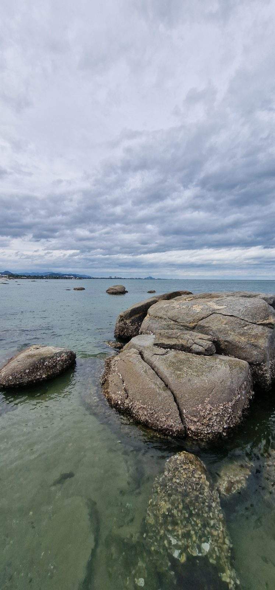
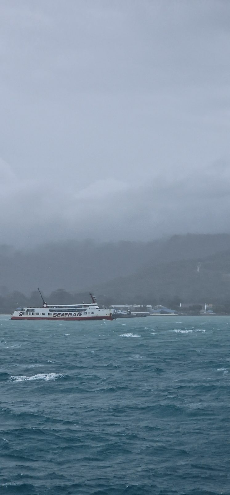
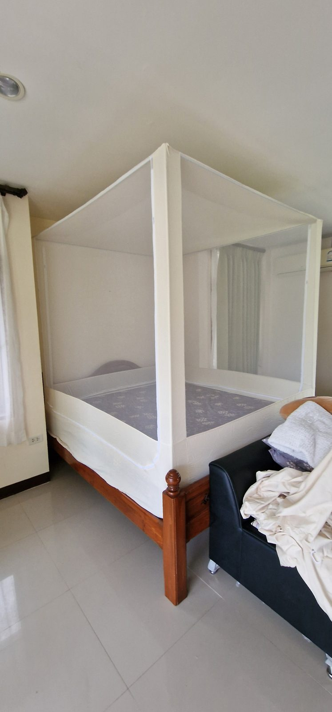
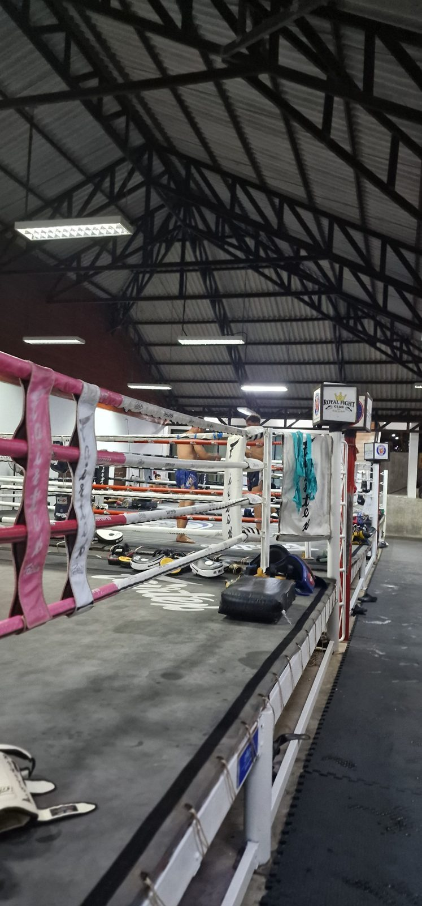
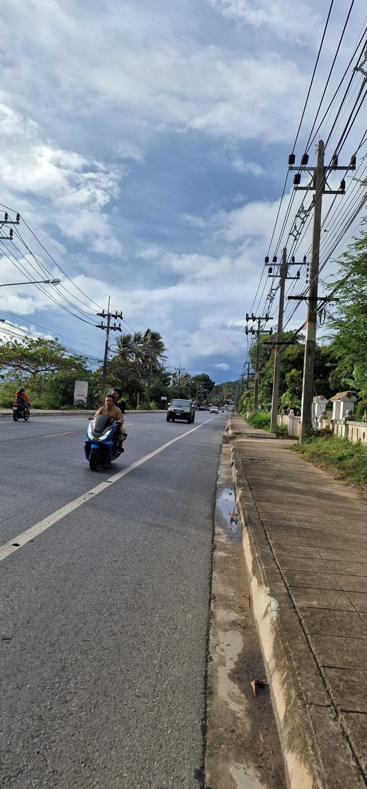

Eine Spüle, ein Wasserkocher, ein Schrank, Ablagen fürs Badezimmer und ein Toaster. Das waren einige der Dinge, mit denen wir uns in unseren ersten Tagen auf Koh Samui beschäftigten. Während die Kinder verständlicherweise lieber etwas unternehmen wollten, fuhren Hagen und ich von Geschäft zu Geschäft und versuchten, unsere beiden Bungalows einigermaßen alltagstauglich einzurichten.

Dabei hatte ich bis zu unserer Ankunft überhaupt nicht darüber nachgedacht, dass wir hier ja auch noch einziehen müssen. In Deutschland hatten wir unseren Haushalt aufgelöst, alles organisiert und die Reise vorbereitet. Aber irgendwie hatte ich den Umzug in meinem Kopf mit unserer Ankunft in Thailand bereits abgehakt.

Dass wir nun in einer Unterkunft standen, in der es weder eine vernünftige Küche noch ausreichend Stauraum gab, war natürlich keine Überraschung. Wir kannten die Bungalows längst. Trotzdem musste ich mich erst einmal an den Gedanken gewöhnen, dass wir hier nicht einfach nur ein paar Wochen Urlaub machen würden.

## Ein Wiedersehen mit Hua Hin und eine ausgebuchte Fähre

Bevor wir auf Koh Samui ankamen, hatten wir nach unseren Tagen in Bangkok noch einen Zwischenstopp in Hua Hin eingelegt. Mit diesem Ort verbinden wir einige besondere Erinnerungen.

Wir waren dort schon im März 2020, als wir von Australien nach Thailand gereist waren und sich gerade weltweit die Corona-Pandemie ausbreitete. Damals war völlig unklar, wie sich die Situation entwickeln würde. Wir kontrollierten mehrmals täglich unseren Rückflug nach Deutschland, weil immer mehr Verbindungen gestrichen wurden.

Hagen musste zurück zur Arbeit und hoffte natürlich, dass unser Flug stattfinden würde. Ich war damals noch in Elternzeit und hätte ehrlich gesagt nichts dagegen gehabt, wenn wir vorerst in Thailand hätten bleiben müssen.

Fünfeinhalb Jahre später wohnten wir wieder in derselben Anlage. Wir konnten sogar auf den Balkon schauen, auf dem wir damals gesessen hatten. Inzwischen waren wir schon zum dritten Mal dort, denn auch während unseres früheren Thailandjahres hatten wir noch einmal in der Unterkunft gewohnt.

Eigentlich wollten wir diesmal nur zwei Nächte bleiben und anschließend nach Koh Samui weiterfahren. Allerdings war die Fähre ausgebucht, sodass wir unseren Aufenthalt um einen Tag verlängern mussten.

Als wir am Strand beim Essen saßen, wurde uns bewusst, wie angenehm diese neue Flexibilität war. Wir mussten nicht zu einem bestimmten Termin wieder in Deutschland sein. Kein Arbeitsbeginn, kein Schulstart, kein Rückflug, auf den wir Rücksicht nehmen mussten. Ob wir nun einen Tag früher oder später auf Koh Samui ankamen, war eigentlich völlig egal.

Ganz so entspannt ging es am nächsten Morgen allerdings nicht weiter. Die Fähren waren immer noch ziemlich voll, und wir hatten gerade noch einen Platz für die Verbindung um 13 Uhr bekommen. Also klingelte der Wecker schon um halb fünf, denn bis zum Fähranleger lagen noch mehrere Stunden Fahrt vor uns.

Ich hatte mich auf die Überfahrt gefreut, weil ich Koh Samui unbedingt bei Tageslicht vom Wasser aus sehen wollte. Diesen Moment, wenn die Insel langsam näher kommt und man das viele Grün und die tropische Landschaft erkennt, finde ich immer wieder schön.

Leider spielte das Wetter nicht mit. Es regnete und war so diesig, dass wir von der Insel kaum etwas sahen.

## Warum dieselben Bungalows plötzlich ganz anders wirkten

Unsere beiden Bungalows kannten wir aus unserem früheren Thailandjahr. Auch bei unserem Aufenthalt im Februar hatten wir wieder dort gewohnt. Wir wussten also, worauf wir uns einließen.

Als wir die Unterkunft damals zum ersten Mal kennengelernt hatten, war ich total begeistert gewesen. Wir hatten vorher in einer noch einfacheren und dunkleren Unterkunft gewohnt. Im Vergleich dazu kamen mir die Bungalows richtig großzügig und schön vor.

Jetzt ging ich hinein und war erst einmal ziemlich ernüchtert.

Das lag nicht daran, dass sich die Unterkunft grundlegend verändert hatte. Es war vielmehr der Gedanke, dass wir hier nun unseren Alltag organisieren mussten. Wir hatten zwei Bungalows mit jeweils einem Badezimmer. Eine Menge Platz befindet sich draußen, aber letztendlich gibt es nur zwei richtige, geschlossene Wohnräume. Die Küche ist im Freien, der Wohnbereich ebenfalls.

Hagen sah das deutlich entspannter. Schließlich haben wir insgesamt eine ziemlich große Fläche zur Verfügung. Und damit hat er auch recht. Nur stand ich vor der Outdoor-Küche und fragte mich, wie wir dort auf Dauer vernünftig kochen, Geschirr unterbringen und den ganzen Kleinkram verstauen sollten.

Dazu kam, dass die Bungalows offenbar schon länger nicht mehr gründlich gereinigt worden waren. In den Ecken und an den Fensterrahmen lagen überall kleine Häufchen Geckokot. Da die Räume nicht vollständig abgeschlossen sind, kommen Geckos und andere Tiere relativ leicht hinein.

Dass man in tropischen Unterkünften mit solchen Dingen rechnen muss, ist uns natürlich klar. Aber wenn man einzieht, möchte man trotzdem erst einmal alles sauber haben.

Also begannen wir unsere ersten Tage auf Koh Samui mit Putzen, Möbelrücken und Einkaufen.

## Einrichten in Thailand: Warum selbst das neue Besteck schon rostet

Unsere Einkaufsliste wurde länger statt kürzer. Wir brauchten einen Schrank, eine vernünftige Spüle mit Unterschrank, verschiedene Ablagen und einige Haushaltsgeräte. Einen Airfryer hatten wir relativ schnell gekauft, einen Toaster dagegen noch nicht. Bis dahin machten wir unser Toastbrot eben auf dem Gasgrill.

Nach und nach richteten wir die beiden Bungalows so ein, dass sie für uns vier besser funktionieren. Wir verschoben Möbel zwischen den Räumen, schufen einen Bereich für die Kinder und stellten für Hermine einen kleinen Schreibtisch zum Malen und Lernen auf.

Besonders schön sind unsere großen Moskitonetze über den Betten. Sie hängen nicht einfach lose herunter, sondern bilden richtige viereckige Zelte. Das sieht gemütlich aus und ist natürlich auch praktisch, wenn man in einer Unterkunft lebt, in der sich immer wieder irgendwelche Insekten verirren.

Was mich ebenfalls überraschte, war, wie schnell hier manche Dinge kaputtgehen. Ich hatte neues Besteck gekauft, es abgespült und anschließend zum Trocknen liegen lassen. Am nächsten Morgen hatte es bereits Rost angesetzt.

Wir wohnen ungefähr 50 Meter vom Meer entfernt. Durch die salzhaltige Luft, die hohe Feuchtigkeit und die Qualität mancher Materialien rostet Metall hier unglaublich schnell. Hagen erklärte auch, dass man bei solchen Bedingungen besonders auf korrosionsbeständiges Material achten müsste.

Trotzdem fand ich es schon bemerkenswert, dass unser Besteck nicht einmal eine Nacht überstanden hatte.

Das Einrichten war jedenfalls anstrengender, als ich erwartet hatte. Wir waren bei hohen Temperaturen stundenlang unterwegs, kamen mit unseren Einkäufen zurück und mussten anschließend alles aufbauen oder einräumen. Und die Kinder fanden es natürlich überhaupt nicht toll, dass wir ständig irgendwelche Möbelhäuser und Geschäfte abklapperten.

Ein besonders aufregendes Ferienprogramm war das wirklich nicht.

## Unser erster Skorpion und eine ziemlich drastische Lösung

Eine Begegnung mit der heimischen Tierwelt gab es dann auch noch.

Ein anderer Bewohner unserer Anlage hatte einen großen schwarzen Thai-Skorpion entdeckt, ungefähr zehn Zentimeter lang, und holte uns dazu. Die Kinder wollten ihn sich natürlich anschauen. Sie fragten sogar, ob man mit einem Stock testen könnte, wie der Skorpion reagiert. Wir erklärten ihnen, dass wir das Tier lieber in Ruhe lassen sollten.

Anschließend baten wir eine Frau, die auf dem Gelände arbeitet und dort bei praktisch allem hilft, sich um den Skorpion zu kümmern.

Sie verschwand kurz und kam mit einem Spaten zurück.

Ich dachte zunächst, sie würde den Skorpion damit aufnehmen und irgendwo anders hinbringen. Aber das hatte sie offensichtlich nicht vor. Stattdessen schlug sie mit dem Spaten auf das Tier ein. Als sich der Skorpion noch bewegte, schlug sie weiter, bis schließlich kaum noch etwas von ihm übrig war.

Die Kinder waren ziemlich entsetzt. Und wir ehrlich gesagt auch.

Gerade hatten wir ihnen noch erklärt, dass man das Tier nicht unnötig ärgern oder verletzen soll. Und kurz darauf mussten sie mitansehen, wie es mit einem Spaten zerhackt wurde.

Natürlich können Skorpione gefährlich sein, und wir möchten auch nicht, dass eines unserer Kinder gestochen wird. Trotzdem hätten wir uns eine andere Lösung vorgestellt. Im Anschluss mussten wir den Kindern erst einmal erklären, warum die Frau so gehandelt hatte.

Es war jedenfalls eine ziemlich skurrile Begegnung, die uns vermutlich noch lange in Erinnerung bleiben wird.

Und sie erinnerte uns daran, dass zu unserem Leben in Thailand eben nicht nur Palmen, Strand und warmes Wetter gehören.

## Mit dem neuen Gym waren wir schneller zufrieden als mit dem Straßenverkehr

Neben dem Einrichten haben wir uns auch schon nach einem geeigneten Sportstudio umgesehen. Das ist uns wichtig, denn Sport gehört für uns fest zum Alltag.

Hagen hat ein Muay-Thai-Training ausprobiert und war ziemlich begeistert. Das Training war strukturiert, mit Aufwärmen, Technikübungen und einer längeren Sparringseinheit. Anschließend war er ordentlich ausgepowert.

Ich möchte dort zunächst mit Hyrox anfangen und später auch wieder Pole Dance machen. Das Studio bietet verschiedene Trainingsmöglichkeiten an und für Menschen mit längerfristigem Aufenthaltsstatus gibt es einen günstigeren Tarif. Statt ungefähr 7.000 Baht kostet die Mitgliedschaft für uns rund 3.000 Baht im Monat.

Das fanden wir für das umfangreiche Angebot ziemlich gut.

Weniger gut komme ich momentan mit dem Straßenverkehr zurecht. Und das hat mich tatsächlich selbst überrascht.

Wir waren inzwischen schon so oft auf Koh Samui, dass ich die Verkehrsverhältnisse eigentlich kenne. Noch im Februar war ich ganz selbstverständlich ins Auto gestiegen und losgefahren. Diesmal fühlte ich mich plötzlich total unsicher.

Bei einer meiner ersten Fahrten wäre ich beinahe mit einem Rollerfahrer zusammengestoßen. Danach hatte ich richtig Herzrasen und erst einmal überhaupt keine Lust mehr, selbst zu fahren.

Dabei bin ich grundsätzlich keine ängstliche Autofahrerin. In Deutschland fahre ich bei jedem Wetter und mache mir darüber keine großen Gedanken.

Auf Koh Samui muss man allerdings permanent aufpassen. Überall sind Roller unterwegs, die teilweise plötzlich auftauchen, überholen oder die Spur wechseln. Dazu kommen Touristen, die zu Hause möglicherweise noch nie auf einem motorisierten Zweirad gesessen haben und sich hier direkt auf einen 125er-Roller setzen.

Schon auf unserer Fahrt von der Fähre zu den Bungalows sahen wir einen Rollerunfall. Am nächsten Tag begegneten uns Touristen mit großflächigen Verbänden an Armen und Beinen. Besonders solche Bilder machen einem bewusst, wie schnell hier etwas passieren kann.

Hagen kommt mit dem Verkehr deutlich besser zurecht. Er fährt auch selbst Roller und ist es gewohnt, ständig aufmerksam zu sein und vorausschauend zu fahren. Mir fehlt diese Selbstverständlichkeit momentan noch.

Vielleicht legt sich das wieder, wenn ich häufiger unterwegs bin. Bis dahin bin ich ganz froh, wenn Hagen fährt.

## Koh Samui ist schön. Anstrengend kann es trotzdem sein.

Nach den ersten Tagen hatten wir schon einiges geschafft. Die Bungalows waren sauberer, die Möbel besser verteilt und die wichtigsten Dinge für unseren Alltag nach und nach angeschafft.

Gleichzeitig war ich immer noch dabei, mich an unsere neue Wohnsituation zu gewöhnen. Während Hagen vor allem die Vorteile sah – viel Platz im Freien, warme Abende und das Meer direkt vor der Tür –, störten mich zwischendurch die vielen praktischen Kleinigkeiten, die noch nicht funktionierten.

Und natürlich hat er recht: Es ist schon ziemlich schön, wenn man abends gegen halb zehn bei 27 Grad draußen sitzen kann, die Grillen hört und weiß, dass das Meer nur wenige Schritte entfernt liegt.

Ich finde das auch schön. Nur bedeutet das eben nicht, dass ich es gleichzeitig toll finden muss, ständig Geckokot wegzufegen oder mich mit einer Outdoor-Küche herumzuschlagen.

In Bangkok hatte sich unsere Ankunft in Thailand noch wie ein normaler Urlaub angefühlt. Auf Koh Samui änderte sich das ziemlich schnell. Wir hatten uns nicht einfach in einer Unterkunft einquartiert, sondern mussten sie so einrichten, dass wir darin tatsächlich leben können.

Und das ist offensichtlich noch einmal etwas anderes.

---

**Noch mehr Geschichten aus unseren ersten Tagen auf Koh Samui gibt es im Podcast.** In der 20. Folge von *DLIZKFI – Das Leben ist zu kurz für irgendwann* erzählen Hagen und ich gemeinsam von der Ankunft, unseren beiden Bungalows, dem Einrichtungschaos, der Skorpionbegegnung und dem Straßenverkehr. Dabei schweifen wir auch immer wieder ab – so wie das eben passiert, wenn wir zusammen erzählen.

Die vollständige Folge findest du auf [Spotify](https://open.spotify.com/show/0m7DHiEhXuUZJPDkmtmWb0), [Apple Podcasts](https://podcasts.apple.com/us/podcast/dlizkfi-das-leben-ist-zu-kurz-f%C3%BCr-irgendwann/id1821004400) und [YouTube](https://www.youtube.com/@DLIZKFIPodcast).
