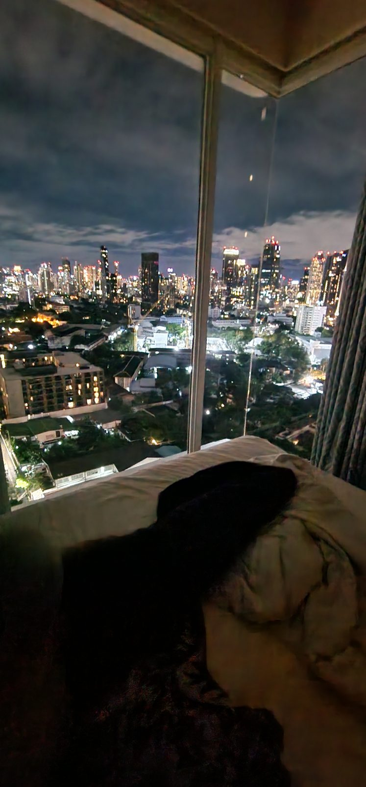
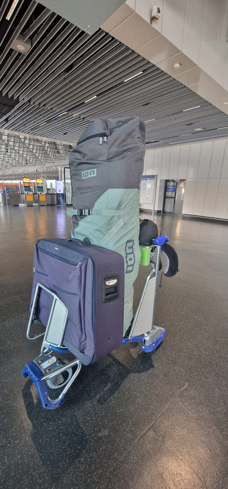
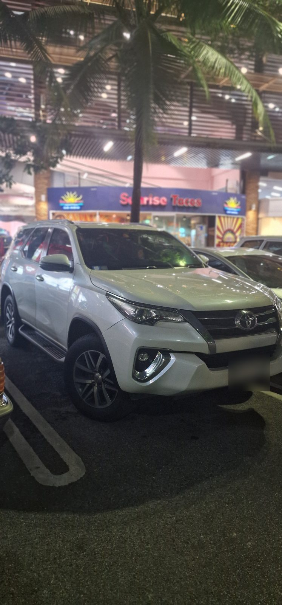
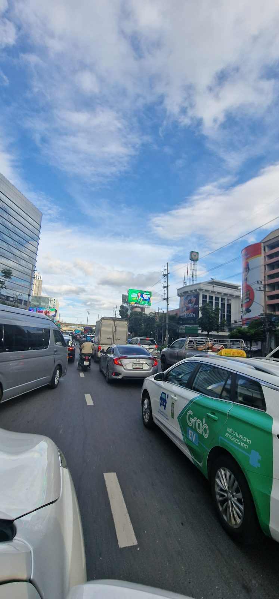

Eigentlich wollte ich am letzten Abend unserer drei Tage in Bangkok auf der Dachterrasse sitzen und den Podcast aufnehmen. Von dort hat man einen wunderbaren Blick über die beleuchtete Stadt. Nur hatte ich nicht mit den Bewohnern der Terrasse gerechnet: Schnecken. Überall Schnecken, in allen Größen, gefühlt ganze Großfamilien. Ich weiß nicht, warum sie ausgerechnet dort so zahlreich unterwegs waren, aber die Vorstellung, dass mir während der Aufnahme eine übers Bein kriecht, fand ich wenig verlockend.

Also lag ich schließlich im Bett unseres Hotelzimmers und schaute durch das Fenster auf die Hochhäuser. Das war ohnehin einer meiner Wünsche für unsere Unterkunft gewesen: abends auf eine Stadt blicken, die einfach nicht zur Ruhe kommt. Und während draußen Bangkok leuchtete, versuchte ich einzuordnen, wie sich unsere Ankunft in Thailand eigentlich anfühlte.

Schließlich waren wir dieses Mal nicht für einen gewöhnlichen Urlaub hergeflogen. Wir waren mit den Kindern auf dem Weg in einen neuen Lebensabschnitt. Nur dieses ganz große Gefühl, von dem man bei solchen Entscheidungen immer liest, wollte sich irgendwie nicht einstellen.

## Vier große Koffer, ein fast leerer Flieger und der erste 7-Eleven

Unsere Reise von Frankfurt nach Bangkok verlief erstaunlich entspannt. Wir flogen über Nacht mit Thai Airways und hatten das Glück, dass die Maschine nicht besonders voll war. Hagen und Heinrich konnten sich jeweils über eine ganze Dreierreihe ausbreiten, Hermine und ich teilten uns eine. Für einen Langstreckenflug mit zwei Kindern ist das schon ziemlich luxuriös.

Geschlafen haben Hagen und ich trotzdem nicht besonders gut. Die Kinder waren da erfolgreicher. Aber immerhin kamen wir nach ungefähr zehn Stunden ohne größeren Reisestress an. Auch die Einreise mit unserem DTV-Visum ging problemlos. Keine langen Diskussionen, keine unerwarteten Nachfragen. Sogar Passkontrolle und Gepäckausgabe waren schnell erledigt.

Bevor wir irgendetwas anderes machten, gingen wir natürlich erst einmal zu 7-Eleven am Flughafen. Für mich gehört dieser erste Stopp inzwischen genauso zu Thailand wie die warme Luft, die einem draußen entgegenschlägt. Die Kinder holten sich ihre Getränke, ich meinen Kaffee, und dann mussten wir nur noch unser Gepäck in den Mietwagen bekommen.

„Nur noch“ ist gut: Wir hatten vier große Koffer und eine riesige Tasche dabei. Unser Toyota Fortuner war deshalb keine übertriebene Wahl. Selbst in diesem großen Auto mussten wir noch einen Sitz umklappen, damit alles hineinpasste.

## Warum sieben Mietwagentage günstiger waren als drei

Eigentlich hatten wir einen anderen Plan. In Bangkok wollten wir uns mit öffentlichen Verkehrsmitteln fortbewegen und erst für die Weiterfahrt nach Hua Hin ein Auto mieten. Anschließend sollte der Wagen auf Koh Samui zurückgegeben werden.

Beim Vergleichen der Mietwagenpreise entdeckten wir allerdings eine merkwürdige Rechnung. Für drei Tage mit Rückgabe an einem anderen Ort hätten wir 345 Euro bezahlt. Darin enthalten war eine Einweggebühr von 214 Euro. Ab sieben Tagen Mietdauer entfiel diese Gebühr bei unserem Angebot – und plötzlich kostete uns der große SUV für eine ganze Woche nur noch 285 Euro.

Wir sparten also 60 Euro und hatten das Auto vom ersten Tag an. Außerdem konnten wir flexibel entscheiden, wie lange wir in Hua Hin bleiben und ob wir unterwegs nach Koh Samui noch einen Zwischenstopp einlegen wollten. Falls du selbst einmal einen Mietwagen an einem anderen Ort zurückgeben möchtest, lohnt es sich deshalb, nicht nur die tatsächlich benötigten Tage durchzurechnen.

Einen Haken hatte die Sache allerdings: Jetzt hatten wir auch in Bangkok ein Auto. Und Bangkok ist nun wirklich nicht die Stadt, in der ich unbedingt selbst fahren möchte.

## Drei Kilometer können in Bangkok ziemlich lang sein

Den Verkehr in Bangkok muss man erlebt haben. Es ist laut, voll und manchmal bewegt sich minutenlang so gut wie nichts. Für eine Strecke von drei Kilometern können schon einmal 45 Minuten vergehen. Früher sind wir deshalb sogar aus einem Tuk-Tuk ausgestiegen und den Rest zu Fuß gelaufen.

Besonders verrückt fand ich eine Reportage, die ich einmal gesehen habe. Darin ging es um Polizisten, die zusätzlich für die Geburtshilfe ausgebildet werden, weil werdende Mütter es im dichten Verkehr nicht immer rechtzeitig ins Krankenhaus schaffen. Mit ihren Motorrädern können die Beamten häufig schneller durch den Stau gelangen als ein Krankenwagen. Wenn eine Stadt solche Lösungen braucht, sagt das einiges über ihre Verkehrslage aus.

Wir waren jedenfalls schnell wieder überzeugt, dass die Bahn für manche Strecken die angenehmere Wahl gewesen wäre. Hinzu kam, dass wir an unserer Unterkunft nicht einfach bequem parken konnten. Meist stellten wir das Auto irgendwo in einer Seitenstraße ab und liefen das letzte Stück.

Und trotzdem: Kaum waren wir angekommen, machten wir genau das, was wir auch auf früheren Reisen gemacht hatten. Wir wollten möglichst viel sehen, waren ständig unterwegs und gönnten uns wenig Zeit, um überhaupt erst einmal anzukommen.

## Warum der große Auswanderungsmoment ausblieb

Vor unserem Abflug hatte ich mich schon gefragt, ob mich die Entscheidung irgendwann emotional einholen würde. Ob ich in Frankfurt am Flughafen stehen und plötzlich denken würde: Jetzt geht es wirklich los. Jetzt verändert sich unser Leben.

Aber auch in Bangkok fühlte es sich zunächst wie Urlaub an. Wir kannten die Stadt bereits, wussten, wie sich Thailand anfühlt, und waren mit den vertrauten ersten Besorgungen beschäftigt. Dazu kam der Jetlag. Nach dem Nachtflug hielten wir bis zum Abend durch, schliefen in der ersten Nacht ganz ordentlich und merkten erst danach, wie durcheinander unsere innere Uhr noch war.

Die zweite Nacht war deutlich weniger erholsam. Tagsüber wollten wir natürlich trotzdem etwas unternehmen. Die Hitze, der wenige Schlaf und die vielen Eindrücke machten sich irgendwann bei allen bemerkbar. Dann ist auch mal jemand schlecht gelaunt, die Kinder sind erschöpft oder man hat schlicht keine Lust mehr, noch eine weitere Sehenswürdigkeit anzuschauen.

Vielleicht ist das einer der Gründe, warum mir unser Neustart nicht wie ein feierlicher Einschnitt vorkam. Das Familienleben reist ja mit. Wir sind dieselben vier Menschen wie vorher, mit denselben Bedürfnissen und gelegentlich denselben kleinen Reibereien. Nur dass wir dabei durch Bangkok laufen statt durch Rostock.

## Bangkok erleben, ohne alles abhaken zu müssen

Drei Nächte sind in einer Stadt wie Bangkok eigentlich nichts. Wir wollten die Zeit trotzdem nutzen, ohne jeden Tag zu einem minutiös geplanten Besichtigungsprogramm zu machen.

Einen Vormittag verbrachten wir im neu eröffneten Dusit Central Park, dessen begrünte Bereiche hoch über der Stadt liegen. Zwischen all den Gebäuden ist so ein Garten eine schöne Abwechslung. Wir erledigten dort auch ein paar praktische Dinge und besorgten endlich unsere thailändischen SIM-Karten. Am Nachmittag fuhren wir mit einem Longtailboot über den Chao Phraya. Das hatten wir schon vor Jahren einmal gemacht und wollten es unbedingt wiederholen.

Eigentlich stand auch Wat Arun auf dem Plan, einer unserer Lieblingstempel in Bangkok. Aber irgendwann waren wir zu müde, und der Gedanke, uns noch einmal durch den Verkehr zu bewegen, war nicht besonders verlockend. Also ließen wir den Tempel aus. Abends gab es stattdessen koreanisches Barbecue und später noch eine Runde im Hotelpool für die Kinder. Nachts schwimmen zu gehen ist schließlich auch etwas, das nicht zum normalen Alltag in Deutschland gehört.

An einem anderen Tag besuchten wir das Museum Siam, um etwas über die Geschichte und Kultur Thailands zu erfahren. Bei einem allerersten Kurzbesuch in Bangkok würde ich vermutlich andere Dinge empfehlen. Für uns passte es aber gut. Wir kommen schließlich nicht nur zum Sightseeing her, sondern möchten das Land, in dem wir leben, auch besser kennenlernen.

Am Abend landeten wir auf einem Nachtmarkt, auf dem wir gefühlt fast die einzigen ausländischen Besucher waren. Genau solche Orte mögen wir: Essen aussuchen, durch die Gänge schlendern, schauen, was die Menschen kaufen und wie das Leben um uns herum stattfindet. Ohne dass alles ausschließlich für Touristen inszeniert ist.

## Eine Massage mit Kindern – und niemand fand es merkwürdig

Eine Kleinigkeit ist mir aus diesen drei Tagen besonders in Erinnerung geblieben. Wir gingen zu viert spontan in einen Massagesalon. Hermine wollte das zum ersten Mal ausprobieren. Zunächst waren nur drei Mitarbeiterinnen frei, die vierte sollte etwas später kommen. Also wartete ich und die anderen fingen schon an.

Als Hermine nach ihrer halben Stunde fertig war, blieb sie einfach noch dort, aß die Mango, die ich ihr mitgebracht hatte, und ging irgendwann zur Toilette. Eine Mitarbeiterin zeigte ihr den Weg und begleitete sie. Niemand wirkte genervt, niemand hatte das Gefühl, dass ein Kind hier gerade stört.

Das sind Momente, in denen ich wieder merke, was ich am Leben in Thailand so mag. Wir empfinden Kinder hier im Alltag oft als selbstverständlicher einbezogen. Nicht nur in ausdrücklich familienfreundlichen Einrichtungen, sondern auch in Restaurants oder eben in einem Massagesalon. Natürlich ist nicht jeder Ort gleich, aber diese entspannte Haltung begegnet uns immer wieder.

In Deutschland überlege ich bei solchen Dingen häufiger schon vorher, ob es mit Kindern überhaupt unkompliziert möglich ist. Hier sind wir einfach hineingegangen. Für vier Massagen zahlten wir zusammen ungefähr 41 Euro. Das Preisniveau ist natürlich ein zusätzlicher Vorteil, aber fast wichtiger war mir, wie selbstverständlich der Besuch ablief.

Manchmal braucht es eben keinen spektakulären Ausflug, um zu merken, warum man sich an einem Ort wohlfühlt.

## Nicht der große Neustart, sondern viele kleine Momente

Besonders schön war für mich aber etwas ganz Einfaches. Wir waren abends unterwegs, es war längst dunkel und trotzdem noch angenehm warm. Ich mag dieses Gefühl unglaublich gern. Zu wissen, dass man auch spät am Abend draußen sitzen kann und die Wärme nicht mit dem Sonnenuntergang verschwindet.

Vielleicht brauchte es deshalb gar keinen Moment, in dem uns plötzlich alles bewusst wurde. Unser Leben in Thailand begann nicht mit einem großen Knall, sondern mit Dingen, die sich bereits vertraut anfühlten. Und mit den üblichen Kleinigkeiten, die jede Familienreise begleiten.

Nach drei Tagen Bangkok sollte es für uns weiter nach Hua Hin gehen und später nach Koh Samui. Dort würde sich der Alltag dann nach und nach ganz von selbst einstellen. Für den Moment waren wir einfach froh, angekommen zu sein – auch wenn es sich noch immer ein bisschen wie Urlaub anfühlte.

**Wie verliefen unsere ersten Tage nach der Ankunft in Thailand wirklich?** In der dazugehörigen Folge von *DLIZKFI – Das Leben ist zu kurz für irgendwann* erzähle ich noch ausführlicher von Bangkok, unserem Start mit den Kindern, dem Verkehr und den kleinen Erlebnissen, die in keinem Reiseplan stehen. Die ganze Geschichte kannst du auf [Spotify](https://open.spotify.com/show/0m7DHiEhXuUZJPDkmtmWb0), [Apple Podcasts](https://podcasts.apple.com/us/podcast/dlizkfi-das-leben-ist-zu-kurz-f%C3%BCr-irgendwann/id1821004400) oder [YouTube](https://www.youtube.com/@DLIZKFIPodcast) anhören.
