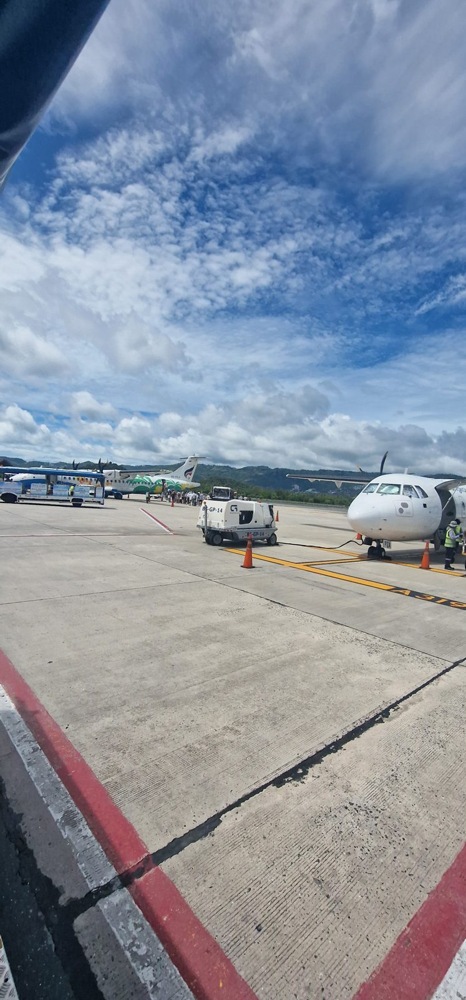
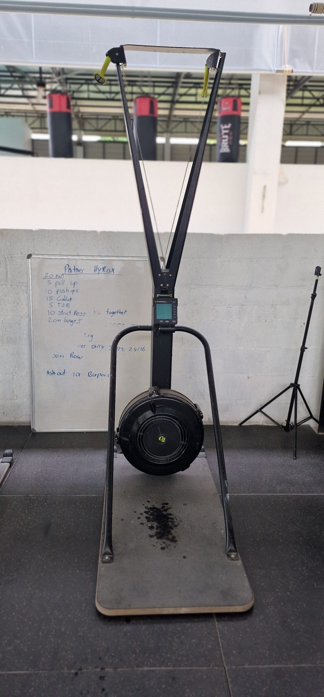
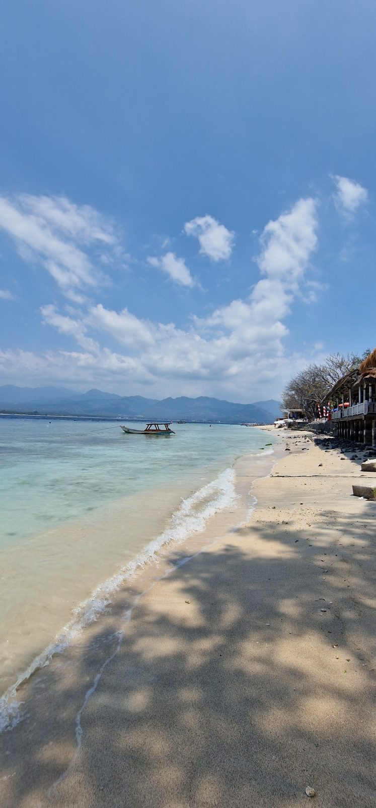
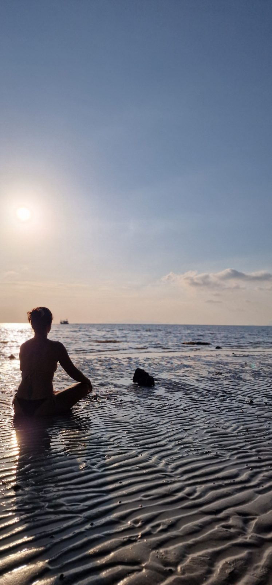

Fast hätte ich unseren ersten Auswanderungsgeburtstag vergessen. Nicht, weil mir das Datum egal wäre, sondern weil ich überhaupt nicht auf dem Schirm hatte, dass wir schon ein ganzes Jahr nicht mehr in Deutschland leben. Erst als wir unsere zweite Visa-Reise planten, fiel mir auf, dass sich unsere Abreise bereits zum ersten Mal jährt.

Am 17. September 2025 hatten wir Deutschland verlassen. Mit unserem ganzen Gepäck waren wir damals in Hannover in den Zug nach Frankfurt gestiegen und am nächsten Tag in Bangkok angekommen. Jetzt, genau ein Jahr später, stand wieder eine Reise an.

Eigentlich hätte ich gedacht, dass dieser erste Jahrestag ein ganz besonderes Datum für mich sein würde. Eines, auf das man wochenlang hinfiebert, wie auf einen Geburtstag oder Weihnachten. Stattdessen wäre es mir ohne unsere Reiseplanung möglicherweise überhaupt nicht aufgefallen.

Und als der Tag dann da war? Keine große Euphorie, keine besonderen Gefühle, kein Kuchen mit einer Eins darauf. Es war einfach ein ganz normaler Tag in unserem Leben.

Dabei hat sich in diesem einen Jahr unglaublich viel verändert.

## Ein Jahr vergangen und trotzdem fühlt sich Deutschland so weit weg an

Was mich an diesem ersten Jahr besonders erstaunt, ist mein völlig unterschiedliches Zeitgefühl. Einerseits kann ich kaum glauben, dass zwölf Monate schon wieder vorbei sind. Andererseits fühlt sich unsere Abreise aus Deutschland inzwischen unglaublich weit weg an.

Als ich vor Kurzem darüber nachdachte, wie wir damals nach Thailand gekommen waren, musste ich Hagen tatsächlich fragen, ob wir nach unserer Ankunft in Bangkok gewesen seien. Natürlich waren wir das. Wir hatten dort sogar eine Bootstour gemacht, bevor es weiter nach Hua Hin und schließlich nach Koh Samui ging. Aber diese ersten Tage scheinen inzwischen so lange zurückzuliegen, dass ich mich erst wieder richtig daran erinnern musste.

Ähnlich geht es mir mit unserer Zeit in Deutschland. Der ganze Stress vor der Auswanderung, die Wohnungsauflösung, das Organisieren und die unzähligen Dinge, die noch erledigt werden mussten, sind gedanklich ziemlich weit weg. Zwei Freundinnen sind inzwischen ebenfalls ausgewandert, eine in die Schweiz und eine nach Schweden. Wenn ich mitbekomme, womit sie sich während ihrer Vorbereitungen beschäftigen mussten, erinnere ich mich natürlich wieder daran, wie anstrengend das bei uns war. Gleichzeitig fühlt es sich an, als lägen Jahre dazwischen.

Besonders interessant finde ich, dass sich sogar unsere Sprache verändert hat. In den ersten Monaten haben wir häufig noch von unserer Wohnung in Goorstorf als „zu Hause“ gesprochen. Das war völlig selbstverständlich. Schließlich hatten wir dort bis zu unserer Abreise gelebt.

Heute macht das keiner von uns mehr. Wenn wir über unser früheres Leben sprechen, sagen wir Deutschland, Goorstorf oder die Wohnung in Goorstorf. Aber nicht mehr zu Hause.

Das hat sich ganz von selbst verändert.

## Ein neues Haus und ein alter Ort, der mir nicht aus dem Kopf geht

Eine der größten Veränderungen im vergangenen Jahr war sicherlich unser Umzug innerhalb von Koh Samui. Damit hatte ich am Anfang überhaupt nicht gerechnet. Schließlich waren wir so glücklich, endlich wieder in unseren geliebten Bungalows wohnen zu können.

Dass wir sie trotzdem verlassen haben, hatte verschiedene Gründe. Die beiden Bungalows waren für uns vier auf Dauer einfach keine optimale Wohnlösung mehr. Dazu kamen immer mehr Touristen und die damit verbundenen Begleiterscheinungen, auf die wir zunehmend keine Lust mehr hatten.

In unserem neuen Haus haben wir inzwischen bessere Bedingungen und fühlen uns grundsätzlich wohl. Trotzdem ist mir der Abschied von den Bungalows unglaublich schwergefallen.

Mit diesem Ort verbinde ich seit Jahren ein ganz besonderes Gefühl. Es war schon bei unserem früheren längeren Aufenthalt da, begleitete mich während unserer Zeit zurück in Deutschland und kam sofort wieder, als wir bei späteren Besuchen auf Koh Samui ankamen.

Und dieses Gefühl ist noch immer da, sobald ich wieder dort bin.

Ich weiß selbst nicht genau, warum, aber irgendwie habe ich die Vorstellung, irgendwann noch einmal an diesen Ort zurückzukehren. Nicht jetzt und auch nicht unter den bisherigen Bedingungen. Vielleicht irgendwann viel später, wenn Hagen und ich alt sind. Wer weiß.

Für mich zeigt das aber auch, dass Zuhause nicht unbedingt nur ein bestimmtes Haus oder ein Land sein muss. Ich fühle mich in unserem jetzigen Zuhause wohl und habe trotzdem eine besondere Verbindung zu dem Ort, an dem wir vorher gewohnt haben.

## Viermal die Woche Sport und plötzlich spricht die Familie Englisch

Unser Alltag hat inzwischen eine ziemlich feste Struktur. Interessanterweise sieht die allerdings ganz anders aus, als wir es uns vor unserer Auswanderung vorgestellt hatten.

Ich hatte mich darauf gefreut, endlich wieder regelmäßig Pole Dance zu machen. Hagen wollte zurück zum Muay Thai und auch die Kinder, insbesondere Hermine, hatten sich darauf gefreut, diese Sportart auszuprobieren.

Am Ende machen wir inzwischen fast alle etwas anderes.

Die Kinder haben Brazilian Jiu-Jitsu für sich entdeckt und trainieren zusätzlich Judo. Zweimal pro Woche BJJ, zweimal Judo. Beide sind mit Begeisterung dabei. Besonders Hermine würde wahrscheinlich am liebsten jeden Tag zum Training gehen. Auch Heinrich, der früher bei manchen Sportarten durchaus mal keine Lust hatte, geht inzwischen richtig gerne.

Hagen und ich sind dagegen beim Hyrox gelandet. Das hatte ursprünglich keiner von uns geplant. Inzwischen trainieren wir drei- bis viermal pro Woche und sind ziemlich begeistert davon. Hagen überlegt sogar, gemeinsam mit einem unserer Trainer an einem Wettkampf in Bangkok teilzunehmen.

Ich hatte zwischenzeitlich ebenfalls mit dem Gedanken gespielt, irgendwann einen Hyrox-Wettkampf mitzumachen. Allerdings gibt es da ein kleines Problem: Ich bin wirklich grottenschlecht im Laufen. Das war schon immer so. Selbst früher beim Handball konnte ich problemlos ein ganzes Spiel durchhalten, aber sobald es beim Training hieß, wir gehen joggen, war meine Begeisterung schlagartig vorbei.

Und bei einem Hyrox-Wettkampf muss man insgesamt acht Kilometer laufen. Bis dahin ist es für mich also noch ein ziemlich weiter Weg.

Das Training bestimmt inzwischen einen großen Teil unserer Woche. Das Fitnessstudio liegt leider nicht gerade um die Ecke. Normalerweise brauchen wir ungefähr 45 Minuten für eine Strecke, in der Hochsaison kann daraus auch mal über eine Stunde werden. Dass die Trainingszeiten der Kinder und unsere Hyrox-Kurse zusammenpassen, ist deshalb Gold wert.

Fast noch spannender finde ich allerdings, was sich bei den Kindern sprachlich getan hat.

Als wir nach Thailand kamen, sprach Hermine praktisch kein Englisch. Heinrich hatte zwar in der Grundschule Unterricht gehabt, aber eine richtige Unterhaltung war damit noch nicht möglich. Inzwischen können sich beide auf Englisch verständigen. Als wir kürzlich Besuch von einem Franzosen hatten, beteiligte sich Heinrich sogar am Gespräch und Hermine versuchte ebenfalls, ihm Fragen zu stellen.

Beim Thailändischen sieht die Sache etwas anders aus. Hier ist Hagen eindeutig am weitesten. Er kann sich inzwischen recht gut mit Thais unterhalten, während die Kinder und ich noch deutlich hinterherhinken.

Seine Lernmethode war allerdings auch ziemlich konsequent. Ich erinnere mich noch, wie wir in Bangkok das thailändische Wort für Ananas gelernt hatten. Hagen saß anschließend am Tisch und wiederholte es immer wieder laut vor sich hin. Wir fanden das ziemlich peinlich und baten ihn irgendwann, damit aufzuhören. Er machte einfach weiter.

Und offenbar hatte er recht damit, denn heute spricht er von uns allen am besten Thai.

## Warum es sich komisch anfühlt, in den Urlaub zu fahren

Eine Sache finde ich nach wie vor merkwürdig: Wenn ich jemandem erzähle, dass wir in den Urlaub fahren.

Bei unserer Reise nach Indonesien war das wieder so. Natürlich fahren wir in den Urlaub. Wir verlassen unser Zuhause auf Koh Samui und verbringen drei Wochen in einem anderen Land. Eigentlich eine völlig normale Sache.

Trotzdem fühlt es sich manchmal fast ein bisschen dekadent an, das auszusprechen.

Ich glaube, das liegt daran, dass einem bei einer Auswanderung nach Thailand ständig suggeriert wird, man würde ohnehin dauerhaft Urlaub machen. Wenn jemand nach Schweden oder in die Schweiz zieht, geht jeder selbstverständlich davon aus, dass er dort einen normalen Alltag hat. Mit Arbeit, Schule und allen anderen Verpflichtungen.

Wenn man nach Koh Samui auswandert, scheint dagegen häufig die Vorstellung zu bestehen, man würde den ganzen Tag am Strand liegen.

Dabei hat sich an meiner Arbeit durch die Auswanderung überhaupt nichts geändert. Ich mache weiterhin dasselbe wie vorher und arbeite aktuell sogar mehr. Wir haben im August eine Zusammenarbeit mit einer Unternehmensberatung begonnen, um einen Vertriebsprozess aufzubauen. Das kostet zusätzlich Zeit.

Manchmal sitzen wir deshalb bis elf oder zwölf Uhr nachts am Computer. Natürlich könnten wir das anders organisieren. Wir könnten beispielsweise weniger Sport machen und die Zeit stattdessen zum Arbeiten nutzen. Aber das möchten wir nicht.

Auch der Unterricht der Kinder gehört inzwischen fest zum Tagesablauf. Nachdem wir verschiedene Möglichkeiten ausprobiert hatten, übernimmt Hagen mittlerweile täglich eine Stunde Homeschooling. Dazu kommen die Sporttermine, Einkäufe und alles, was in einer Familie eben sonst noch anfällt.

Der große Unterschied zu Deutschland ist, dass wir diese Abläufe selbst bestimmen können. Wenn sich Trainingszeiten ändern, passen wir unsere Arbeitszeiten und den Unterricht entsprechend an.

Das bedeutet nicht, dass wir weniger zu tun haben. Im Gegenteil. Aber wir entscheiden weitgehend selbst, wann wir was machen. Und diese Freiheit möchten wir nicht mehr missen.

## Die letzten Monate waren alles andere als entspannt

Bei all den schönen Dingen könnte man meinen, unser erstes Jahr in Thailand sei ausschließlich großartig gewesen. Das war es allerdings nicht.

Gerade die letzten Monate waren teilweise ziemlich anstrengend. Es gab Phasen, in denen gefühlt ständig irgendetwas schieflief.

Ein besonders einschneidendes Erlebnis war Heinrichs Rollerunfall, bei dem er sich am Zeh verletzte und ins Krankenhaus musste. Ich hatte mir vorher ohnehin immer wieder Sorgen darüber gemacht, dass irgendwann jemand von uns wegen eines Unfalls ins Krankenhaus kommen könnte.

Glücklicherweise waren unsere Erfahrungen mit der medizinischen Versorgung sehr gut. Die Betreuung, das Krankenhaus und auch das Zimmer waren wirklich hervorragend. Das hat mir zumindest einen Teil meiner bisherigen Sorgen genommen, auch wenn ich natürlich hoffe, dass wir solche Erfahrungen nicht regelmäßig machen müssen.

Was mich ebenfalls überrascht hat, ist, wie häufig wir in diesem Jahr krank waren. So etwas kenne ich von unserer Familie eigentlich überhaupt nicht.

Über Weihnachten waren die Kinder und ich so heftig krank, dass ich teilweise morgens vor Schmerzen geweint habe. Im Nachhinein vermuten wir, dass ich möglicherweise Dengue-Fieber hatte. Sicher wissen wir es allerdings nicht.

Dazu kamen immer wieder Erkältungen, lang anhaltender Husten, Hautausschläge und Pilzinfektionen. Wir vermuten inzwischen, dass unser großes Fitnessstudio eine Rolle spielen könnte, weil dort ständig Menschen aus unterschiedlichsten Ländern trainieren. Belegen können wir das natürlich nicht.

Neben den gesundheitlichen Themen gab es die anstrengende Suche nach einem neuen Haus. Immer wieder fanden wir etwas, und dann wurde uns doch wieder abgesagt. Gleichzeitig wurde unsere bisherige Wohnsituation zunehmend unbefriedigend.

Auch finanziell lief nicht alles rund. Nach einer Finanzschulung hatten wir angefangen zu investieren. Dann brach der Bitcoin-Kurs ein und ein Teil unseres Geldes war über Monate gebunden, obwohl wir es eigentlich für andere Dinge gebraucht hätten. Hinzu kam, dass unsere Zusammenarbeit mit der Unternehmensberatung nicht so reibungslos verlief, wie wir es uns vorgestellt hatten.

Und natürlich bleibt auch unser Familienleben nicht von schwierigen Phasen verschont. Hagen und ich haben uns in den letzten Wochen wieder häufiger gestritten. Wir sind ohnehin kein Paar, bei dem es nie Konflikte gibt. Das ist über die Jahre zwar deutlich harmonischer geworden, aber wenn wir streiten, dann manchmal auch ziemlich heftig.

Es gab also durchaus Momente, in denen ich dachte: Wie soll das jetzt alles funktionieren?

Was ich allerdings nicht eine einzige Sekunde gedacht habe, war, dass unsere Auswanderung ein Fehler gewesen sein könnte.

Nicht einmal in den anstrengendsten Phasen hatte ich den Wunsch, wieder in Deutschland zu leben.

## Ein Jahr Thailand und noch immer die richtige Entscheidung

Vielleicht ist das tatsächlich meine wichtigste Erkenntnis nach diesem ersten Jahr: Wir haben hier nicht automatisch weniger Probleme. Es sind zum Teil einfach andere.

Krankheiten, Streit, finanzielle Sorgen oder berufliche Schwierigkeiten verschwinden schließlich nicht, nur weil man in einem anderen Land wohnt. Vieles von dem, was uns in den letzten Monaten beschäftigt hat, hätte uns in Deutschland genauso passieren können.

Und ich weiß inzwischen aus genügend anderen Lebenssituationen, dass solche Phasen auch wieder vorbeigehen. Mal dauert es länger, mal geht es schneller. Aber irgendwann läuft es wieder besser.

Wir haben uns ein Leben geschaffen, in dem wir uns alle vier wohlfühlen. Wir können unsere Tage weitgehend selbst gestalten, haben neue Hobbys entdeckt, neue Erfahrungen gemacht und unseren ganz eigenen Familienalltag entwickelt.

Ab jetzt beginnt für uns außerdem ein neuer Abschnitt. Wir waren früher schon einmal ungefähr ein Jahr am Stück nicht in Deutschland, wenn auch nicht die gesamte Zeit auf Koh Samui. Alles, was jetzt kommt, ist für uns deshalb tatsächlich Neuland.

Ich bin gespannt, ob sich unser Gefühl noch einmal verändert, wenn wir zwei Jahre oder länger hier leben. Vielleicht erscheinen uns dann manche Dinge völlig selbstverständlich, über die wir uns heute noch regelmäßig freuen. Vielleicht kommen auch Gedanken auf, die wir bisher überhaupt nicht hatten.

Für den Moment kann ich aber sagen: Auch ohne Jubiläumstorte, Feuerwerk und große Emotionen war die Entscheidung, Deutschland zu verlassen, für uns richtig.

Unser Leben ist nicht immer entspannt, nicht immer einfach und ganz sicher kein Dauerurlaub. Aber es ist das Leben, das wir führen möchten.

*In der passenden Folge von „DLIZKFI – Das Leben ist zu kurz für irgendwann“ ziehe ich noch ausführlicher Bilanz nach unserem ersten Jahr in Thailand. Ich erzähle von unserem Umzug, den Veränderungen bei den Kindern, unserem Alltag zwischen Sport und Arbeit und den schwierigen Monaten, die ebenfalls dazugehört haben. Die vollständige Folge findest du auf Spotify, Apple Podcasts und YouTube.*
