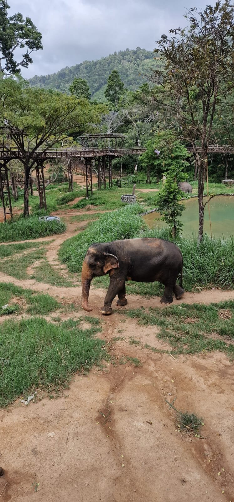
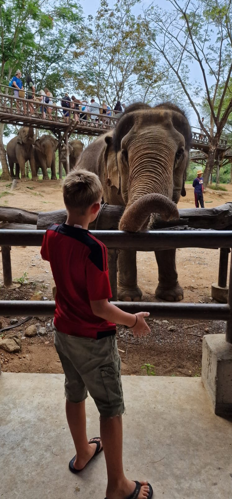
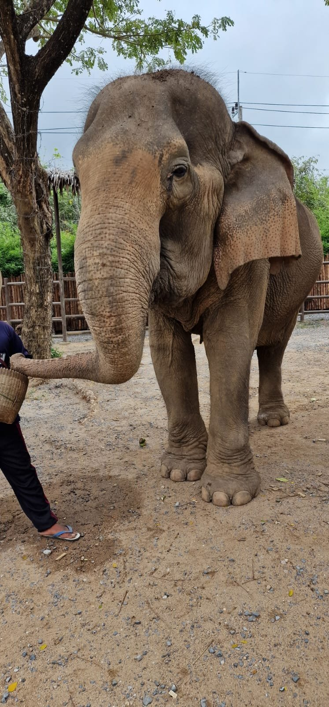
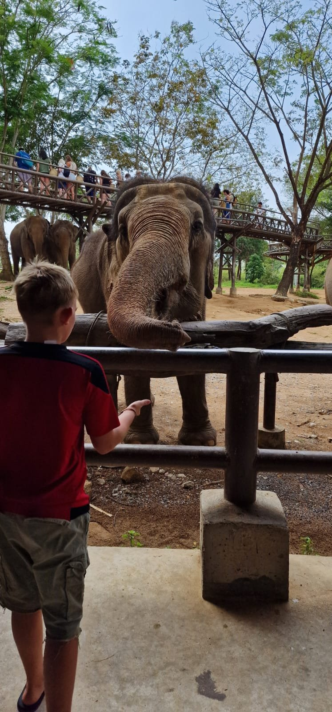
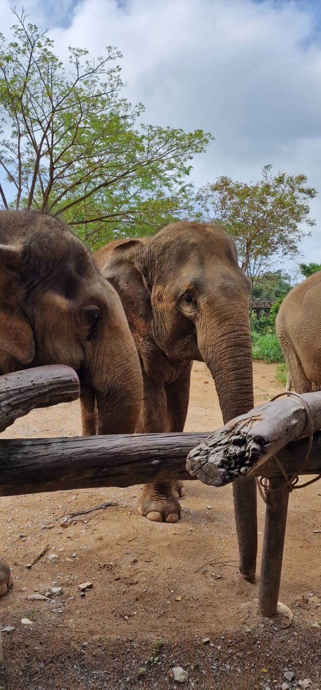

Eigentlich hatte ich gar nicht vor, ein Elefantencamp auf Koh Samui zu besuchen. Wir leben inzwischen schon eine ganze Weile hier, waren mehrfach in Thailand unterwegs und haben auch früher bereits Erfahrungen mit Elefanten gemacht. Aber ausgerechnet auf Koh Samui hatte ich noch keines der sogenannten Sanctuaries besucht.

Das änderte sich vor ein paar Wochen ziemlich spontan. Wir hatten für eine Woche sehr nette Nachbarn aus der Schweiz, deren Sohn sich hervorragend mit Hermine verstand. Als kleines Dankeschön dafür, dass wir öfter auf ihn aufgepasst hatten, wollten seine Eltern Hermine zu einem Besuch im Elephant Kingdom einladen. Am betreffenden Morgen ging es ihr allerdings nicht besonders gut und sie wollte nicht alleine mitfahren. Also beschlossen Heinrich und ich, sie zu begleiten. Eigentlich war die Tour ausgebucht, aber vor Ort bekamen wir tatsächlich noch zwei Tickets.

Und so stand ich plötzlich in einem Elefantensanctuary, obwohl ich selbst vermutlich keinen solchen Ausflug gebucht hätte.

Im Nachhinein bin ich ganz froh darüber. Denn obwohl ich mich schon länger mit dem Thema Elefantentourismus beschäftige, habe ich dort einiges erfahren, was mir vorher nicht bewusst war. Vor allem aber hat mich der Besuch noch einmal darüber nachdenken lassen, wo eigentlich die Grenze zwischen einem schönen Tiererlebnis und einer touristischen Attraktion auf Kosten der Tiere verläuft.

## Vom Elefantenreiten zum Elefantenbaden

Meine erste Erfahrung mit Elefantentourismus liegt inzwischen ziemlich lange zurück. 2008 war ich mit einer Freundin zum ersten Mal in Thailand unterwegs. Sie hatte schon vor unserer Reise den Wunsch geäußert, unbedingt einmal auf einem Elefanten zu reiten.

Ich fand die Vorstellung ehrlich gesagt nicht besonders spannend. Allerdings nicht, weil ich damals irgendwelche Bedenken hinsichtlich des Tierwohls hatte. Ich hatte schlicht keine Lust auf eine typische Touristenveranstaltung. Weil meine Freundin aber nicht alleine gehen wollte, habe ich sie begleitet.

Wir waren in einem Camp, in dem die Elefanten zunächst hinter einer Absperrung standen und gefüttert werden konnten. Anschließend saßen wir zu zweit auf einem Gestell, das auf dem Rücken eines Elefanten befestigt war, und wurden durch den Dschungel geführt.

Ich fand es ganz okay, aber auch nicht besonders aufregend. Schon damals war für mich klar, dass ich das nicht noch einmal brauche. Dass Elefantenreiten grundsätzlich problematisch ist, war mir zu diesem Zeitpunkt überhaupt nicht bewusst.

Einige Jahre später sah ich das bereits anders.

2019 verbrachten wir wieder längere Zeit in Thailand und besuchten in der Nähe des Khao-Sok-Nationalparks ein Elefantenangebot, bei dem man die Tiere nicht reiten, sondern mit ihnen baden konnte. Das erschien uns damals als wesentlich bessere Alternative.

Wir waren nur zu viert dort, Hagen, Heinrich, Hermine und ich. Hermine war gerade einmal vier oder fünf Monate alt. Zunächst durften wir den Elefanten füttern, anschließend begleiteten wir ihn gemeinsam mit seinem Mahout zu einem Teich. Dort ging er ins Wasser und wir durften ihn mit Schlamm einreiben.

Für uns war das damals ein schönes Erlebnis, bei dem wir dachten, dem Tier nicht zu schaden.

Heute würde ich auch das nicht mehr buchen.

## Warum es in Thailand überhaupt so viele Elefantencamps gibt

Um die ganze Diskussion zu verstehen, muss man sich zunächst anschauen, warum Elefanten in Thailand überhaupt so häufig für touristische Zwecke eingesetzt werden.

Elefanten wurden dort über viele Jahre als Arbeitstiere genutzt, insbesondere in der Holzwirtschaft. Als Thailand 1989 die kommerzielle Abholzung natürlicher Wälder weitgehend verbot, verloren viele Elefantenhalter ihre bisherige Einkommensgrundlage.

Die Tiere waren natürlich weiterhin da und mussten versorgt werden. Und auch die Familien, die zuvor mit ihnen gearbeitet hatten, brauchten weiterhin Geld zum Leben.

Eine Folge davon waren die sogenannten Bettel-Elefanten. Ihre Besitzer zogen mit ihnen durch Städte, um Geld von Passanten zu bekommen. Andere Elefanten wurden für Zirkusvorführungen, Kunststücke oder eben das Elefantenreiten eingesetzt.

In dem Sanctuary, das wir besucht haben, lebt beispielsweise ein Elefant, der früher als Bettel-Elefant in Bangkok eingesetzt wurde. Unser Guide erzählte uns, wie belastend es für die Tiere ist, bei großer Hitze über den heißen Asphalt zu laufen.

Natürlich kann man solche Praktiken kritisieren. Das tue ich auch. Gleichzeitig finde ich es wichtig, nicht zu vergessen, dass hinter diesen Elefanten häufig Familien stehen, die von den Einnahmen abhängig sind.

Wir haben auf unseren Reisen schon öfter erlebt, wie kompliziert das Verhältnis zwischen Tierschutz und Existenzsicherung sein kann. Bei einem Besuch eines Gepardenschutzzentrums in Namibia wurde uns beispielsweise erklärt, welche Konflikte zwischen Farmern und Raubtieren entstehen, wenn Nutztiere gerissen werden und damit die Lebensgrundlage einer Familie bedroht ist.

Deshalb fällt es mir schwer, Menschen pauschal zu verurteilen, wenn sie mit Tieren Geld verdienen, obwohl die Bedingungen für die Tiere schlecht sind. Das macht die Haltung nicht besser, aber die wirtschaftlichen Hintergründe sollte man meiner Meinung nach trotzdem berücksichtigen.

## Warum auch Elefantenbaden keine gute Alternative sein muss

Elefantenreiten ist inzwischen bei vielen Touristen verpönt. Auf Koh Samui hat sich in dieser Hinsicht in den vergangenen Jahren einiges verändert.

Als wir 2016 zum ersten Mal mit Heinrich auf der Insel waren, waren Elefantenritte noch völlig normal. Teilweise standen Elefanten angekettet am Straßenrand und konnten von vorbeifahrenden Touristen fotografiert werden.

Inzwischen haben viele Einrichtungen auf das Konzept eines Sanctuaries umgestellt. Trotzdem wird Elefantenreiten weiterhin angeboten, beispielsweise im Bereich des unteren Na-Muang-Wasserfalls.

Was ich bei meinem Besuch im Elephant Kingdom allerdings besonders interessant fand, waren die Erklärungen zum Elefantenbaden.

Unser Guide berichtete, dass Elefanten normalerweise freiwillig mehrmals täglich ins Wasser gehen. Bei touristischen Badeangeboten könne es dagegen passieren, dass sie bis zu 18 Mal am Tag ins Wasser geführt werden, weil immer neue Besuchergruppen kommen.

Er erklärte außerdem, dass das häufige Baden die Haut an den Füßen aufweichen und gesundheitliche Probleme verursachen könne. Gerade bei einem Tier mit einem solchen Körpergewicht ist das natürlich keine Kleinigkeit.

Ob diese extremen Bedingungen für jedes Camp gelten, kann ich nicht beurteilen. Aber allein der Gedanke, dass ein Elefant ständig wieder ins Wasser geführt wird, damit die nächste Touristengruppe ihn waschen kann, lässt mich unser Erlebnis von 2019 inzwischen anders betrachten.

Hinzu kommt der Sicherheitsaspekt. Elefanten sind riesige, schwere Tiere. Schon damals habe ich mich beim Baden gefragt, was passieren würde, wenn sich der Elefant plötzlich zur Seite fallen ließe, während jemand direkt neben ihm steht.

Deshalb würde ich heute darauf achten, dass ein Sanctuary kein gemeinsames Baden mit den Elefanten anbietet.

## Was ich im Elephant Kingdom auf Koh Samui erlebt habe

Das Elephant Kingdom Sanctuary befindet sich beim oberen Na-Muang-Wasserfall. Die Anlage ist wirklich schön gestaltet und bietet den Elefanten tagsüber ein rund fünf Hektar großes Gelände.

Unser Besuch begann damit, dass wir Futter für die Tiere zubereiteten. Aus Bananen, Reismehl, Kürbis, Futterpellets und Wasser formten wir kleine Kugeln, die wir den Elefanten später hinter einer Absperrung reichen durften.

Anschließend ging es auf einen über 400 Meter langen Skywalk, der durch das Gelände führt. Von dort aus kann man die Elefanten beobachten und ihnen auch Futter wie Zuckerrohr, Bananen oder Gras anbieten.

Mir gefiel besonders, dass die Tiere nicht unmittelbar zu uns geführt wurden, sondern selbst zur Futterstelle kamen. Natürlich wissen sie, dass es dort etwas zu essen gibt. Aber das ist für mich zunächst einmal ein nachvollziehbares Verhalten.

Etwas kritischer sehe ich dagegen den letzten Teil des Besuchs.

Wir durften mit einer kleinen Gruppe ins Gelände, wo einige Elefanten gemeinsam mit ihren Mahouts standen. Dort konnten wir die Tiere vorsichtig berühren und Fotos mit ihnen machen. Das dauerte vielleicht zehn bis fünfzehn Minuten.

Es war angenehm organisiert und wir waren nur ungefähr acht Personen. Trotzdem muss man sich natürlich fragen, ob die Elefanten wirklich freiwillig für diese Fotos bereitstehen.

Schließlich sind wir nicht die einzige Besuchergruppe am Tag. Die Tiere werden also immer wieder für solche Begegnungen an einen bestimmten Platz gebracht.

Und da wird es für mich schwierig, eine klare Grenze zu ziehen.

Das Elephant Kingdom bietet laut unserem Guide weder Elefantenreiten noch Elefantenbaden an. Außerdem werden dort keine Elefanten gezüchtet. Das fand ich besonders wichtig, denn schließlich sollen solche Einrichtungen vor allem Tieren helfen, die bereits aus schlechten Haltungsbedingungen kommen, und nicht noch weiteren Nachwuchs in Gefangenschaft hervorbringen.

Interessant fand ich auch, dass die Elefanten nach der Schließung auf ein angrenzendes, ungefähr 18 Hektar großes Gelände gebracht werden, auf dem sich auch die Unterkünfte der Mahouts befinden. Laut unserem Guide geschieht das unter anderem, weil sich früher nach Betriebsschluss immer wieder betrunkene Wasserfallbesucher Zugang zum Sanctuary verschafft und die Tiere gestört hätten.

Das sind zumindest alles Aspekte, bei denen ich den Eindruck hatte, dass man sich Gedanken über die Bedürfnisse und den Schutz der Elefanten macht.

## Zwischen Tierschutz und der Frage, wer das alles bezahlt

Ein Elefantensanctuary zu betreiben, kostet Geld. Sehr viel Geld sogar.

Unser Guide sprach von ungefähr 4.000 Euro monatlichen Unterhaltskosten pro Elefant. Hinzu kommen natürlich die gesamte Anlage, das Personal und die laufenden Betriebskosten.

Diese Summe kann ich nicht unabhängig bestätigen, aber dass die Versorgung so großer Tiere aufwendig ist, dürfte jedem klar sein.

Die Einrichtungen sind deshalb auf Einnahmen angewiesen. Und diese kommen größtenteils von den Besuchern.

Genau hier entsteht das Problem: Je weniger direkten Kontakt mit den Elefanten man anbietet, desto schwieriger könnte es sein, Touristen dazu zu bewegen, für den Besuch viel Geld auszugeben.

Würdest du 80 oder 100 Euro bezahlen, um über einen Skywalk zu laufen und Elefanten aus einiger Entfernung zu beobachten? Vielleicht. Aber vermutlich würden sich deutlich weniger Menschen dafür entscheiden als für ein Erlebnis, bei dem sie die Tiere füttern, anfassen und fotografieren dürfen.

Und wenn dadurch weniger Einnahmen erzielt werden, fehlt wiederum Geld für die Versorgung der Elefanten.

Für mich ist das ein ziemlicher Balanceakt.

Natürlich wäre es ideal, wenn die Tiere möglichst ungestört leben könnten. Gleichzeitig kann ich nachvollziehen, warum Betreiber versuchen, den Besuchern etwas anzubieten, wofür diese bereit sind, Geld auszugeben.

Das bedeutet nicht, dass damit jede touristische Aktivität gerechtfertigt wäre. Aber ich finde es schwierig, alle Einrichtungen über einen Kamm zu scheren, ohne zu berücksichtigen, welche Alternativen es für die vorhandenen Tiere überhaupt gibt.

## Worauf ich bei einem Elefantensanctuary heute achten würde

Wenn du auf Koh Samui oder anderswo in Thailand ein Elefantencamp besuchen möchtest, würde ich mir vorher genauer anschauen, wie die Einrichtung arbeitet.

Elefantenreiten wäre für mich inzwischen grundsätzlich ausgeschlossen. Ebenso würde ich ein Camp meiden, in dem gemeinsames Elefantenbaden angeboten wird.

Außerdem würde ich darauf achten, ob Elefanten gezüchtet werden, wie viel Platz die Tiere haben und ob transparent erklärt wird, woher sie stammen und wie sie gehalten werden.

Auch bei Fütterungen und Fototerminen lohnt es sich, genauer hinzuschauen. Können die Elefanten selbst entscheiden, ob sie sich nähern? Oder werden sie für jede Besuchergruppe wieder an denselben Platz geführt?

Letztendlich muss jeder selbst entscheiden, welche Formen des Kontakts er noch vertreten kann.

Wenn du grundsätzlich keine touristischen Begegnungen mit Elefanten unterstützen möchtest, kannst du natürlich auch ganz auf einen Besuch verzichten und stattdessen eine seriöse Einrichtung mit einer Spende unterstützen.

Was ich allerdings nicht für sinnvoll halte, ist Elefantenreiten zu buchen, weil man den Besitzern damit vermeintlich etwas Gutes tut. Solange solche Angebote Geld einbringen, besteht schließlich auch ein wirtschaftlicher Grund, sie fortzuführen.

Und noch ein praktischer Tipp: Wenn du ein Sanctuary besuchen möchtest, schau zunächst auf dessen eigener Website nach den Ticketpreisen. Wir haben unsere Tickets direkt vor Ort gekauft. Bei Buchungen über Vermittlungsplattformen können die Preise teilweise deutlich höher sein. Viele Einrichtungen lassen sich auch direkt per WhatsApp kontaktieren.

## Würde ich das Elephant Kingdom noch einmal besuchen?

Ich war von unserem spontanen Besuch tatsächlich positiv überrascht. Die Anlage war schön, die Führung interessant und ich habe einiges erfahren, was ich vorher nicht wusste.

Das bedeutet nicht, dass ich jetzt jedes Sanctuary automatisch für eine gute Einrichtung halte, sobald es sich so nennt. Auch dort werden die Elefanten letztendlich für touristische Zwecke genutzt, und nicht jede angebotene Aktivität ist deshalb automatisch unproblematisch.

Aber ich finde es gut, dass sich auf Koh Samui in den vergangenen Jahren etwas verändert hat und Elefantenreiten längst nicht mehr die einzige Möglichkeit ist, diese Tiere aus der Nähe zu erleben.

Für mich war der Besuch vor allem deshalb interessant, weil er meine Sicht auf manche Dinge noch einmal verändert hat. 2008 bin ich selbst auf einem Elefanten geritten, ohne mir besonders viele Gedanken darüber zu machen. 2019 dachte ich, mit dem Elefantenbaden bereits eine bessere Alternative gefunden zu haben.

Heute würde ich beides nicht mehr machen.

Und wenn mich jetzt jemand fragt, welches Elefantencamp er auf Koh Samui besuchen sollte, kann ich zumindest genauer erklären, worauf ich bei der Auswahl achten würde.

*In der dazugehörigen Folge von „DLIZKFI – Das Leben ist zu kurz für irgendwann“ erzähle ich noch ausführlicher von meinem Besuch im Elephant Kingdom, unseren früheren Erfahrungen mit Elefanten in Thailand und den Hintergründen des Elefantentourismus. Die ganze Folge kannst du auf Spotify, Apple Podcasts oder YouTube anhören.*
