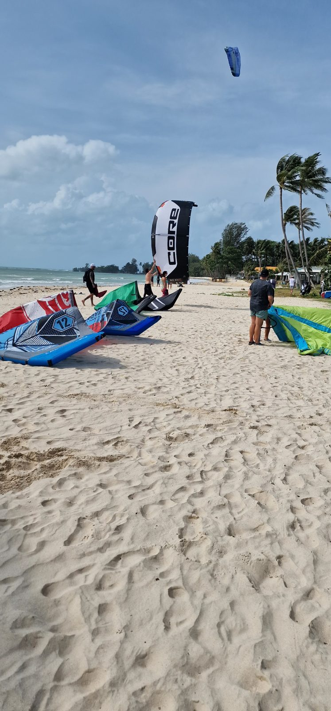
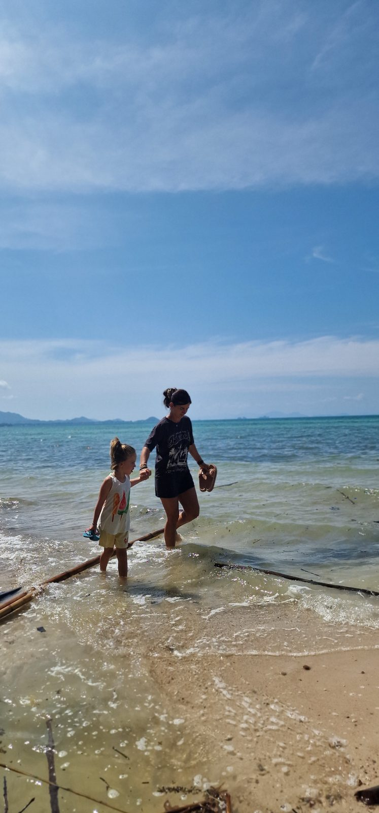
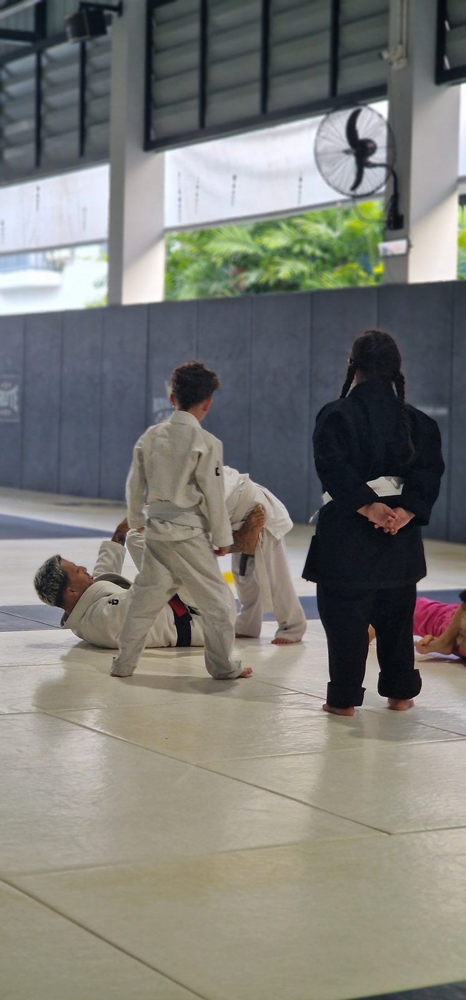
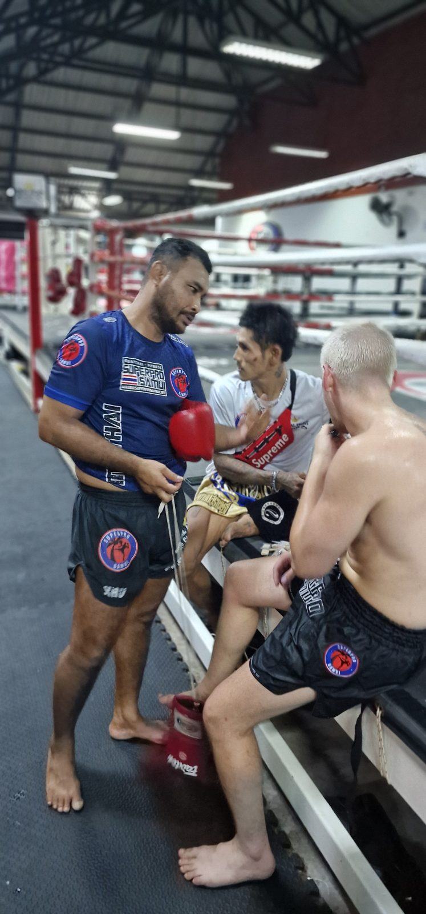
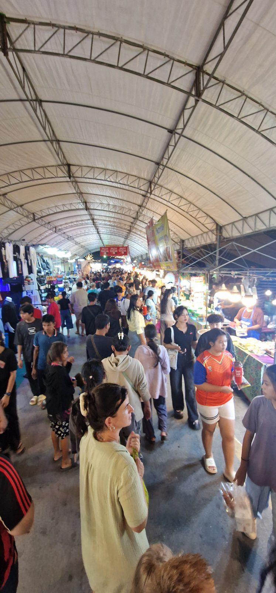

„Schönen Urlaub noch!“

Diesen Satz hören wir auf Koh Samui ziemlich häufig. Meistens von Menschen, mit denen wir gerade ein nettes Gespräch geführt haben und die davon ausgehen, dass wir genauso wie sie für zwei oder drei Wochen auf der Insel sind.

Früher habe ich dann meistens erklärt, dass wir hier leben. Woraufhin fast immer dieselben Fragen folgten: „Ach, wirklich? Wie cool! Und wie macht ihr das? Was arbeitet ihr? Wie lange seid ihr schon hier?“

Inzwischen nicke ich manchmal einfach nur freundlich und lasse die Leute in dem Glauben, dass wir Urlaub machen.

Nicht, weil ich unfreundlich sein möchte. Sondern weil ich dieses Gespräch mittlerweile gefühlt hundertmal geführt habe. Und irgendwann hat man einfach keine Lust mehr, immer wieder dieselben Dinge zu erzählen.

Das klingt jetzt vielleicht etwas merkwürdig, wenn ich gleichzeitig behaupte, dass es auf Koh Samui unglaublich einfach ist, neue Menschen kennenzulernen. Aber genau darum geht es eigentlich: Kontakte entstehen hier fast von alleine. Die Frage ist nur, welche davon man wirklich vertiefen möchte.

Auf Instagram wurde ich kürzlich gleich von zwei Personen gefragt, wie das mit der Expat-Community auf Koh Samui funktioniert. Ob es viele Ausländer gibt, wie man Freunde findet und ob man sich als Familie überhaupt ein neues soziales Umfeld aufbauen kann.

Ehrlich gesagt wäre ich selbst gar nicht auf die Idee gekommen, darüber einen eigenen Artikel zu schreiben. Für uns ist das Thema inzwischen so selbstverständlich geworden, dass ich kaum noch darüber nachdenke.

## Warum wir nach unserer Auswanderung nicht bei null anfangen mussten

Wir hatten natürlich einen großen Vorteil: Als wir nach Koh Samui ausgewandert sind, kannten wir die Insel bereits ziemlich gut. Wir hatten hier vor einigen Jahren schon ein ganzes Jahr gelebt und waren danach mehrfach für längere Aufenthalte zurückgekommen.

Dadurch gab es bereits Menschen, mit denen wir befreundet waren und zu denen wir auch während unserer Zeit in Deutschland Kontakt gehalten hatten.

Wir wussten also schon vor unserer Auswanderung, dass wir nicht irgendwo ankommen würden, wo wir niemanden kennen. Und auch unsere Kinder hatten hier bereits Freunde, auf die sie sich gefreut haben.

Das ist aus meiner Sicht ein riesiger Unterschied zu einer Auswanderung in ein Land, das man nur aus einem zweiwöchigen Urlaub kennt.

Trotzdem sind inzwischen auch neue Freundschaften entstanden. Und dabei hat sich für mich wieder einmal gezeigt, dass man heute nicht unbedingt im selben Ort wohnen muss, um sich überhaupt erst kennenzulernen.

Ein gutes Beispiel sind Andrea und Tobi.

Andrea habe ich über eine Facebook-Gruppe kennengelernt, als wir noch in Deutschland waren. Ich hatte jemanden gesucht, der bereits mit dem DTV-Visum in Thailand lebt, weil ich gerne Erfahrungen aus erster Hand hören wollte.

Wir kamen ins Gespräch und blieben anschließend in Kontakt. Andrea und Tobi suchten damals gerade ein neues Haus auf Koh Samui, und wir beschäftigten uns ebenfalls mit möglichen Unterkünften. Also haben wir uns immer wieder Links geschickt, Informationen ausgetauscht und zwischendurch geschrieben.

Als wir dann selbst auf der Insel waren und uns etwas eingelebt hatten, haben wir uns schließlich verabredet.

Bis dahin kannte ich Andrea nur online. Hagen und die Kinder kannten weder sie noch Tobi. Und natürlich weiß man vorher nie so genau, ob man sich auch persönlich gut versteht. Vielleicht sitzt man nach einer halben Stunde zusammen und fragt sich, wie man die restliche Zeit jetzt möglichst angenehm übersteht.

Bei uns hat es aber sofort gepasst. Inzwischen sind wir befreundet und sehen uns regelmäßig.

## Eine Freundschaft, die mit einer Frage über Ägypten begann

Noch länger kenne ich Nicole, mit deren Familie wir auf Koh Samui inzwischen ebenfalls viel Zeit verbringen.

Unsere Bekanntschaft hat allerdings überhaupt nichts mit Thailand angefangen.

Vor einigen Jahren wollte ich mit den Kindern alleine für eine Woche nach Ägypten reisen. Bei der Recherche bin ich auf Nicoles Instagram-Account gestoßen. Sie war damals mit ihrer Familie in Dahab gewesen und hatte auch einen Reiseblog.

Also habe ich ihr geschrieben und gefragt, wie sie die Gegend einschätzt, ob sie Tipps für uns hat und ob sie glaubt, dass ich dort als Frau alleine mit zwei Kindern gut zurechtkomme.

Aus dieser ursprünglichen Frage entwickelte sich ein Kontakt, der über die Jahre bestehen blieb.

Während unseres früheren Jahres auf Koh Samui haben wir uns zum ersten Mal persönlich getroffen, damals allerdings nur einmal. Als wir später noch einmal für sechs Wochen auf der Insel waren, haben wir uns deutlich häufiger gesehen.

Und heute gehört Nicoles Familie zu unserem festen Freundeskreis.

Das finde ich rückblickend eigentlich ziemlich schön. Eine Frage zu einer Reise nach Ägypten führt Jahre später dazu, dass unsere Familien auf einer thailändischen Insel regelmäßig Zeit miteinander verbringen.

Man weiß eben manchmal nicht, was aus einem einfachen Kontakt irgendwann werden kann.

## Brauchen Kinder wirklich 30 Gleichaltrige um sich herum?

Besonders wichtig sind diese Freundschaften natürlich auch für Heinrich und Hermine.

Nicole hat vier Kinder. Dazu kommt ein thailändisches Mädchen, das mit seiner Familie ebenfalls dort lebt. Gemeinsam mit unseren beiden sind es also sieben Kinder zwischen drei und 16 Jahren, die immer wieder zusammenkommen.

Das ist eine ziemlich große Altersspanne. Und genau das gefällt mir an dieser Konstellation.

Wenn wir über Homeschooling und das Leben ohne klassischen Schulbesuch sprechen, kommt häufig die Frage auf, ob unseren Kindern nicht die sozialen Kontakte fehlen.

Ich kann den Gedanken grundsätzlich nachvollziehen. Schließlich verbringen Kinder in Deutschland normalerweise einen großen Teil ihres Tages im Kindergarten oder in der Schule, umgeben von vielen anderen Kindern, die ungefähr gleich alt sind.

Aber ich frage mich, ob man wirklich 20 oder 30 Gleichaltrige braucht, um soziale Fähigkeiten zu entwickeln.

In unserer kleinen Gruppe müssen sich die Kinder ebenfalls aufeinander einstellen. Die Jüngeren spielen mit den Älteren, es gibt unterschiedliche Interessen, Meinungsverschiedenheiten und natürlich auch mal Streit. Sie müssen Rücksicht nehmen, Kompromisse finden und herausfinden, wie sie miteinander zurechtkommen.

Das alles funktioniert aus meiner Sicht genauso in einer kleineren Gruppe mit unterschiedlichen Altersstufen.

Dazu kommen bei uns die regelmäßigen Sportkurse. Die Kinder trainieren vier- bis fünfmal pro Woche und treffen dort ebenfalls auf Kinder aus verschiedenen Ländern und Altersgruppen. Auch die Trainer kommen aus unterschiedlichen Ländern.

Deshalb haben wir momentan nicht das Gefühl, dass Heinrich und Hermine zu wenig Kontakt zu anderen Kindern haben.

Natürlich kann sich das irgendwann verändern. Nicoles Familie wird beispielsweise für zwei Monate verreisen. Ich bin gespannt, ob unsere Kinder in dieser Zeit vielleicht verstärkt den Kontakt zu anderen Kindern beim Sport suchen oder sich neue Verabredungen ergeben.

Bisher sind sie mit ihrem Freundeskreis jedenfalls ziemlich zufrieden.

## Warum wir nicht mehr jedes Playdate mitnehmen

Es gibt auf Koh Samui eine Facebook-Gruppe namens „Koh Samui with Kids“. Dort schreiben regelmäßig Eltern, dass sie mit ihren Kindern für eine bestimmte Zeit auf der Insel sind und gerne andere Familien kennenlernen möchten.

Oft werden direkt das Alter der Kinder und die Reisedaten genannt, damit man sich zu einem Playdate verabreden kann.

Früher habe ich auf solche Beiträge durchaus reagiert. Inzwischen mache ich das eigentlich nicht mehr.

Der Grund ist ganz einfach: Die meisten dieser Familien sind nur für kurze Zeit hier.

Gerade bei Kindern geht das mit den Freundschaften ja unglaublich schnell. Sie verbringen zwei Stunden miteinander, haben eine tolle Zeit und sind danach gefühlt beste Freunde.

Und dann reist die andere Familie drei Tage später wieder ab.

Wenn man selbst im Urlaub ist, gehört das irgendwie dazu. Man lernt Menschen kennen, verbringt ein paar schöne Tage miteinander und fährt anschließend wieder nach Hause.

Wenn man aber dauerhaft an einem Ort lebt, sieht die Sache etwas anders aus.

Wir haben nach unserem früheren Jahr auf Koh Samui schon gemerkt, dass es irgendwann anstrengend wird, immer wieder Menschen kennenzulernen, mit denen man sich gut versteht, die aber nach zwei Wochen schon wieder abreisen.

Natürlich kann man auch daraus langfristige Freundschaften entwickeln. Nicole ist schließlich das beste Beispiel dafür, dass räumliche Entfernung keine große Rolle spielen muss.

Trotzdem wählen wir inzwischen bewusster aus, mit wem wir Zeit verbringen und welche Kontakte wir vertiefen möchten. Gerade für die Kinder finde ich es schöner, wenn sie Freundschaften aufbauen können, bei denen nicht von Anfang an klar ist, dass man sich in wenigen Tagen wieder verabschieden muss.

Das bedeutet nicht, dass wir grundsätzlich keine Urlauber kennenlernen möchten. Aber wir suchen nicht mehr aktiv nach jeder Möglichkeit für neue Kontakte.

## Facebook ist auf Koh Samui viel mehr als nur Social Media

Wer neu auf die Insel kommt und Menschen kennenlernen möchte, hat allerdings jede Menge Möglichkeiten.

Und eine der wichtigsten ist tatsächlich Facebook.

In Deutschland hat Facebook inzwischen ja eher den Ruf, eine Plattform für die ältere Generation zu sein. Hier in Thailand wird es dagegen noch sehr intensiv genutzt.

Gerade der Facebook Marketplace und die vielen lokalen Gruppen spielen im Alltag eine große Rolle. Man findet dort Häuser und Wohnungen, Autos, Möbel und alles Mögliche, was man kaufen oder verkaufen möchte. Auch wir haben unser Auto über Facebook gefunden.

Daneben gibt es Gruppen für praktisch jedes Thema: Unterkünfte, Familien mit Kindern, Auswanderer, Kaufen und Verkaufen oder ganz allgemeine Fragen zum Leben auf Koh Samui.

Manchmal schreibt jemand, dass er ganz dringend einen bestimmten Gegenstand braucht oder wissen möchte, wo er etwas erledigen kann. Und meistens dauert es nicht lange, bis die ersten Antworten kommen.

Über solche Gruppen kann man natürlich auch wunderbar Kontakte knüpfen. Man muss nicht gleich öffentlich nach neuen Freunden suchen. Manchmal reicht es, eine Frage zu stellen, sich mit jemandem auszutauschen und anschließend in Kontakt zu bleiben.

Genauso funktioniert das über Instagram oder andere soziale Netzwerke.

Und wer lieber direkt vor Ort Menschen kennenlernen möchte, findet auf Koh Samui ebenfalls genügend Gelegenheiten.

## Sport, Schulen und gemeinschaftliche Wohnanlagen

Sport ist für uns einer der wichtigsten Orte, an denen wir regelmäßig andere Menschen treffen.

Dabei merkt man nach einiger Zeit auch, wer wirklich auf der Insel lebt und wer nur Urlaub macht. Wenn man jemanden vier Wochen hintereinander beim Training sieht, ist die Wahrscheinlichkeit relativ groß, dass diese Person zumindest länger hierbleibt.

Es gibt schließlich nicht nur Menschen, die dauerhaft auf Koh Samui wohnen, sondern auch viele, die hier mehrere Monate überwintern oder als digitale Nomaden für eine Zeit auf der Insel leben.

Für Familien sind außerdem die internationalen Schulen eine gute Möglichkeit, Kontakte zu knüpfen.

Dort gibt es Veranstaltungen, bei denen auch die Eltern dabei sind. Und Kindergeburtstage können hier eine ganz andere Größenordnung haben als in Deutschland.

Wir waren beispielsweise einmal zu einem Geburtstag eingeladen, bei dem ein Beachclub gemietet wurde. Es gab ein Buffet, die gesamte Schulklasse war eingeladen und die Eltern waren ebenfalls dabei.

Das hatte von der Größe her eher etwas von einer deutschen Einschulungsfeier.

Bei solchen Gelegenheiten lernt man natürlich ziemlich schnell andere Familien kennen, auch wenn die Kinder vorher noch gar nicht miteinander befreundet waren.

Eine weitere Möglichkeit sind Wohnanlagen, die speziell für Langzeitmieter gedacht sind. Davon gibt es auf Koh Samui einige. Oft stehen mehrere Bungalows oder kleine Häuser rund um einen gemeinsamen Pool.

Wer dort wohnt, begegnet seinen Nachbarn automatisch regelmäßig und weiß meistens auch, dass diese nicht nach drei Tagen wieder abreisen.

Manche dieser Anlagen haben einen richtigen Community-Charakter. Teilweise leben dort überwiegend deutschsprachige Menschen, in anderen ist die Bewohnerschaft international gemischt.

Wenn einem so ein Umfeld wichtig ist, kann man durchaus schon bei der Wohnungssuche darauf achten.

Für Hagen und mich wäre das allerdings überhaupt nichts.

## Wir brauchen kein ganzes Dorf um uns herum

Hagen und ich sind nicht die Menschen, die unbedingt in einer großen Gemeinschaft wohnen möchten, in der sich alle ständig treffen und etwas zusammen unternehmen.

Am liebsten hätten wir eigentlich ein Haus, bei dem rundherum niemand wohnt.

Nicht, weil wir keine anderen Menschen mögen. Wir sind einfach viel unterwegs, verbringen Zeit beim Sport, treffen Freunde und unternehmen als Familie ohnehin eine ganze Menge.

Da brauche ich nicht unbedingt noch Nachbarn, mit denen ich mich jeden Nachmittag am Gemeinschaftspool unterhalte.

Was ich dagegen sehr schön finde, ist der Kontakt zu den Menschen, die hier in unserem direkten Umfeld leben und arbeiten.

Bei unserer Bungalowanlage kennen die Besitzer und die Menschen im Restaurant unsere Kinder. Wenn Hermine vorne am Strand mit der Katze spielt, wissen sie, dass sie zu uns gehört. Man unterhält sich, die Kinder bekommen vielleicht mal eine Kokosnuss geschenkt und es gibt einfach dieses vertraute Miteinander.

Das ist für mich ebenfalls eine Form von Gemeinschaft, auch wenn wir nicht gemeinsam in einem Community-Dorf leben.

Oft wird in diesem Zusammenhang das Sprichwort genannt, dass es ein ganzes Dorf braucht, um ein Kind großzuziehen.

Diesen Gedanken finde ich grundsätzlich schön. Allerdings hatten wir schon in Deutschland nie eine solche Familienkonstellation, in der ständig Großeltern oder andere Verwandte in der Nähe waren und uns im Alltag unterstützt haben.

Wir waren als Familie weitgehend auf uns selbst gestellt. Deshalb hatten wir auch nach unserer Auswanderung nicht das Bedürfnis, uns möglichst schnell ein großes Unterstützungsnetzwerk aufzubauen.

Wenn sich gegenseitige Hilfe ergibt, ist das natürlich wunderbar. Aber es ist nicht etwas, wonach wir aktiv suchen.

## Warum Freundschaften unter Auswanderern manchmal schneller entstehen

Was ich sowohl auf Reisen als auch jetzt auf Koh Samui beobachte, ist, dass man mit manchen Menschen erstaunlich schnell auf einer Wellenlänge ist.

Ich glaube, das liegt daran, dass man häufig schon bestimmte Gemeinsamkeiten mitbringt.

Wer sich entscheidet, in einem anderen Land zu leben, hat sich zumindest mit der Frage beschäftigt, wie und wo er sein Leben verbringen möchte. Oft verbindet einen bereits die Begeisterung für ein bestimmtes Land oder eine andere Lebensweise.

Bei Individualreisen erlebe ich das ganz ähnlich. Man trifft Menschen, die sich ebenfalls gerne auf eigene Faust neue Orte anschauen, und hat dadurch sofort gemeinsame Gesprächsthemen.

Bei Auswanderern geht das manchmal noch etwas tiefer. Schließlich haben sie eine ziemlich große Lebensentscheidung getroffen. Und hinter dieser Entscheidung stehen häufig bestimmte Wünsche, Prioritäten oder Vorstellungen davon, wie man leben möchte.

Das heißt natürlich nicht, dass man automatisch mit jedem anderen Auswanderer befreundet sein wird. Wir kennen hier genauso Menschen, mit denen wir wenig gemeinsam haben.

Aber ich habe schon den Eindruck, dass es manchmal leichter ist, sich näherzukommen, weil man über viele Dinge nicht erst lange erklären muss, warum man sie anders macht als die meisten Menschen im früheren Umfeld.

Als Erwachsene in Deutschland neue Freundschaften zu schließen, fand ich teilweise schwieriger. Man hat seinen gewohnten Alltag, arbeitet und trifft Menschen häufig über Kollegen, Vereine oder die Kinder.

Wenn man wie ich selbstständig ist und überwiegend alleine am Computer arbeitet, fallen die Kollegen als Möglichkeit ohnehin weg.

Auf Koh Samui sind es dagegen oft die gemeinsamen Aktivitäten, die Kinder oder eben die Tatsache, dass man selbst neu an einem Ort ist und offener auf andere zugeht.

## Und wovon leben die ganzen Auswanderer eigentlich?

Neben der Frage nach Freundschaften kam auch die Frage auf, was die Ausländer auf Koh Samui eigentlich beruflich machen.

Das lässt sich natürlich nicht pauschal beantworten. Eine genaue Zahl, wie viele Ausländer dauerhaft auf der Insel leben, ist ohnehin schwierig zu ermitteln, weil nicht jeder mit einem klassischen langfristigen Aufenthaltsstatus hier ist. Manche bleiben nur einige Monate, andere kommen regelmäßig zurück und wieder andere leben über Jahre hier.

Beruflich begegnen uns vor allem zwei größere Gruppen.

Zum einen gibt es Menschen wie uns, die ihr Geld online verdienen. Viele arbeiten selbstständig, betreiben ein Online-Business und haben Kunden außerhalb Thailands. Dadurch können sie ihren Wohnort relativ flexibel wählen.

Zum anderen gibt es Ausländer, die direkt im Tourismusgeschäft tätig sind. Gerade Immobilien, Ferienunterkünfte, Hotels und Gastronomie spielen auf Koh Samui eine große Rolle.

Manche betreiben Restaurants, andere vermieten Unterkünfte oder investieren in Immobilienprojekte. Das ist allerdings längst nicht immer so unkompliziert, wie es vielleicht aussieht. Gerade bei ausländischen Geschäftsaktivitäten gibt es rechtliche Vorgaben, und auch wirtschaftlich kann man sich mit solchen Projekten ordentlich verkalkulieren.

Wer auf Koh Samui ein Restaurant betreibt, hat außerdem nicht plötzlich ein entspanntes Leben unter Palmen. Gastronomie bleibt ein anstrengender Job, egal in welchem Land.

Für die digitalen Selbstständigen gibt es ebenfalls Möglichkeiten, sich beruflich zu vernetzen.

Ich weiß beispielsweise von einem regelmäßigen Business-Lunch in Fisherman's Village, bei dem sich Selbstständige und Online-Unternehmer treffen können.

Ich war allerdings noch nie dort.

Allein die Vorstellung, irgendwo alleine in eine Gruppe von Menschen zu gehen, die ich nicht kenne, und mich dann mit meinem Business vorzustellen, finde ich furchtbar. Ich bewundere wirklich alle, denen so etwas leichtfällt.

Meine beruflichen Kontakte pflege ich deshalb überwiegend online. Und damit bin ich auch vollkommen zufrieden.

Aber wer solche persönlichen Netzwerktreffen mag, findet auf Koh Samui durchaus entsprechende Möglichkeiten.

## Muss man Angst haben, nach dem Auswandern einsam zu werden?

Wenn ich unsere Erfahrungen zusammenfasse, würde ich sagen, dass es auf Koh Samui relativ einfach ist, neue Menschen kennenzulernen.

Natürlich hängt das auch davon ab, was man selbst möchte.

Wer unbedingt eine deutschsprachige Gemeinschaft sucht, kann gezielt danach schauen. Wer lieber internationale Kontakte knüpfen möchte, findet über Sport, Freizeitangebote oder die Kinder genügend Möglichkeiten. Und wer gerne seine Ruhe hat, muss sich auch nicht jeden Nachmittag mit irgendwelchen Nachbarn treffen.

Es kommt eben darauf an, wie man sich sein Leben vorstellt.

Wenn ich beispielsweise nach Schweden in eine abgelegene Gegend ziehe, in der mein nächster Nachbar 15 Kilometer entfernt wohnt, werde ich vermutlich nicht dieselben Möglichkeiten haben wie auf einer touristisch geprägten Insel mit vielen internationalen Bewohnern.

Aber wahrscheinlich entscheide ich mich dann auch ganz bewusst für ein ruhigeres, abgeschiedeneres Leben.

Für uns ist Koh Samui jedenfalls ein Ort, an dem wir nicht das Gefühl haben, auf irgendetwas verzichten zu müssen, was Freundschaften und soziale Kontakte betrifft.

Wir haben alte Kontakte wieder aufgenommen, neue Freundschaften geschlossen und verbringen regelmäßig Zeit mit Menschen, die uns wichtig sind. Gleichzeitig genießen wir es, als Familie auch einfach für uns zu sein.

Und vielleicht ist das für mich der entscheidende Unterschied zwischen einer großen Community und einem Freundeskreis: Ich muss nicht möglichst viele Menschen um mich herum haben. Mir reicht es, wenn ich ein paar Menschen habe, mit denen ich gerne Zeit verbringe und bei denen es einfach passt.

**Wenn du noch mehr darüber erfahren möchtest, wie die Expat-Community auf Koh Samui aussieht, welche Menschen hier leben und welche Möglichkeiten es gibt, sich privat oder beruflich zu vernetzen, dann hör in die dazugehörige Folge von „DLIZKFI – Das Leben ist zu kurz für irgendwann“ rein.** Dort erzähle ich ausführlicher von unseren Erfahrungen und davon, warum ich mir um das Thema Anschluss finden beim Auswandern wenig Sorgen machen würde.
