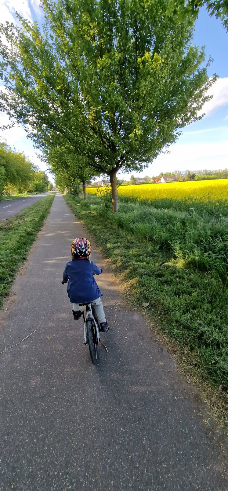
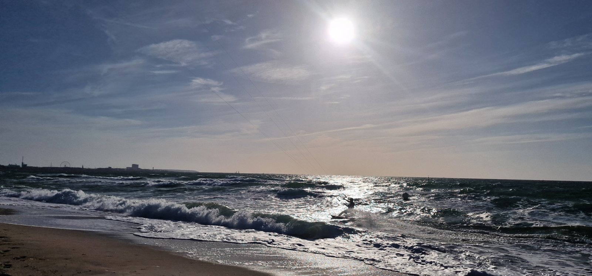
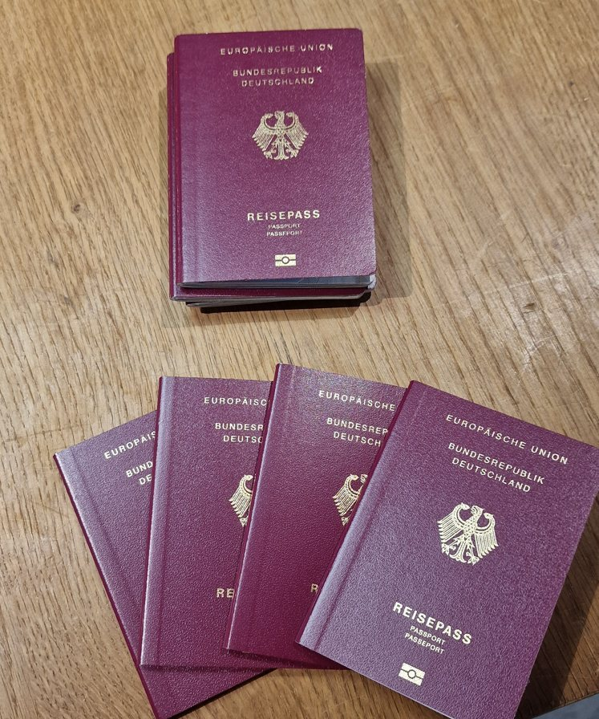

„Ach, schade. Ich hatte mir das schon so schön vorgestellt, wenn die beiden später zusammen mit dem Fahrrad zur Schule fahren.“

Das sagte neulich eine Mutter aus Hermines Kindergarten zu mir, als sie von unserer geplanten Auswanderung erfahren hat. Sie wohnt mit ihrer Familie ebenfalls in unserem Dorf und hatte sich einfach vorgestellt, dass unsere Kinder auch in den kommenden Jahren gemeinsam aufwachsen würden.

Eigentlich ein völlig harmloser Satz. Trotzdem hat er bei mir sofort etwas ausgelöst. Plötzlich habe ich daran gedacht, dass ich Hermine mit unserer Entscheidung genau diese Möglichkeit nehme. Mit den Kindern, mit denen sie schon jetzt im Kindergarten spielt, irgendwann gemeinsam zur Schule zu fahren. Weiter im selben Dorf aufzuwachsen, mit all den Menschen, die sie seit Jahren kennt.

Natürlich bekommt sie in Thailand dafür andere Möglichkeiten. Sie wird neue Kinder kennenlernen und ganz andere Dinge erleben. Aber in diesem Moment habe ich vor allem daran gedacht, was wir ihr wegnehmen. Und das hat sich plötzlich ziemlich egoistisch angefühlt.

Solche Momente gibt es in letzter Zeit immer wieder. Obwohl wir uns schon so lange mit unserer Auswanderung beschäftigen und ich mich riesig auf unser neues Leben freue, kommen zwischendurch Zweifel auf, mit denen ich selbst nicht gerechnet habe.

## Warum ich plötzlich eine Entscheidung hinterfrage, die ich seit Jahren treffen möchte

Der Wunsch, im Ausland zu leben, begleitet mich schon länger, als ich Hagen kenne. Wir sind außerdem nicht gerade unerfahren, was längere Auslandsaufenthalte angeht. Wir haben viel Zeit in unterschiedlichen Ländern verbracht und sogar schon ein ganzes Jahr in Thailand gelebt.

Unsere Auswanderung ist also keine spontane Idee, die während eines zweiwöchigen Urlaubs entstanden ist, weil wir das Wetter so toll fanden. Wir wissen, dass ein Alltag in Thailand etwas anderes ist als Urlaub. Wir kennen Koh Samui, haben dort schon längere Zeit gelebt und uns sehr ausführlich mit der Entscheidung beschäftigt.

Wenn mich jemand fragt, ob wir uns das wirklich gut überlegt haben, kann ich deshalb ganz klar mit Ja antworten.

Und trotzdem gibt es diese kurzen Momente, in denen ich denke: Oh Gott, machen wir hier gerade das Richtige?

Besonders häufig passiert mir das morgens nach dem Aufwachen oder abends im Bett, wenn es endlich ruhig wird. Tagsüber beschäftigen wir uns mit der Organisation unserer Auswanderung. Es gibt unzählige Dinge zu erledigen, Entscheidungen zu treffen und Termine zu koordinieren. Da bleibt nicht besonders viel Zeit, um sich über seine Gefühle Gedanken zu machen.

Wenn dann Ruhe einkehrt, sieht das manchmal ganz anders aus.

Normalerweise habe ich für schwierige Entscheidungen übrigens eine ziemlich einfache Methode. Wenn ich zwischen zwei Möglichkeiten schwanke und nicht weiterkomme, entscheide ich irgendwann, auf mein Gefühl direkt nach dem Aufwachen am nächsten Morgen zu hören. Damit fahre ich meistens ziemlich gut.

Würde ich das allerdings bei unserer Auswanderung konsequent machen, hätten wir wahrscheinlich schon mehrfach wieder alles abgeblasen.

Dabei gibt es gar keinen konkreten Grund, unsere Entscheidung grundsätzlich infrage zu stellen. Trotzdem schießen mir manchmal Gedanken durch den Kopf, die ich vorher überhaupt nicht hatte.

## Die Kinder freuen sich auf Thailand. Aber was ist später?

Am meisten beschäftigen mich tatsächlich die Kinder.

Heinrich und Hermine sind beide daran gewöhnt, viel unterwegs zu sein. Sie kennen längere Auslandsaufenthalte und haben sich bisher sowohl im Ausland als auch nach unserer Rückkehr nach Deutschland immer ziemlich problemlos in ihre Umgebung eingefunden.

Außerdem sind beide sehr kommunikativ. Wer unsere Kinder persönlich kennt, weiß, dass sie sich nicht schwer damit tun, mit anderen Menschen in Kontakt zu kommen. Sie freuen sich auf Thailand und möchten genauso wie wir gerne dort leben.

Trotzdem frage ich mich manchmal, ob sie überhaupt einschätzen können, was diese Entscheidung langfristig bedeutet.

Natürlich verstehen sie, dass wir nach Thailand ziehen und nicht nach ein paar Wochen wieder zurückkommen. Aber können sie wirklich beurteilen, was es bedeutet, ihr bisheriges Umfeld dauerhaft zu verlassen?

Und was ist, wenn sie uns irgendwann als Erwachsene vorwerfen, dass wir ihnen etwas genommen haben?

Man kennt das doch aus der eigenen Kindheit. Manchmal bleiben irgendwelche Dinge hängen, die für die Eltern überhaupt keine große Bedeutung hatten. Vielleicht ein blöder Spruch oder eine bestimmte Situation. Als Erwachsener denkt man Jahre später noch darüber nach, obwohl sich die Eltern vermutlich nicht einmal daran erinnern können.

Wir versuchen natürlich, bei der Erziehung unserer Kinder alles nach bestem Wissen und Gewissen zu machen. Trotzdem weiß man nie, wie sie bestimmte Entscheidungen später einmal bewerten werden.

Bei einer Auswanderung kommt hinzu, dass die Kinder letztendlich keine wirkliche Wahl haben. Auch wenn sie begeistert sind und sich auf unser neues Leben freuen, sind wir als Eltern diejenigen, die diese Entscheidung treffen.

Und dann reicht plötzlich ein Satz über zwei Mädchen, die gemeinsam mit dem Fahrrad zur Schule fahren könnten, um mich wieder ins Grübeln zu bringen.

Dabei weiß ich aus eigener Erfahrung, wie schnell sich solche vermeintlich wichtigen Dinge verändern können.

Als wir nach unserem ersten längeren Aufenthalt in Thailand nach Deutschland zurückgekommen sind, hat Heinrich mit dem Segeln angefangen. Das fand ich damals richtig schön. Wir wohnen in Rostock, haben die Warnow direkt vor der Haustür und bei gutem Wetter ist es einfach toll, dort auf dem Wasser unterwegs zu sein.

Gleichzeitig habe ich mich schon damals mit dem Gedanken beschäftigt, irgendwann dauerhaft auszuwandern. Und prompt hatte ich wieder dieses schlechte Gewissen. Jetzt hat Heinrich ausgerechnet eine Sportart für sich entdeckt, die so eng mit unserem Wohnort verbunden ist. Fußball kann man schließlich überall spielen, aber die Möglichkeiten zum Segeln sind nicht an jedem Ort gleich.

Ich hatte wirklich das Gefühl, dass ich ihm etwas wegnehmen würde, wenn wir Deutschland verlassen.

Ein Jahr später haben wir ihn allerdings wieder vom Segelverein abgemeldet. Es stellte sich heraus, dass weder die Sportart noch das Vereinsumfeld besonders gut zu ihm passten.

Was ich also zu diesem Zeitpunkt als eine wichtige Sache in seinem Leben empfunden hatte, war ein Jahr später schon gar kein Thema mehr.

Daran versuche ich mich auch jetzt zu erinnern, wenn mich solche Gedanken beschäftigen. Schließlich weiß niemand, wie sich die Freundschaften und Interessen der Kinder entwickeln würden, wenn wir in Deutschland blieben. Vielleicht würde Hermine tatsächlich jahrelang mit denselben Freundinnen zur Schule fahren. Vielleicht aber auch nicht.

Und vielleicht erlebt sie in Thailand Dinge, die ihr später genauso viel bedeuten. Nur eben ganz andere.

## Wenn selbst ein Lied in der Sporthalle plötzlich ein komisches Gefühl auslöst

Es sind allerdings nicht nur die Gedanken um unsere Kinder, die mich manchmal verunsichern.

Neulich habe ich beim Sport ein Lied gehört, das ich auch häufig beim Training in Thailand gehört habe. Eigentlich verbinde ich damit schöne Erinnerungen, und normalerweise würde ich mich bei diesem Lied sofort wieder nach Koh Samui sehnen.

Diesmal war es anders.

Plötzlich wurde mir bewusst, dass wir bald tatsächlich wieder auf dieser Insel leben werden. Und auf einmal kam mir Koh Samui unglaublich klein vor. Eine Insel ist eben räumlich begrenzt, ganz anders als das Festland. Ich hatte kurz dieses seltsame Gefühl, dort irgendwie eingeengt zu sein.

Gleichzeitig dachte ich daran, dass ich bald nicht mehr in dieser Sporthalle sitzen werde. Dass unser ganz normaler Alltag, so wie wir ihn jetzt kennen, bald vorbei ist.

Das ist eigentlich völlig absurd, wenn man bedenkt, wie sehr ich mir diese Veränderung wünsche.

Ich bin nämlich überhaupt kein Mensch, der besonders viel Wert auf gleichbleibende Abläufe legt. Eher im Gegenteil. Ich bin gerne unterwegs, unternehme ständig etwas und brauche immer wieder Veränderungen.

Auch als Familie sind wir ziemlich aktiv. Andere fragen uns manchmal schon, ob uns die ganze Unternehmerei nicht irgendwann zu anstrengend wird. Für uns gehört das einfach dazu.

Die Vorstellung, dass ich heute schon wüsste, wie die nächsten 30 Jahre meines Lebens aussehen werden, finde ich eigentlich eher beängstigend.

Und trotzdem gibt es plötzlich Momente, in denen genau das irgendwie verlockend erscheint.

Einfach hierbleiben. Weiterhin in der gewohnten Umgebung leben. Wissen, wo alles ist, wie alles funktioniert und was einen am nächsten Tag erwartet.

## Was es wirklich bedeutet, seine Komfortzone zu verlassen

Ich habe mich inzwischen ziemlich intensiv gefragt, woher diese seltsamen Gefühle kommen. Und ich glaube, dass ich gerade sehr deutlich spüre, was es bedeutet, seine Komfortzone zu verlassen.

Diesen Begriff hört man ja ständig. Jeder soll seine Komfortzone verlassen, neue Dinge ausprobieren und über sich hinauswachsen.

Aber wie fühlt sich das eigentlich an, wenn man tatsächlich dabei ist, sein gewohntes Leben komplett hinter sich zu lassen?

Ich bin über 40 Jahre alt. Deutschland ist das Land, in dem ich aufgewachsen bin und den größten Teil meines Lebens verbracht habe. Auch wenn ich viel gereist bin und immer wieder längere Zeit im Ausland gelebt habe, bin ich letztendlich doch immer wieder hierher zurückgekommen.

Ich kenne die Abläufe, die Menschen, die Sprache und all die kleinen Selbstverständlichkeiten des Alltags. Und natürlich hängt an diesem Leben auch jede Menge Geschichte.

Wir geben mit unserer Auswanderung schließlich nicht nur eine Wohnung auf. Es fühlt sich vielmehr so an, als würden wir ein ganzes bisheriges Leben hinter uns lassen und noch einmal neu anfangen.

Ich glaube, dass sich in solchen Momenten irgendetwas in mir krampfhaft an dem festhalten möchte, was es kennt.

Als würde jemand innerlich an mir ziehen und sagen: Bleib doch hier. Hier ist alles vertraut. Hier weißt du, was dich erwartet.

Obwohl ich mich bewusst für ein anderes Leben entschieden habe, fühlt sich das Bekannte plötzlich sicherer an.

Dabei weiß ich natürlich auch in Deutschland nicht, was mich erwartet. Niemand kann mir sagen, wie unser Leben in fünf oder zehn Jahren aussehen würde, wenn wir hierblieben. Welche Veränderungen auf uns zukommen, was beruflich passiert oder welche unerwarteten Situationen wir erleben werden.

Trotzdem vermittelt das Gewohnte offenbar ein Gefühl von Sicherheit, an dem ich manchmal stärker hänge, als ich selbst gedacht hätte.

## Geld, Rollerunfälle und die Angst, Verantwortung für alles zu tragen

Neben diesen grundsätzlichen Gedanken gibt es natürlich auch ganz konkrete Sorgen.

Da ist beispielsweise das Geld.

Ich bin selbstständig und kann meine Arbeit auch von Thailand aus fortführen. Wir haben außerdem Ersparnisse, mit denen wir eine gewisse Zeit überbrücken könnten, falls einmal ein Kunde wegfallen sollte.

Allerdings ist unser finanzieller Puffer sicherlich nicht so groß, wie manche Menschen vielleicht vermuten oder wie andere ihn für eine solche Entscheidung bräuchten.

Dazu kommt, dass Koh Samui in den vergangenen Jahren deutlich teurer geworden ist. Besonders die Mietpreise haben seit unserem letzten längeren Aufenthalt ordentlich angezogen.

Natürlich frage ich mich deshalb manchmal, was passiert, wenn meine Einnahmen zurückgehen oder unsere Lebenshaltungskosten höher ausfallen als geplant.

Noch viel häufiger beschäftigen mich aber Sorgen um unsere Sicherheit.

Wer Koh Samui kennt, weiß, dass der Straßenverkehr dort nicht gerade ungefährlich ist. Viele Menschen fahren ohne Helm Roller, teilweise nicht einmal mit vernünftiger Kleidung oder Schuhen. Und Unfälle sieht man leider immer wieder.

Natürlich ist mir das bewusst, und natürlich macht Rollerfahren auch Spaß. Aber gerade mit den Kindern habe ich manchmal ziemlich furchtbare Vorstellungen davon, was alles passieren könnte.

Was, wenn Hagen mit den Kindern unterwegs ist und sie einen schweren Unfall haben? Was, wenn eines der Kinder beim Schwimmen von einer gefährlichen Qualle erwischt wird? Was, wenn wir auf eine Kobra treffen oder jemand plötzlich schwer krank wird?

Solche Gedanken beschäftigen mich nicht ständig. Sonst würde ich vermutlich irgendwann durchdrehen. Aber sie kommen eben manchmal hoch.

Dabei weiß ich aus eigener Erfahrung, dass schlimme Dinge genauso gut in Deutschland passieren können.

Hermine hat sich innerhalb eines halben Jahres zweimal den Arm gebrochen. Der zweite Bruch am Ellenbogen war so schlimm, dass wir bis heute damit zu tun haben und möglicherweise auch langfristig noch Folgen bleiben.

Passiert ist das bei einem ganz normalen Kindergeburtstag. Sie ist aus einer ziemlich geringen Höhe von einer Hüpfburg heruntergefallen. Direkt vor ihr hatte ihre Freundin praktisch dieselbe Bewegung gemacht und sich überhaupt nicht verletzt.

Bei Hermine dagegen war der Ellenbogen schwer gebrochen.

So etwas kann man weder vorhersehen noch vollständig verhindern.

Trotzdem fühlt es sich bei unserer Auswanderung manchmal anders an. Weil wir bewusst entscheiden, mit den Kindern in ein anderes Land zu gehen, habe ich plötzlich das Gefühl, für alles verantwortlich zu sein, was dort passieren könnte.

Ich stelle mir vor, dass vielleicht irgendwann etwas Schlimmes passiert und ich denke: Wenn wir in Deutschland geblieben wären, wäre das nicht geschehen.

Dabei könnte ich mir genauso gut vorwerfen, dass Hermines Arm nicht gebrochen wäre, wenn ich damals nicht mit ihr zu diesem Kindergeburtstag gegangen wäre.

So kann man natürlich nicht leben.

Aber gerade in den ruhigeren Momenten lassen sich solche Gedanken nicht immer einfach abschalten.

## Warum wir trotzdem weiter an unseren Plänen festhalten

Interessanterweise geht es Hagen teilweise ähnlich. Auch er hat zwischendurch Momente, in denen er denkt, dass vielleicht doch nicht alles funktionieren wird.

Am Anfang kamen solche Gedanken bei uns noch relativ häufig auf. Inzwischen werden sie allerdings immer seltener.

Das liegt vermutlich auch daran, dass unsere Auswanderung immer konkreter wird. Wir haben bereits so viele Entscheidungen getroffen und Dinge in die Wege geleitet, dass es zunehmend schwieriger wäre, jetzt noch alles rückgängig zu machen.

Und ich glaube, das ist für mich sogar ganz gut.

Ich kenne das von mir, dass ich mich manchmal bewusst in Situationen bringe, in denen ich nicht mehr ständig neu entscheiden kann. Irgendwann ist eine Entscheidung getroffen, und dann geht es eben weiter.

Denn wenn ich bei jedem kurzen Anflug von Unsicherheit alles wieder infrage stellen würde, käme ich vermutlich nie besonders weit.

Das bedeutet natürlich nicht, dass wir mögliche Risiken ignorieren. Wir beschäftigen uns mit unseren Finanzen, überlegen, wie wir unseren Alltag gestalten wollen, und versuchen, die Auswanderung so gut wie möglich vorzubereiten.

Aber eine Garantie dafür, dass alles funktioniert und niemandem etwas passiert, gibt es eben nicht. Die hätten wir schließlich auch nicht, wenn wir in Deutschland blieben.

Vielleicht ist das für mich gerade die größte Herausforderung: zu akzeptieren, dass ich mir etwas seit vielen Jahren wünschen und trotzdem zwischendurch Angst davor haben kann.

Dass ich mich riesig auf Koh Samui freue und gleichzeitig manchmal eine Sporthalle, einen vertrauten Alltag oder die Vorstellung von Hermines Schulweg plötzlich besonders wertvoll finde.

Und dass diese Gefühle nicht automatisch bedeuten, dass unsere Entscheidung falsch ist.

Wir gehen diesen Schritt jedenfalls weiter. Nicht, weil wir uns über alles vollkommen sicher sind, sondern weil wir nach all unseren Erfahrungen und Überlegungen davon überzeugt sind, dass wir so leben möchten.

Und vielleicht brauche ich einfach noch ein bisschen, bis auch der Teil von mir, der sich gerade so hartnäckig an unserem alten Leben festklammert, verstanden hat, dass es jetzt tatsächlich losgeht.

*In der dazugehörigen Folge von „DLIZKFI – Das Leben ist zu kurz für irgendwann“ erzähle ich noch ausführlicher von den Ängsten und Zweifeln, die mich gerade vor unserer Auswanderung beschäftigen. Von meinen Gedanken als Mutter, den manchmal ziemlich absurden Sorgen und der Frage, warum selbst ein lang gehegter Traum plötzlich Angst machen kann. Die vollständige Folge findest du auf Spotify, Apple Podcasts und YouTube.*
