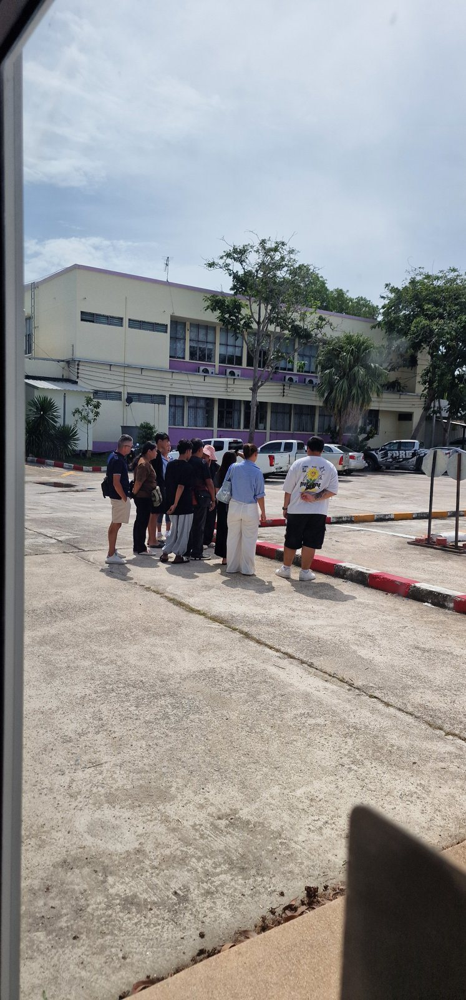
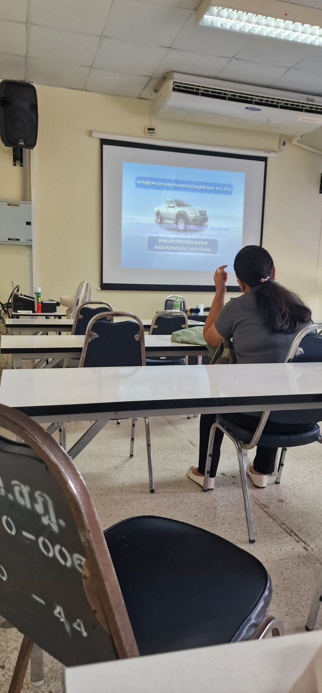
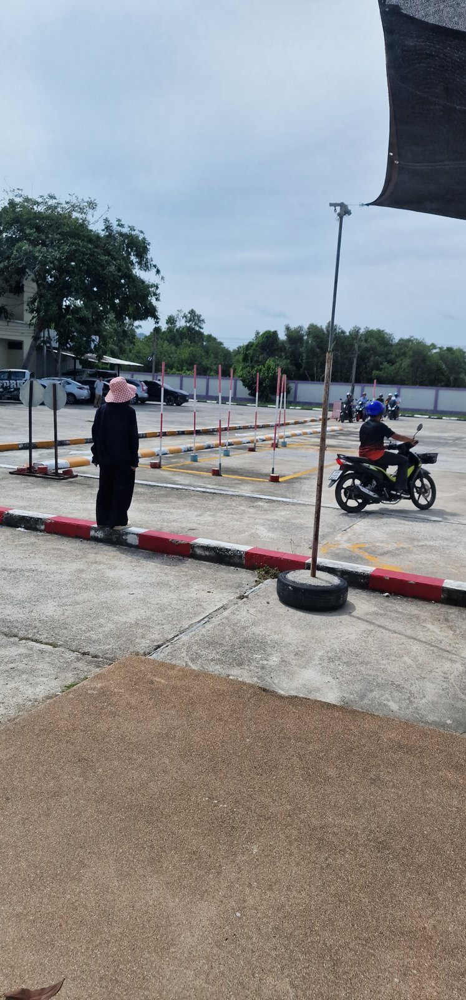
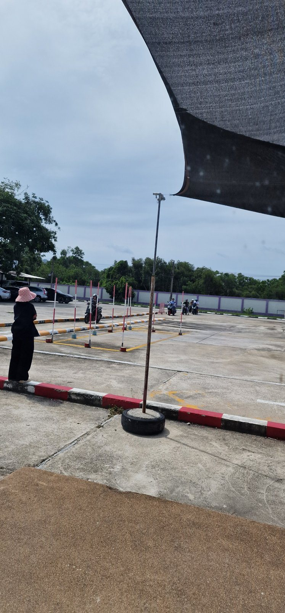

„You need online appointment.“

Das war die Antwort, die Hagen bekam, nachdem er morgens um halb sechs losgefahren war und mehr als zwei Stunden vor der thailändischen Führerscheinstelle gewartet hatte. Eigentlich hatte er alles genauso gemacht, wie es uns eine Bekannte erklärt hatte: früh hinfahren, Nummer ziehen und warten, bis man an der Reihe ist. Nur gab es plötzlich keine Nummern mehr. Stattdessen brauchte man neuerdings einen online gebuchten Termin.

Und der nächste freie Termin? Zwei Monate später.

Willkommen beim Führerscheinmachen in Thailand!

Inzwischen hat Hagen seinen thailändischen Führerschein tatsächlich in der Tasche. Dafür hat er sich durch Hunderte Theoriefragen gearbeitet, mehrere Stunden Verkehrserziehung über sich ergehen lassen und eine praktische Prüfung absolviert, die gerade einmal zwei Minuten und fünfzehn Sekunden gedauert hat.

Das Beste daran: Trotz des ganzen Aufwands hat ihn der Führerschein am Ende gerade einmal rund 21 Euro gekostet.

Wie das alles abgelaufen ist und warum wir überhaupt einen thailändischen Führerschein brauchen, ist allerdings eine etwas längere Geschichte.

## Warum wir einen thailändischen Führerschein wollten

Seit wir auf Koh Samui leben, haben wir ein eigenes Auto. Und damit stellt sich natürlich auch die Frage, wie das mit dem Führerschein und der Versicherung funktioniert.

Wir hatten uns darüber informiert und waren zu dem Ergebnis gekommen, dass wir für unseren längerfristigen Aufenthalt einen thailändischen Führerschein benötigen, damit es insbesondere bei einem Unfall keine Probleme mit dem Versicherungsschutz gibt. Ein internationaler Führerschein wäre für uns nach den Informationen, die wir damals hatten, nur für einen begrenzten Zeitraum eine Lösung gewesen. Außerdem hatten wir keinen.

Besonders wichtig wurde uns das Thema nach dem Unfall mit Heinrich. Wenn man erlebt, wie schnell etwas passieren kann, ohne dass man groß etwas dazu beiträgt, beschäftigt man sich plötzlich ganz anders mit solchen Dingen.

Wir wollten jedenfalls nicht irgendwann in einen Verkehrsunfall verwickelt sein und dann feststellen, dass die Versicherung möglicherweise nicht zahlt, weil wir uns nicht ausreichend um die Führerscheinfrage gekümmert hatten.

Deshalb sollte das Ganze möglichst schnell erledigt werden. Eigentlich wollten wir beide den Führerschein machen. Hagen war allerdings deutlich motivierter als ich, sich mit den dafür nötigen Theoriefragen zu beschäftigen.

## Zwei Bescheinigungen, jede Menge Kopien und ein früher Start

Bevor Hagen überhaupt zur Führerscheinstelle fahren konnte, musste er verschiedene Unterlagen organisieren.

Dazu gehörte zunächst ein sogenanntes *Certificate of Residence*, also eine behördliche Bestätigung seines Wohnsitzes in Thailand. Dafür brauchte er wiederum das TM30-Dokument unseres Vermieters, das bestätigt, unter welcher Adresse wir wohnen. Mit diesem Nachweis, seinem Reisepass und den Visumsunterlagen ging es zur Immigration. Dort konnte er das Certificate of Residence beantragen und später abholen.

Außerdem benötigte er ein *Medical Certificate*, eine ärztliche Bescheinigung. Dafür musste er keine große medizinische Untersuchung über sich ergehen lassen. Es gab einen kleinen Seh- beziehungsweise Farbtest, der Blutdruck wurde gemessen und die Ärztin stellte ein paar Fragen, unter anderem zu Alkohol und Drogen.

Anschließend hatte er auch dieses Dokument.

Dazu kamen Kopien von Reisepass, Visum und den übrigen Unterlagen, möglichst ordentlich sortiert und unterschrieben. Hagen hatte also alles vorbereitet und machte sich frühmorgens auf den Weg zur Führerscheinstelle.

Eine Bekannte hatte ihm erzählt, dass man gegen sechs Uhr dort sein sollte, um noch eine der begehrten Nummern zu bekommen. Sie hatte ihren Führerschein selbst erst wenige Monate zuvor gemacht.

Hagen fuhr also gegen halb sechs los. Als er ankam, saßen dort bereits einige Thailänder und warteten. Das schien ihm ein gutes Zeichen zu sein. Nur eine Nummer konnte er nirgendwo ziehen.

Also setzte er sich dazu und wartete ebenfalls.

Nach mehr als zwei Stunden ging es endlich los. Hagen erklärte der Mitarbeiterin, dass er seinen Führerschein machen wollte, und bekam die Frage gestellt, ob er denn einen Online-Termin hätte.

Hatte er nicht.

Es stellte sich heraus, dass die Behörde ihre Abläufe zwischenzeitlich geändert hatte. Statt morgens eine Nummer zu ziehen, musste man sich jetzt online anmelden, verschiedene Angaben machen und zusätzliche Schulungsvideos ansehen.

Hagen konnte also mit seinem sorgfältig vorbereiteten Ordner wieder nach Hause fahren.

Als er sich anschließend online registrierte, stellte sich heraus, dass der nächste Termin erst zwei Monate später frei war.

Und das ausgerechnet in einer Situation, in der wir den Führerschein möglichst schnell haben wollten.

## Kann man einen Führerschein in Thailand eigentlich auch kaufen?

An dieser Stelle nahm die Geschichte eine etwas ungewöhnliche Wendung.

Wir hatten nämlich schon von verschiedenen Leuten gehört, dass es in Thailand unter Umständen auch andere Möglichkeiten geben soll, an einen Führerschein zu kommen. Sagen wir mal: ohne sich vorher tagelang durch Theoriefragen arbeiten zu müssen.

Selbstverständlich bewegen wir uns hier in einem rein hypothetischen Bereich.

Jedenfalls stand irgendwann ein Betrag von ungefähr 240 Euro im Raum, für den man sich angeblich einen großen Teil des Prüfungsaufwands ersparen könnte. Insbesondere die Theorieprüfung. Eine praktische Fahrprüfung wäre wohl trotzdem nötig gewesen.

Nachdem klar war, dass Hagen auf regulärem Weg noch zwei Monate warten musste, erschien uns diese Möglichkeit vorübergehend durchaus interessant.

Es gab auch einige Gespräche mit Menschen, die angeblich weiterhelfen konnten. Zwischendurch waren wir sogar bei der Immigration, wo eine Mitarbeiterin zuvor eine entsprechende Möglichkeit angedeutet hatte. Dort stellte sich dann allerdings heraus, dass längst nicht jeder so begeistert von der Idee war. Ein anderer Ansprechpartner wollte damit überhaupt nichts zu tun haben.

Und letztendlich bekamen wir von verschiedenen Seiten die Rückmeldung, dass diese Wege zumindest zu diesem Zeitpunkt nicht mehr funktionierten.

Also blieb es bei der regulären Anmeldung.

Im Nachhinein war das vermutlich ohnehin die bessere Entscheidung. Schließlich hilft einem ein möglicherweise nicht ordnungsgemäß registrierter Führerschein wenig, wenn es bei einem ernsthaften Unfall tatsächlich auf den Versicherungsschutz ankommt.

Hagen buchte jedenfalls die offiziellen Termine für uns beide. Bis dahin hatte er ausreichend Zeit, sich auf die Theorieprüfung vorzubereiten.

Zumindest dachte ich, dass zwei Monate ja wirklich genug Zeit sein müssten.

## Warum man die thailändische Theorieprüfung nicht unterschätzen sollte

Eine klassische Fahrschule wie in Deutschland musste Hagen nicht besuchen. Keine regelmäßigen Theorieabende, keine vorgeschriebenen Fahrstunden mit einem Fahrlehrer. Stattdessen ging es vor allem darum, sich selbstständig auf die theoretische Prüfung vorzubereiten.

Über unsere Bekannte hatte Hagen einen Link zu einem Online-Portal bekommen, auf dem man die Fragen üben konnte.

Und das waren nicht gerade wenige.

Ungefähr 700 Fragen zu Verkehrsregeln, Schildern, Fahrsicherheit und Unfallvermeidung standen dort zur Auswahl. Ähnlich wie bei der deutschen Führerscheinprüfung waren es Multiple-Choice-Fragen, wobei jeweils eine von vier Antworten richtig war.

Die Fragen reichten von völlig selbstverständlich bis ziemlich merkwürdig. Dazu kamen teilweise ausgesprochen eigenartige englische Übersetzungen. Denn die ursprünglichen Fragen sind auf Thai, und die englischen Versionen ergaben nicht immer besonders viel Sinn.

Hagen erzählte beispielsweise von einer Frage, bei der man erkennen musste, mit welcher Krankheit man noch ein Fahrzeug führen darf. Eine der Antwortmöglichkeiten lautete Gingivitis.

Falls dir das nichts sagt: Das ist eine Zahnfleischentzündung.

Das war dann auch die richtige Antwort.

Bei anderen Fragen musste man teilweise eher die seltsamen Formulierungen auswendig lernen, als dass einem das eigene Wissen über den Straßenverkehr besonders geholfen hätte.

Hagen setzte sich deshalb über mehrere Abende hin und übte die Testfragen. Bei einer Probeprüfung musste er 50 Fragen beantworten und durfte sich höchstens fünf Fehler leisten.

Irgendwann klappte das zuverlässig und er fühlte sich bestens vorbereitet.

Dann platzte der erste Termin, und das ganze Lernen war erst einmal umsonst gewesen. Als sein neuer Termin näher rückte, musste er die Fragen deshalb noch einmal auffrischen.

Dazu kam eine weitere Aufgabe: Im Rahmen der Online-Anmeldung musste er verschiedene Schulungsvideos ansehen. Die liefen insgesamt ungefähr anderthalb Stunden und wurden zwischendurch immer wieder unterbrochen. Dann musste man eine Frage beantworten oder bestätigen, dass man tatsächlich noch vor dem Bildschirm saß.

Einfach das Video starten und nebenbei etwas anderes machen, funktionierte also nicht.

Und schließlich musste Hagen auch noch seine beiden Bescheinigungen neu besorgen. Denn das Medical Certificate und das Certificate of Residence durften nach den Vorgaben, die ihm für seinen Termin genannt worden waren, nicht älter als vier Wochen sein.

Bis zum Prüfungstag hatte er also noch einmal einiges zu erledigen.

## Fünf Stunden Verkehrserziehung statt einer schnellen Prüfung

Am Tag seines Termins stand Hagen wieder bei der Führerscheinstelle. Dieses Mal mit Online-Anmeldung, den notwendigen Dokumenten und dem Wissen aus ungefähr 700 Übungsfragen.

Allerdings hatte er ausgerechnet vergessen, einen Screenshot seiner Terminbestätigung zu machen.

Die Mitarbeiterin wollte diesen natürlich sehen.

Hagen erklärte ihr, dass er zwar einen Termin hatte, aber keinen Screenshot vorzeigen konnte. Nach etwas Hin und Her und einer kurzen Wartezeit fand sie seinen Namen schließlich auf einer Liste.

Die erste Hürde war geschafft.

Zusammen mit ungefähr 20 anderen Teilnehmern ging es dann durch verschiedene Seh- und Reaktionstests. Bei einer Aufgabe musste man möglichst schnell von einem Pedal auf das andere treten, sobald ein Licht aufleuchtete. Bei einer anderen ging es um räumliches Sehen, indem man zwei Stäbe optisch auf eine Linie bringen musste. Außerdem wurden das periphere Sehen und die Farberkennung geprüft.

Anschließend kamen alle in einen Raum, der ein bisschen wie ein ziemlich in die Jahre gekommenes Klassenzimmer aussah.

Dort erklärte eine Mitarbeiterin auf Thai, was als Nächstes passieren würde. Für die ausländischen Teilnehmer gab es noch eine kurze englische Zusammenfassung.

„Video. Five hours.“

Fünf Stunden?

Hagen hatte doch bereits die Schulungsvideos während der Online-Anmeldung angesehen. Er war eigentlich davon ausgegangen, dass dieser Teil damit erledigt wäre.

War er nicht.

Nun saß er mehrere Stunden in diesem Raum und sah sich weitere Videos über Verkehrssicherheit an. Es ging um Themen wie Schulterblick, gefährliche Verkehrssituationen und das Fahren bei starkem Regen. Gerade während der thailändischen Regenzeit, wenn Straßen überflutet oder extrem rutschig werden können, ist das schließlich ein wichtiges Thema.

Zwischendurch wurden allerdings auch ziemlich erschreckende Aufnahmen realer Verkehrsunfälle gezeigt. Dazu kamen Interviews mit Menschen, deren Leben durch schwere Unfälle und deren Folgen verändert worden war.

Die Botschaft war eindeutig: Nehmt die Gefahren im Straßenverkehr ernst.

Besonders entspannt war diese Art der Verkehrserziehung nicht.

Mit einer Mittagspause zog sich die Veranstaltung über mehrere Stunden. Einige Teilnehmer nutzten die Zeit, um noch auf ihren Handys Theoriefragen zu üben.

Und genau das sorgte bei Hagen kurz vor der Prüfung noch einmal für ordentlich Nervosität.

## Kurz vor der Prüfung plötzlich Panik

Hagen hatte sich mit seinen Übungsfragen eigentlich ziemlich sicher gefühlt. Als er nun aber bei anderen Teilnehmern auf die Handys schaute, sah er völlig andere Fragen und ein anderes Layout.

Was, wenn er die ganze Zeit mit dem falschen Fragenkatalog gelernt hatte?

Nach zwei Monaten Wartezeit, mehreren Behördengängen und unzähligen Übungsstunden wäre das natürlich ausgesprochen ärgerlich gewesen.

Er schrieb mir sogar, dass er befürchtete, bei der Prüfung durchzufallen.

Als es schließlich losging, war die Aufregung allerdings schnell vorbei.

Die Fragen sahen fast genauso aus wie in seinem Übungsprogramm, einschließlich der teilweise merkwürdigen englischen Übersetzungen.

Für die 50 Fragen hatte er eine Stunde Zeit. Hagen war nach ungefähr zehn Minuten fertig und bestand direkt beim ersten Versuch mit, soweit er sich erinnert, 47 richtigen Antworten.

Als Erster konnte er den Prüfungsraum verlassen.

Damit war der anstrengendste Teil geschafft. Am nächsten Morgen sollte er zur praktischen Fahrprüfung wiederkommen.

## Zwei Minuten und fünfzehn Sekunden Fahrprüfung

Am nächsten Tag sind die Kinder und ich mit Hagen zur Führerscheinstelle gefahren. Diesmal fand die Prüfung auf einem kleinen abgesperrten Gelände hinter dem Gebäude statt.

Und zwar mit unserem eigenen Auto.

Das muss man sich aus deutscher Sicht erst einmal vorstellen: Man fährt mit dem eigenen Auto zur Führerscheinprüfung, steigt ein und absolviert damit die praktische Prüfung.

Zunächst waren die Rollerfahrer an der Reihe. Die fuhren hintereinander eine vorgegebene Strecke ab, mussten unter anderem auf einer schmalen Linie fahren und bekamen anschließend ihre Prüfungszettel.

Dann kamen die Autos.

Hagen war ziemlich weit hinten dran, und Heinrich und Hermine konnten sich das Ganze in Ruhe anschauen. Heinrich filmte schließlich auch Hagens komplette praktische Prüfung.

Die Aufgaben waren überschaubar: vorwärts und rückwärts zwischen eng stehenden Pylonen hindurchfahren, möglichst dicht an einem Bordstein entlangfahren und rückwärts einparken.

Besonders das Fahren am Bordstein war mit unserem ziemlich großen Auto nicht ganz so komfortabel. Aber insgesamt hatte Hagen wenig Schwierigkeiten.

Nach exakt zwei Minuten und fünfzehn Sekunden war die Prüfung vorbei. Hier kannst du dir die komplette praktische Fahrprüfung als Video anschauen: [https://youtube.com/shorts/BDfkAySahvE?si=tZX7S8HRD0W3RLX3](https://youtube.com/shorts/BDfkAySahvE?si=tZX7S8HRD0W3RLX3)

Das heißt übrigens nicht, dass dort grundsätzlich jeder besteht. Wir haben auch eine Teilnehmerin gesehen, die mehrere Pylonen umgefahren hat und ihre Prüfung nicht bestanden hat.

Bei Hagen lief dagegen alles problemlos.

Anschließend ging es noch einmal ins Hauptgebäude. Nach einer weiteren Wartezeit wurde ein Foto gemacht und der Führerschein direkt vor Ort ausgedruckt.

Eine richtige Plastikkarte mit Foto und Hologramm.

Hagen war mächtig stolz auf sein neues Dokument. Für ihn war das irgendwie auch ein kleines Stück thailändische Identität, das er nun mit sich herumtragen konnte.

Sein erster thailändischer Führerschein ist zwei Jahre gültig. Anschließend soll er ihn nach den damaligen Informationen ohne die komplette erneute Prüfung auf fünf Jahre verlängern können.

## Was der thailändische Führerschein gekostet hat

Wenn man den ganzen Aufwand betrachtet, könnte man meinen, dass der Führerschein wenigstens ordentlich ins Geld gegangen ist.

Aber tatsächlich war das Gegenteil der Fall.

Für das Medical Certificate zahlte Hagen jeweils 250 Baht. Da er es wegen des geplatzten ersten Termins zweimal beantragen musste, waren das insgesamt 500 Baht.

Das Certificate of Residence bekam er kostenlos bei der Immigration. Und der Führerschein selbst kostete gerade einmal 205 Baht.

Zusammen also 705 Baht – umgerechnet damals ungefähr 21 Euro.

Ein thailändischer Autoführerschein für rund 21 Euro, inklusive der zweimal benötigten ärztlichen Bescheinigung!

Wenn man bedenkt, dass man in Deutschland für den Führerschein inzwischen schnell mehrere Tausend Euro bezahlen kann, ist das schon ein ziemlich gewaltiger Unterschied.

Allerdings muss man auch sagen, dass in Deutschland deutlich mehr praktische Ausbildung dazugehört. In Thailand war Hagen nach ein paar Minuten auf einem abgesperrten Parcours fertig und musste während seiner Prüfung nicht einmal am öffentlichen Straßenverkehr teilnehmen.

**Wenn du die ganze Geschichte inklusive unserer etwas absurden Überlegungen zum Führerscheinkauf, Hagens Erfahrungen mit der Theorieprüfung und den Bildern vom zweiminütigen Fahrparcours hören möchtest, dann hör in die dazugehörige Folge von „DLIZKFI – Das Leben ist zu kurz für irgendwann“ rein.** Diesmal ist Hagen wieder mit dabei und erzählt selbst, wie das alles abgelaufen ist.
