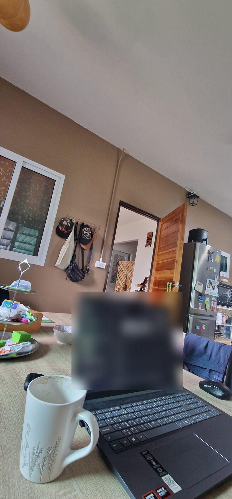
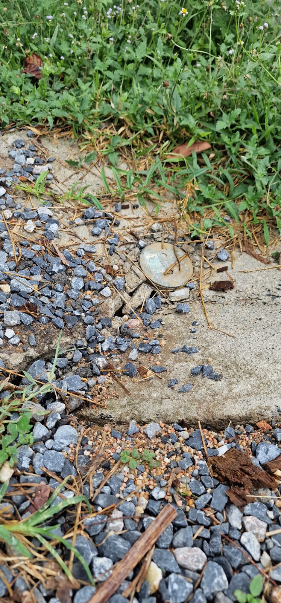
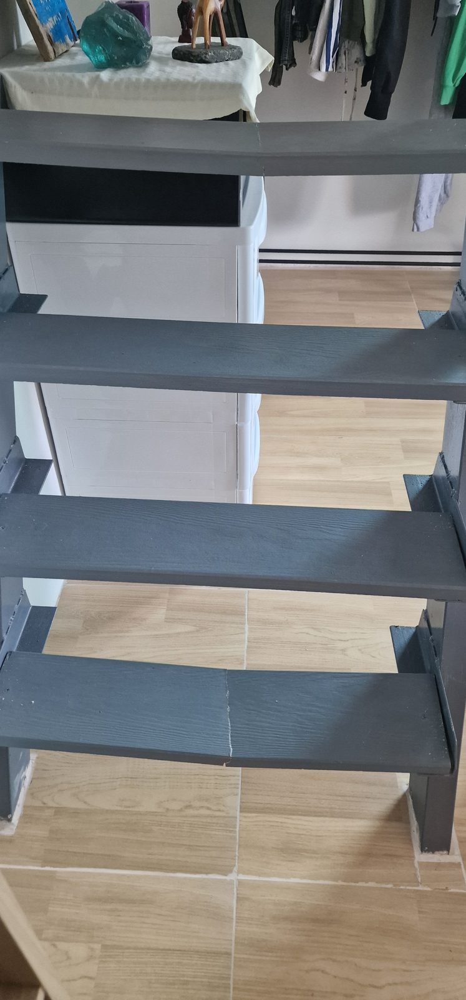

Der Schuppen war leer. Komplett leer.

Bis vor Kurzem hatten dort noch Gartengeräte, Farbeimer, Pinsel und jede Menge anderer Kram gestanden. Nicht unbedingt Dinge, die wir täglich brauchten, aber immerhin gehörten sie zur Ausstattung unseres gemieteten Hauses.

Jetzt war alles verschwunden.

Unsere Vermieterin hatte den Schuppen ausgeräumt, während wir zu Hause waren. Ohne ein Wort darüber zu verlieren. Und wir hatten davon nichts mitbekommen, obwohl sie die ganze Zeit nur ein paar Meter von uns entfernt gewesen war.

Das muss man auch erst einmal schaffen.

Allerdings war das längst nicht die erste merkwürdige Situation mit unserer thailändischen Vermieterin. Seit unserem Einzug auf Koh Samui hatten sich einige Erlebnisse angesammelt, bei denen Hagen und ich uns zunehmend fragten: Verstehen wir hier gerade etwas kulturell nicht richtig? Oder ist dieses Verhalten einfach ziemlich dreist?

## Ein neues Haus und eine ausgesprochen herzliche Vermieterin

Eigentlich hatte alles richtig gut angefangen.

Als wir unser neues Haus auf Koh Samui fanden, waren wir froh, direkt mit der Eigentümerin zu tun zu haben. Viele Mietobjekte werden hier über Makler vermittelt, sodass man die eigentlichen Vermieter manchmal überhaupt nicht kennenlernt.

Wir hatten in dieser Hinsicht bisher gute Erfahrungen gemacht. Bei unserem vorherigen Bungalow wohnten die Vermieter sogar auf demselben Gelände. Wir verstanden uns hervorragend und fühlten uns dort immer willkommen.

Unsere neue Vermieterin schien genauso unkompliziert zu sein. Sie war unglaublich freundlich, herzlich und vom ersten Moment an sehr zugewandt.

Vielleicht sogar ein bisschen zu zugewandt.

Aber wie soll man das sagen, ohne undankbar zu klingen? Da freut man sich, dass jemand so nett ist, und gleichzeitig hat man manchmal das Gefühl, dass einem diese Nähe etwas zu viel wird.

Also schoben wir solche Gedanken zunächst beiseite.

Nach dem Einzug kamen allerdings immer wieder neue Kleinigkeiten hinzu. Hier sollte noch etwas unterschrieben werden, dort wurde eine weitere Zahlung fällig. Unter anderem wollte sie eine zusätzliche Kaution und eine ausführliche Inventarliste, auf der neben sämtlichen Gegenständen auch deren Anschaffungspreise standen.

Bei einem alten, schon ziemlich verrosteten Kühlschrank fragte ich mich beispielsweise, ob wir im Falle eines Defekts tatsächlich den angegebenen Neupreis bezahlen sollten.

Laut Vermieterin natürlich nicht.

Trotzdem entstand langsam das Gefühl, dass die Bedingungen unseres Mietverhältnisses noch nicht vollständig geklärt waren, obwohl wir längst eingezogen waren.

Das größere Problem war allerdings nicht die Bürokratie.

Es war die Frage, wie viel Privatsphäre man eigentlich hat, wenn man in Thailand ein Haus mietet.

## Wenn die Vermieterin ständig vor der Tür steht

In unserem Haus hatten wir während der Trockenzeit immer wieder Probleme mit der Wasserversorgung. Teilweise mussten wir alle vier Tage einen Tankwagen bestellen, weil unser Wasser nicht ausreichte.

Eine ziemlich unangenehme Situation. Zeitweise duschten wir sogar im Fitnessstudio, um das wenige Wasser zu Hause für die wirklich notwendigen Dinge zu sparen.

Immer wenn jemand wegen des Wassers, des Internets oder einer anderen Angelegenheit kommen musste, erschien unsere Vermieterin gleich mit.

Das war anfangs nett gemeint. Zumindest gingen wir davon aus.

Allerdings kündigte sie sich häufig nicht an. Plötzlich ging das Tor auf, jemand fuhr auf den Hof und unsere Vermieterin stand mit dem nächsten Dienstleister vor unserer Tür.

Irgendwann erklärte Hagen ihr freundlich, dass sie nicht jedes Mal persönlich erscheinen müsse, wenn wir ohnehin zu Hause seien.

Wir hatten das Gefühl, dass ihr diese direkte Ansprache unangenehm war. Denn eine Sache haben wir in Thailand immer wieder erlebt: Kritik wird häufig wesentlich indirekter formuliert, als wir Deutschen das gewohnt sind.

Aber wie sollte man sonst eine Grenze setzen?

Schließlich hatten wir das Haus gemietet. Und dazu gehörte für uns auch, dass wir nicht ständig mit unangekündigtem Besuch rechnen mussten.

Wir hofften, dass sich die Situation damit erledigt hätte.

## Drei Stunden im Urlaub und schon wird das Haus kontrolliert

Ein paar Wochen später stand unser dreiwöchiger Familienurlaub in Indonesien an.

Ich liebte die vielen Pflanzen auf unserer Terrasse und hatte unserer Vermieterin auch oft erzählt, wie sehr ich mich über diesen üppig begrünten Garten freute. Wir hatten uns sogar über das Gärtnern unterhalten und sie hatte mir zusätzliche Samen mitgebracht.

Wegen der Wasserknappheit konnten wir die Pflanzen vorher kaum noch gießen. Also stellte ich die Kübel von der überdachten Terrasse auf die Wiese, damit sie bei Regen wenigstens etwas Wasser bekamen.

Vor der Abreise schickte ich unserer Vermieterin Fotos davon, wie ich die Pflanzen nach draußen gestellt hatte, damit sie während unseres Urlaubs im Regen stehen konnten. Die Bilder wären eine gute Gelegenheit für sie gewesen, zu erwähnen, dass sie während unserer Abwesenheit vorbeikommen wollte. Doch davon sagte sie nichts. Stattdessen wünschte sie uns einfach einen schönen Urlaub.

Am Freitag flogen wir los.

Und nur wenige Stunden später erhielt ich eine WhatsApp-Nachricht.

Sie wolle mich eigentlich nicht im Urlaub stören, schrieb unsere Vermieterin.

Ein Satz, bei dem ich mich grundsätzlich frage, warum man die Nachricht dann überhaupt verschickt.

Aber es wurde noch interessanter.

Sie berichtete, dass sie am Haus gewesen sei, um Gartenarbeiten zu erledigen. Dabei sei ihr aufgefallen, dass ein Fenster nicht richtig verriegelt gewesen sei.

Ihre Formulierung lautete: *While checking the house.*

Moment mal. Während sie das Haus kontrolliert hatte?

Warum kontrollierte sie überhaupt unser Haus?

Es ging übrigens nicht darum, dass wir eine Haustür sperrangelweit offen gelassen hätten. Unser Grundstück ist eingefriedet, das Tor war abgeschlossen und sämtliche Türen waren verriegelt.

Lediglich der kleine innere Verschlusshaken eines Schiebefensters war offenbar nicht umgelegt gewesen.

Wie bemerkt man so etwas von außen?

Laut ihrer Erklärung hatte sie sich beim Vorbeigehen an dem Fenster abgestützt und dabei festgestellt, dass es nicht verriegelt war.

Natürlich kann das so passiert sein. Trotzdem fühlte sich die gesamte Situation merkwürdig an.

Zusätzlich informierte sie mich über einen beschädigten Abflussdeckel, dessen Reparatur Hagen bereits anderthalb Wochen vorher angesprochen hatte.

Ich machte ihr deutlich, dass ich ihr Vorgehen nicht in Ordnung fand. Schließlich hätte es vor unserer Abreise genügend Gelegenheiten gegeben, über notwendige Arbeiten auf dem Grundstück zu sprechen.

## Nach drei Wochen war der Garten kaum wiederzuerkennen

Als wir aus Indonesien zurückkehrten, war es schon dunkel.

Ich ging auf die Terrasse und bemerkte sofort, dass irgendetwas anders aussah. Allerdings konnte ich zunächst nicht sagen, was genau mich störte.

Am nächsten Morgen war die Sache klar.

Die Pflanzen waren weg.

Nicht nur ein paar kleine Töpfe, sondern große Kübel, zahlreiche Pflanzen und sogar ein Glastisch mit einem kleinen blühenden Gewächs darauf. Alles verschwunden.

Aus dem zuvor dicht begrünten Außenbereich war eine ziemlich kahle Terrasse geworden.

Dafür stand das Gras kniehoch. Von den angeblichen Gartenarbeiten, wegen derer unsere Vermieterin während unseres Urlaubs auf dem Grundstück gewesen war, konnten wir nichts erkennen.

Ich schrieb ihr und fragte, ob sie die Pflanzen und den Tisch mitgenommen habe oder ob etwa jemand eingebrochen sei.

Ein bisschen Provokation konnte ich mir inzwischen nicht mehr verkneifen.

Sie bestätigte, dass sie die Sachen abgeholt habe. Leider habe sie vergessen, mir Bescheid zu sagen, weil sie so beschäftigt gewesen sei.

Und überhaupt sei es doch eigentlich viel besser für mich. Jetzt hätte ich schließlich mehr Platz und könnte mich freier entfalten.

Ich wusste nicht, was ich darauf antworten sollte.

Diese Frau wusste ganz genau, wie sehr ich mich über unseren Garten gefreut hatte. Sie hatte mir selbst Pflanzen und Samen gebracht. Und nun räumte sie die Terrasse leer und erklärte mir anschließend, dass das für mich doch viel schöner sei?

Das Problem war für mich nicht einmal, dass sie ihre Pflanzen zurückhaben wollte. Darüber hätten wir jederzeit sprechen können.

Es war diese Selbstverständlichkeit, mit der sie etwas veränderte, das inzwischen zu unserem Zuhause gehörte.

Ich beschloss, auf ihre Nachricht nicht mehr zu reagieren. Manchmal ist Schweigen vermutlich die bessere Wahl, bevor man etwas schreibt, das man später bereut.

## Die Treppenreparatur und der verschwundene Schuppen

Einige Tage später gab es den nächsten Vorfall.

Heinrich fiel auf einer steilen Treppe im Haus hinunter, wobei zwei Stufen durchbrachen. Wir informierten unsere Vermieterin, die mit zwei weiteren Personen vorbeikam, um sich den Schaden anzusehen.

Am nächsten Tag sollten die Stufen repariert werden.

Während oben gearbeitet wurde, saßen Hagen und ich unten an unseren Computern. Die Kinder waren ebenfalls im Haus.

Alles schien ganz normal zu laufen.

Bis Hermine plötzlich sagte, dass unsere Vermieterin schon wieder eine Pflanze mitnehmen würde.

Ich hielt das zunächst für einen Scherz. Inzwischen war das bei uns beinahe ein Running Gag geworden.

Aber Heinrich bestätigte es.

Also ging ich zur Glastür und sah tatsächlich, wie unsere Vermieterin gerade eine weitere Pflanze auf ihren Pick-up lud.

Diesmal platzte mir der Kragen.

Ich ging hinaus und fragte, warum sie erneut etwas mitnehmen würde, ohne vorher mit uns zu sprechen.

Ihre erste Erklärung: Die Pflanze brauche Wasser.

Wir befanden uns mitten in der Regenzeit. Es regnete nahezu täglich und die besagte Pflanze stand draußen auf der Wiese.

Mit Wassermangel hatte sie ganz sicher nicht zu kämpfen.

Dann sollte die Pflanze plötzlich geteilt werden.

Was auch immer der tatsächliche Grund war: Warum konnte man das nicht einfach vorher besprechen?

Hagen kam schließlich dazu und versuchte, die Situation zu beruhigen. Die Pflanze wurde wieder abgeladen.

Kurz darauf fragte unsere Vermieterin allerdings, ob sie noch etwas aus dem Schuppen holen dürfe.

Auch Hagen wurde jetzt deutlich. Er erklärte ihr, dass sie sich bitte ein für alle Mal überlegen solle, welche ihrer Sachen sie noch benötige, statt ständig vorbeizukommen und etwas mitzunehmen.

Sie fuhr schließlich weg.

Erst danach schauten wir in den Schuppen.

Und da standen wir nun vor diesem vollständig ausgeräumten Raum.

Während einer der Männer die Treppe repariert hatte, musste unsere Vermieterin offenbar immer wieder Gegenstände zum Auto getragen haben. Wir hatten es schlichtweg nicht bemerkt.

Sie hatte also um Erlaubnis gefragt, noch etwas aus dem Schuppen zu holen, nachdem sie ihn bereits leergeräumt hatte.

Auf diese Idee muss man auch erst einmal kommen.

## Wem gehören die Dinge in einem möblierten Mietshaus?

Natürlich gehören die Pflanzen, Möbel und Gartengeräte unserer Vermieterin. Das haben wir nie infrage gestellt.

Aber wenn ich ein vollständig möbliertes Haus miete, gehe ich doch davon aus, dass die vorhandene Ausstattung für die Dauer des Mietverhältnisses grundsätzlich dazugehört.

Ich würde auch nicht auf die Idee kommen, meinen Mietern nach zwei Monaten die Terrassenstühle wegzunehmen, nur weil ich sie gerade selbst gebrauchen könnte.

Und genau darum ging es uns.

Nicht um den materiellen Wert einer Pflanze oder eines alten Farbeimers. Sondern um das Gefühl, dass wir in unserem eigenen Zuhause jederzeit damit rechnen mussten, dass plötzlich wieder etwas verschwindet.

Nach unserem Streit entschuldigte sich die Vermieterin dafür, dass sie uns respektlos behandelt habe. Auch wir entschuldigten uns für unseren schärferen Ton, denn natürlich wollten wir das Verhältnis nicht dauerhaft belasten.

Ihre abschließende Lösung war allerdings bemerkenswert: Beim nächsten Mal würde sie uns vorher Bescheid sagen, wenn sie etwas abholen wolle.

Beim nächsten Mal?

Offenbar hatten wir nach wie vor unterschiedliche Vorstellungen davon, was es bedeutet, ein Haus zu vermieten.

## Ist das in Thailand normal?

Genau diese Frage beschäftigt mich an der gesamten Geschichte am meisten.

Wir leben nicht zum ersten Mal in Thailand und haben bereits bei mehreren thailändischen Vermietern gewohnt.

Unsere Erfahrungen waren bisher vollkommen anders.

Bei unserem vorherigen Bungalow wohnten die Eigentümer sogar direkt nebenan. Trotzdem kamen sie nie einfach zu uns auf die Terrasse. Wenn sie etwas wollten, blieben sie unten stehen und riefen nach uns.

Einmal wollten wir uns einen anderen, gerade nicht bewohnten Bungalow ansehen. Obwohl die Vermieter einen Schlüssel hatten, erklärten sie uns, dass sie uns ohne Zustimmung des Mieters nicht hineinlassen könnten.

Das war für sie selbstverständlich.

Auch unsere thailändische Freundin Nana, der wir die Geschichte erzählten, fand das Verhalten unserer jetzigen Vermieterin ungewöhnlich.

Deshalb fällt es mir schwer, die Vorfälle einfach unter kulturellen Unterschieden abzuhaken.

Natürlich gibt es unterschiedliche Vorstellungen von Höflichkeit, persönlicher Nähe und direkter Kommunikation. Und selbstverständlich kann man nicht von wenigen Erfahrungen auf eine ganze Gesellschaft schließen.

Aber unabhängig davon, ob jemand aus Thailand, Deutschland oder sonst woher kommt, sollte man doch miteinander sprechen können, bevor man die Ausstattung eines vermieteten Hauses verändert.

Vielleicht ist unsere Vermieterin einfach ein Mensch, der schwer loslassen kann. Vielleicht betrachtet sie das Grundstück weiterhin als ihren ganz persönlichen Bereich. Vielleicht haben wir tatsächlich unterschiedliche Erwartungen an ein Mietverhältnis.

Was auch immer dahintersteckt: Wir wohnen hier. Und wir möchten uns zu Hause fühlen, ohne ständig neue Überraschungen zu erleben.

Immerhin hat unsere Vermieterin inzwischen versprochen, sich künftig anzukündigen.

Ich bin gespannt.

Viel steht draußen inzwischen ohnehin nicht mehr herum. Allerdings gibt es noch einige Pflanzen im Boden, und die Terrassenmöbel sind auch noch da.

Es bleibt also spannend.

**Und jetzt interessiert mich deine Meinung:** Haben wir überreagiert? Würdest du das Verhalten unserer Vermieterin als kulturellen Unterschied betrachten oder findest du es genauso merkwürdig wie wir? Vielleicht hast du selbst schon einmal etwas Ähnliches erlebt.

In der passenden Folge von *DLIZKFI – Das Leben ist zu kurz für irgendwann* erzähle ich die ganze Geschichte noch ausführlicher. Mit weiteren Details zu unseren Erlebnissen, der Kommunikation mit unserer Vermieterin und unseren bisherigen Erfahrungen mit dem Mieten in Thailand.

Du findest den Podcast auf [Spotify](https://open.spotify.com/show/0m7DHiEhXuUZJPDkmtmWb0), [Apple Podcasts](https://podcasts.apple.com/us/podcast/dlizkfi-das-leben-ist-zu-kurz-f%C3%BCr-irgendwann/id1821004400) und [YouTube](https://www.youtube.com/@DLIZKFIPodcast).
