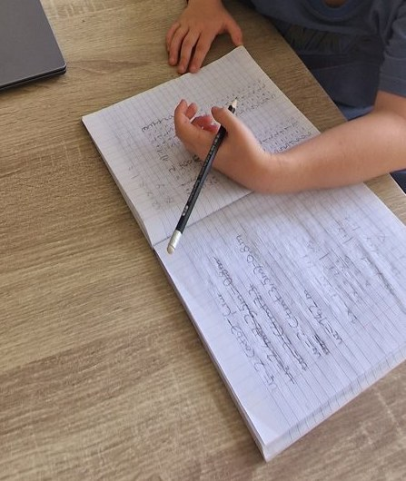
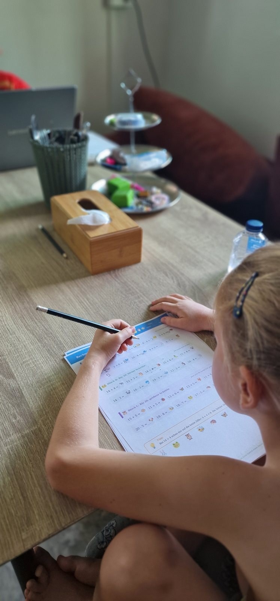
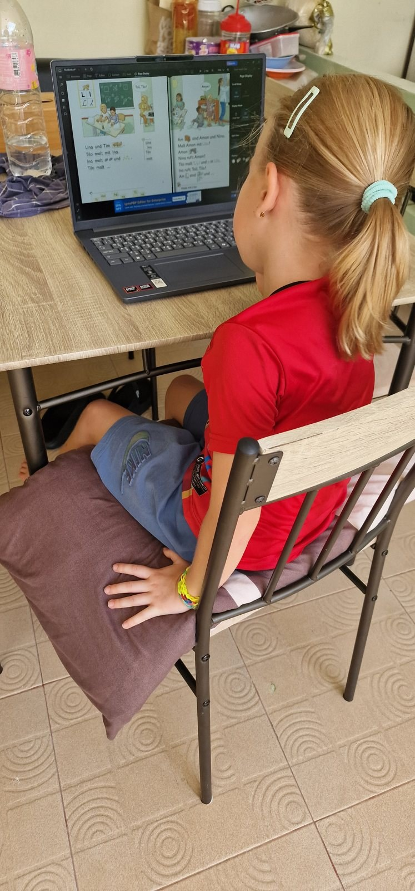
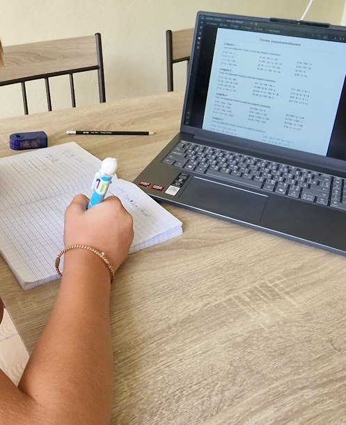

600 Baht hat Hermine inzwischen von ihrem Taschengeld gespart. Als sie sich neulich etwas für 200 Baht bestellen wollte, habe ich ihr erklärt, was es kostet. Daraufhin fing sie an, leise vor sich hinzurechnen: „Sechs minus zwei sind vier. Dann habe ich noch 400 Baht übrig.“

Eigentlich keine besonders aufregende Situation. Allerdings ist Hermine gerade erst sieben Jahre alt geworden und tut sich mit Mathe bisher eher schwer. Zumindest haben wir das immer gedacht.

In diesem Moment hat sie aber ganz selbstverständlich eine Aufgabe im Hunderterbereich gelöst. Sie hat erkannt, dass sie von ihren 600 Baht 200 abziehen muss, die Rechnung für sich vereinfacht und das Ergebnis anschließend wieder auf die ursprüngliche Größenordnung übertragen.

Und ich dachte nur: Warum sagen wir eigentlich ständig, dass ihr Mathe schwerfällt?

Es sind solche Situationen, die mich in den vergangenen Monaten beim Thema Schule und Lernen immer wieder zum Nachdenken gebracht haben. Denn seit wir mit unseren Kindern in Thailand leben, sieht ihr Schulalltag ziemlich anders aus als das, was wir aus Deutschland kennen.

Heinrich geht inzwischen seit über einem Jahr nicht mehr zur Schule. Hermine wäre gerade in die erste Klasse gekommen. Stattdessen lernen beide bei uns zu Hause, wobei Hagen inzwischen den größten Teil des Unterrichts übernommen hat.

Und auch wenn wir mittlerweile einen ganz guten Rhythmus gefunden haben, ist unser Homeschooling längst kein fertiges Konzept, das wir uns einmal überlegt haben und seitdem konsequent durchziehen. Wir probieren aus, verändern Dinge und stellen immer wieder fest, dass unsere beiden Kinder völlig unterschiedlich lernen.

## Ein Jahr ohne Schule – und Heinrich will immer noch nicht zurück

Als das neue Schuljahr in Mecklenburg-Vorpommern begonnen hat, war das für uns ein guter Anlass, einmal zu schauen, wie sich die Einstellung unserer Kinder zur Schule eigentlich entwickelt hat.

Heinrich hat vier Jahre lang eine Grundschule in Deutschland besucht. Schon während dieser Zeit hatte er wenig Freude am klassischen Schulunterricht. Und daran hat sich auch nach über einem Jahr ohne Schulbesuch nicht besonders viel geändert.

Als ich ihn gefragt habe, ob er inzwischen vielleicht wieder mehr Lust auf Schule hätte, war seine Antwort ziemlich eindeutig: Nein. Ein bisschen besser sei es zwar geworden, aber besonders Mathe und Deutsch stehen nach wie vor nicht weit oben auf seiner Beliebtheitsskala.

Das Interessante ist, dass Heinrich überhaupt kein Kind ist, das sich nicht für neue Dinge interessiert. Ganz im Gegenteil. Er hat unglaublich viele Fragen, möchte wissen, wie Sachen funktionieren, und bringt sich ständig irgendetwas bei.

Er nimmt Dinge auseinander, baut sie wieder zusammen, experimentiert mit Batterien und Kabeln und beschäftigt sich mit allem Möglichen, was ihn gerade interessiert. Auch Keyboardspielen hat er sich selbst beigebracht, hauptsächlich mithilfe von YouTube-Videos.

Einen Klavierlehrer wollte er dagegen nie haben. Denn dann müsste er zu einer festgelegten Uhrzeit zum Unterricht erscheinen und womöglich Stücke üben, die ihn überhaupt nicht interessieren.

Genau darin liegt für ihn der Unterschied zwischen Lernen und Schule.

Wenn Heinrich etwas wissen oder können möchte, beschäftigt er sich gerne damit. Wenn jemand anderes entscheidet, dass jetzt eine halbe Stunde Mathe auf dem Programm steht, ist seine Begeisterung dagegen ziemlich überschaubar.

Er bezeichnet seine bevorzugte Art zu lernen selbst als „Learning by doing“. Und das beschreibt es wirklich gut.

Bei Hermine ist die Situation ganz anders. Sie war bisher noch nie in einer Schule und hätte durchaus Lust, einmal zu erleben, wie das eigentlich ist. Besonders schön fände sie es, gemeinsam mit ihren früheren Kindergartenfreunden in eine Klasse zu gehen.

Dass sie nun in Thailand zu Hause lernt, findet sie aber ebenfalls in Ordnung. Vor allem das Lesen macht ihr inzwischen richtig Spaß. Mathe dagegen eher weniger. Besonders Minusaufgaben sind aus ihrer Sicht ziemlich anstrengend.

## Drei Monate Homeschooling – und Hermine liest ihr erstes Buch

Seit ungefähr drei Monaten haben wir bei uns eine feste Lernstruktur. Besonders bei Hermine sehen wir dadurch enorme Fortschritte, weil sie praktisch bei den Grundlagen angefangen hat.

Inzwischen setzt sie sich ganz alleine mit einem Buch hin und liest. Natürlich noch so, wie Kinder am Anfang eben lesen: Sie setzt die einzelnen Buchstaben zusammen, spricht die Wörter laut aus und wiederholt anschließend den ganzen Satz, wenn sie ihn verstanden hat.

Ihr erstes Buch hat sie mittlerweile komplett durchgelesen.

Was ich besonders interessant finde, ist ihre eigene Motivation. Wenn ihr langweilig ist, nimmt sie manchmal einfach ihr Erstlesebuch mit dem Tiptoi-Stift und beschäftigt sich damit. Sie freut sich darüber, neue Buchstaben und Wörter kennenzulernen, und verwendet manches davon später sogar in den Geschichten, die sie sich beim Spielen ausdenkt.

Dazu kommt, dass Hermine unglaublich ehrgeizig ist.

Das beobachten wir nicht nur beim Lesen, sondern genauso beim Sport, beim Schwimmen und bei vielen anderen Dingen. Wenn sie etwas können möchte, übt sie so lange, bis es funktioniert. Und wenn sie dann merkt, dass sie Fortschritte macht, ist sie wahnsinnig stolz auf sich.

Heinrich ist da ganz anders. Ihm fallen viele Dinge relativ leicht. Das war eigentlich schon immer so. Dafür hat er wenig Lust, sich mit etwas länger zu beschäftigen, das nicht sofort funktioniert oder ihn nicht besonders interessiert.

In seiner früheren Schule gab es durch das altersübergreifende Unterrichtskonzept ziemlich viele Freiheiten. Die Kinder konnten beispielsweise an unterschiedlichen Orten arbeiten oder sich in andere Räume zurückziehen. Für manche ist das sicherlich wunderbar. Heinrich hatte dadurch allerdings auch viele Möglichkeiten, sich mit Dingen zu beschäftigen, die gerade nicht auf dem Lernplan standen.

Heute merken wir, dass ihm beim konzentrierten Lernen eine klare Struktur und die direkte Begleitung guttun. Und genau das kann Hagen ihm zu Hause bieten.

## Warum Hagen inzwischen unser Lehrer ist

Anfangs haben wir versucht, uns den Unterricht aufzuteilen. Mal hat Hagen mit einem Kind gearbeitet, mal ich. Allerdings haben wir relativ schnell festgestellt, dass ich dafür deutlich weniger Geduld mitbringe.

Ich kann mich bei solchen Dingen einfach wahnsinnig schnell aufregen. Gerade wenn ich etwas erkläre, das mir vollkommen logisch erscheint, und das Kind versteht es trotzdem nicht, fällt es mir schwer, geduldig zu bleiben.

Ich glaube, damit bin ich nicht alleine. Wer schon einmal mit seinen Kindern Hausaufgaben gemacht hat, kennt das vielleicht.

Hagen geht damit erstaunlich gelassen um. Er hat tatsächlich Freude daran, den Kindern etwas beizubringen, und findet es spannend, ihre Fortschritte zu beobachten. Besonders wenn Hermine etwas Neues verstanden hat und sich über ihren eigenen Erfolg freut, macht ihm das richtig Spaß.

Deshalb hat er den Unterricht inzwischen weitgehend übernommen.

Unser Ablauf ist relativ einfach: An jedem Lerntag beschäftigt sich Hagen intensiv mit einem der beiden Kinder. In der Regel sind das zweimal ungefähr 30 Minuten, unterbrochen von einer Pause von zehn bis zwanzig Minuten. Am nächsten Tag ist das andere Kind dran.

Das Kind, das gerade keinen direkten Unterricht mit Hagen hat, beschäftigt sich beispielsweise mit Aufgaben in der Anton-App oder anderen vorbereiteten Lerninhalten.

Der große Vorteil liegt für uns darin, dass Hagen sich während dieser Zeit vollständig auf ein Kind konzentrieren kann. Er sieht sofort, ob etwas verstanden wurde, wo noch Schwierigkeiten bestehen und wann es sinnvoll ist, zu einem anderen Thema zu wechseln.

Dabei wird auch nicht jeden Tag starr dasselbe Programm abgearbeitet. Mit Heinrich macht er beispielsweise Mathematik aus verschiedenen Klassenstufen, von Prozentrechnung und Dreisatz bis zu ersten algebraischen Aufgaben. Dazu kommen Rechtschreibung oder englische Texte über Themen, die Heinrich interessieren, etwa das alte Ägypten, Pompeji oder Ötzi.

Natürlich bedeutet das auch, dass Hagen sich selbst mit manchen Dingen erst wieder beschäftigen muss. Gerade in Mathematik ist schließlich einiges dabei, was man seit der eigenen Schulzeit nicht mehr gebraucht hat.

## Wie viel Schule braucht ein Kind eigentlich?

Die ungefähr 60 Minuten Lernzeit haben wir übrigens nicht aufgrund irgendeiner pädagogischen Studie festgelegt.

Als wir vor einigen Jahren bereits ein Jahr in Thailand gelebt haben, war Heinrich damals für diesen Zeitraum von seiner deutschen Schule beurlaubt. Wir hatten seine Schulhefte mitgenommen und uns vorgenommen, jeden Tag ungefähr eine Stunde mit ihm daran zu arbeiten.

Bei unserem jetzigen Homeschooling sind wir dann mehr oder weniger automatisch wieder bei dieser Größenordnung gelandet.

Hagen ist inzwischen davon überzeugt, dass diese Zeit für unsere Kinder ausreicht. Seine Begründung: Beim Einzelunterricht fallen viele Dinge weg, die in einer normalen Schulklasse Zeit kosten. Er kann sofort auf die jeweiligen Schwierigkeiten eingehen und muss nicht warten, bis eine ganze Klasse bereit für das nächste Thema ist.

Ich finde das durchaus nachvollziehbar. Gleichzeitig ist es natürlich unsere persönliche Einschätzung anhand der Fortschritte, die wir bei den Kindern beobachten. Einen direkten Vergleich mit einem vollständigen Schultag kann man daraus nicht einfach ableiten.

Viel spannender finde ich ohnehin die Frage, was unsere Kinder außerhalb dieser Unterrichtszeit lernen.

Denn nur weil jemand nicht in einem Klassenzimmer sitzt, bedeutet das ja nicht, dass er den Rest des Tages nichts dazulernt.

## Warum wir freies Lernen trotzdem nicht einfach laufen lassen

Am Anfang unserer Zeit ohne Schule hatten wir uns stärker mit dem Gedanken beschäftigt, dass Heinrich selbstbestimmt lernen könnte. Schließlich ist er unglaublich wissbegierig und bringt sich schon viele Dinge alleine bei.

Allerdings mussten wir feststellen, dass er sich dabei vor allem mit den Themen beschäftigt, die ihm ohnehin Spaß machen.

Er kann beispielsweise handwerklich wahnsinnig viel, hat tolle kreative Ideen und versteht technische Zusammenhänge oft erstaunlich schnell. Aber sich von sich aus hinzusetzen und Rechenaufgaben zu lösen oder an seiner Rechtschreibung zu arbeiten, gehört nicht zu seinen bevorzugten Beschäftigungen.

Und genau da kommen wir als Eltern ins Spiel.

Denn so sehr ich dafür bin, dass Kinder ihre eigenen Interessen entdecken und verfolgen können, finde ich es trotzdem wichtig, dass sie gewisse Grundlagen beherrschen.

Lesen, Schreiben und Rechnen gehören für uns dazu. Genauso die Fähigkeit, sich mit Dingen auseinanderzusetzen, die vielleicht nicht auf Anhieb Spaß machen oder die man nicht sofort versteht.

Gerade beim Thema künstliche Intelligenz diskutieren Hagen und ich darüber häufiger. Wir wissen schließlich überhaupt nicht, welche Berufe unsere Kinder später einmal ausüben werden und wie viel Arbeit bis dahin von KI übernommen wird.

Trotzdem erleben wir selbst regelmäßig, dass KI auch falsche Antworten liefert. Und wenn man keinerlei Grundwissen besitzt, kann man solche Fehler kaum erkennen.

Wir sehen deshalb durchaus einen Sinn darin, weiterhin Kopfrechnen zu üben, handschriftlich zu schreiben und bestimmte Zusammenhänge selbst zu verstehen. Auch wenn die Kinder später vermutlich viele dieser Aufgaben mit dem Computer erledigen werden.

Das bedeutet nicht, dass wir digitale Hilfsmittel ablehnen. Ganz im Gegenteil.

## KI als Unterstützung beim Homeschooling

Hagen nutzt inzwischen regelmäßig KI, um die Unterrichtsinhalte vorzubereiten.

Für jedes Kind hat er einen eigenen Chat angelegt, in dem die bisherigen Lerninhalte und Fortschritte festgehalten werden. So kann er überlegen, welche Themen als Nächstes sinnvoll wären, sich Aufgaben erstellen lassen und die Unterrichtsstunden vorbereiten.

Dafür sitzt er häufig morgens beim Frühstück am Computer und plant den Tag. Ungefähr eine halbe Stunde Vorbereitungszeit kommt zum eigentlichen Unterricht oft noch dazu.

Mit Heinrich lässt er beispielsweise englische Texte erstellen, die sie anschließend gemeinsam übersetzen. Dabei wählt er bewusst Themen, für die sich Heinrich interessiert. Bei Hermine achtet er darauf, Lesen und Mathematik so abzuwechseln, dass sie einerseits Fortschritte macht und andererseits nicht völlig die Lust verliert.

Denn auch das ist schon vorgekommen. Wenn Hermine bei Mathe Schwierigkeiten hat und man deshalb immer wieder dieselben Aufgaben mit ihr übt, ist irgendwann einfach die Motivation weg.

Hagen findet es deshalb wichtig, den Kindern regelmäßig Erfolgserlebnisse zu ermöglichen.

Er sagt allerdings auch, dass man das Unterrichten selbst erst lernen muss. Einen guten Überblick über die Fähigkeiten der Kinder zu behalten, die richtigen Aufgaben auszuwählen und Dinge verständlich zu erklären, ist schließlich nicht automatisch einfach, nur weil man die Inhalte selbst beherrscht.

Und KI nimmt ihm diese Verantwortung nicht ab. Sie hilft ihm bei der Vorbereitung, ersetzt aber nicht das gemeinsame Lernen.

## Englisch lernen, ohne Englischunterricht zu haben

Eine der größten Veränderungen beobachten wir beim Englisch.

Hermine kann sich inzwischen mit anderen Kindern auf Englisch unterhalten, obwohl sie nie klassischen Englischunterricht hatte. Die Sprache begegnet ihr einfach ständig im Alltag. Beim Sport, beim Spielen mit anderen Kindern und in Gesprächen mit Menschen aus unterschiedlichen Ländern.

Sie hört zu, versteht bestimmte Wörter aus dem Zusammenhang und probiert sie irgendwann selbst aus. Wenn beim Versteckspielen alle Englisch sprechen, wird eben auch auf Englisch gespielt.

Heinrich hatte bereits in Deutschland Englischunterricht. Dort ging es allerdings vor allem um einzelne Vokabeln und bestimmte Themen. Wirklich unterhalten hat er sich damals auf Englisch kaum.

Inzwischen versteht er die Sprache ziemlich gut. Beim eigenen Sprechen ist er manchmal noch etwas unsicher, aber die Verständigung mit anderen Kindern funktioniert.

Das erinnert mich an meine eigene Schulzeit. Ich hatte nach 13 Jahren Schule zwar Englisch gelernt, aber fließend gesprochen habe ich die Sprache danach trotzdem nicht. Das kam erst durch meine Reisen.

Mein Bruder hat uns bei seinem Besuch auf Koh Samui sogar darum beneidet, wie selbstverständlich unsere Kinder Englisch im Alltag lernen können.

Wir versuchen solche Gelegenheiten auch bewusst zu nutzen. Als wir beispielsweise in Vietnam unterwegs waren, habe ich Heinrich im Restaurant die englische Speisekarte vorlesen und übersetzen lassen. Man wartet sowieso auf sein Essen, und zehn Minuten später hat das Kind ganz nebenbei wieder etwas geübt.

Ähnlich läuft es beim Einkaufen. Wenn die Kinder mit 100 oder 200 Baht zum 7-Eleven gehen, können wir anschließend gemeinsam überlegen, was sie bezahlt haben und wie viel Wechselgeld zurückgekommen ist.

Und manchmal, wie bei Hermines 600 Baht Taschengeld, merken wir dabei, dass die Kinder längst mehr verstanden haben, als wir ihnen bei einer klassischen Schulaufgabe vielleicht zugetraut hätten.

## Homeschooling bedeutet auch, die Kinder den ganzen Tag um sich zu haben

Bei all den positiven Erfahrungen darf man einen Punkt allerdings nicht vergessen: Unsere Art zu leben verlangt uns als Eltern einiges ab.

Die Kinder gehen morgens nicht in die Schule und kommen erst am Nachmittag zurück. Sie sind den ganzen Tag Teil unseres Alltags, und wir müssen uns nicht nur um die Lerninhalte kümmern, sondern auch um ihre Beschäftigung, ihre Bedürfnisse und all die kleinen und großen Themen, die zwischendurch auftauchen.

Wir haben hier auf Koh Samui auch andere Familien kennengelernt, deren Kinder ganz normal eine internationale Schule besuchen. Das ist natürlich ebenfalls eine Möglichkeit und für viele Eltern vermutlich die praktischere Lösung.

Häufig wird dabei auch das Thema soziale Kontakte angesprochen. Das können wir grundsätzlich gut nachvollziehen. Bei uns ist es allerdings bisher kein Problem, weil Heinrich und Hermine vier- bis fünfmal pro Woche beim Sport sind. Dort treffen sie Kinder unterschiedlichen Alters und aus verschiedenen Ländern. Sie trainieren gemeinsam, spielen, streiten sich auch mal und lernen, sich auf andere einzustellen.

Dazu kommen die Kinder unserer Freunde, mit denen wir uns regelmäßig treffen.

Wir haben deshalb bisher nicht das Gefühl, dass ihnen durch den fehlenden Schulbesuch soziale Kontakte fehlen.

Trotzdem muss man als Eltern natürlich bereit sein, sehr viel Zeit mit seinen Kindern zu verbringen. Und gerade das aktive Begleiten ihrer Entwicklung ist etwas anderes, als ihnen lediglich eine Beschäftigung zu organisieren.

Mir ist inzwischen noch einmal bewusster geworden, wie viel Arbeit tatsächlich dahintersteckt. Vielleicht auch deshalb, weil ich sehe, wie geduldig Hagen sich jeden Tag mit unseren Kindern beschäftigt und wie viel Freude er daran hat.

## Unser Homeschooling ist noch lange nicht fertig entwickelt

Wenn ich heute auf unser erstes Jahr ohne deutsche Schule schaue, dann ist unsere wichtigste Erkenntnis eigentlich, dass wir immer noch dabei sind herauszufinden, was für uns am besten funktioniert.

Wir haben verschiedene Lernmethoden ausprobiert, digitale Programme getestet und festgestellt, dass freies Lernen allein für unsere Kinder nicht unbedingt die richtige Lösung ist. Gleichzeitig sehen wir jeden Tag, wie viel sie außerhalb unserer festgelegten Unterrichtszeit lernen.

Vor allem aber merken wir, wie unterschiedlich Heinrich und Hermine sind. Was den einen motiviert, interessiert den anderen überhaupt nicht. Während Heinrich am liebsten praktisch arbeitet und seine eigenen Themen verfolgt, kann Hermine sich mit viel Ehrgeiz durch eine Aufgabe arbeiten und freut sich unglaublich über ihre Fortschritte.

Unser Modell wird sich deshalb vermutlich auch weiterhin verändern. Je älter die Kinder werden, desto mehr werden wir ausprobieren und neu entscheiden müssen.

Für den Moment funktioniert diese Mischung aus gezieltem Unterricht, eigenständigem Lernen und einem Alltag voller neuer Erfahrungen für uns ziemlich gut.

Und wenn ich Hermine dabei beobachte, wie sie selbstständig ihr Buch liest, oder Heinrich wieder irgendetwas auseinanderbaut, weil er unbedingt verstehen möchte, wie es funktioniert, dann finde ich es spannend zu sehen, auf wie vielen unterschiedlichen Wegen Kinder lernen können.

**Wenn du noch genauer wissen möchtest, wie unser Homeschooling auf Koh Samui funktioniert, dann hör unbedingt in die dazugehörige Folge von „DLIZKFI – Das Leben ist zu kurz für irgendwann“ rein.** Diesmal erzählen Hagen, Heinrich und Hermine selbst, wie sie unseren Lernalltag erleben, was ihnen Spaß macht und worauf sie überhaupt keine Lust haben. Die vollständige Folge findest du auf Spotify, Apple Podcasts und YouTube.
