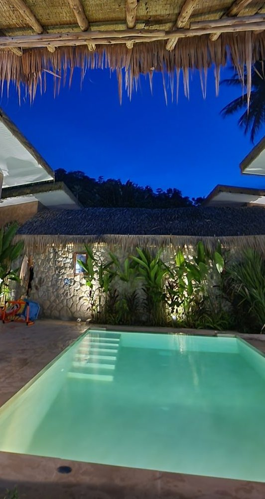
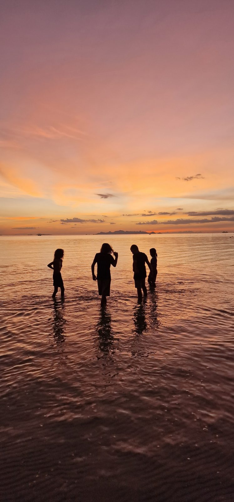
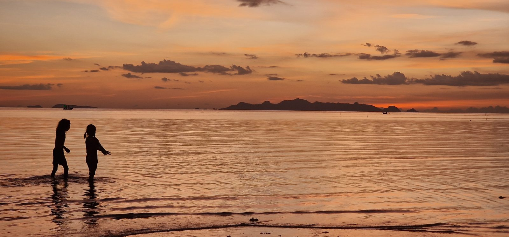
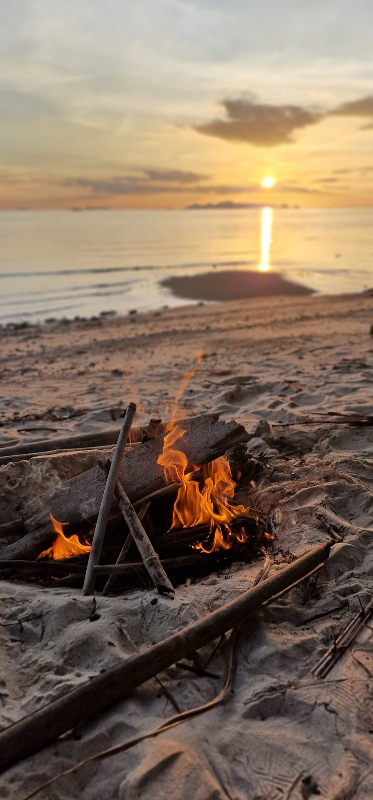

Ich muss mal was zum Thema Kindergeburtstag loswerden. Diese Woche hat Heinrich seinen Geburtstag mit seinen Freunden nachgefeiert. Und in derselben Woche ist das Kind einer Sportkollegin drei geworden, ich habe ein Video von der Party gesehen. Und da ist es mir wieder aufgegangen, wie hier eigentlich Geburtstage gefeiert werden. Und wie komplett anders das ist als das, was ich von früher kenne.

## Früher war Topfschlagen

Ich finde ja, in Deutschland ist es auch schon krass geworden. Wenn man das mit Geburtstagen aus unserer Zeit vergleicht, als wir Kinder waren. Heute hat man das Gefühl, dass immer irgendwas Krasses passieren muss. Eine krasse Aktivität, irgendeine Besonderheit, ein Motto.

Klar, Heinrich ist jetzt zu alt für Topfschlagen. Aber selbst in Hermines Alter: Wenn die Kinder einfach nach Hause kommen und man ein paar Spiele spielt, Topfschlagen oder Schokolade in Zeitungspapier auspacken mit Handschuhen, dann hat man heute irgendwie das Gefühl, das ist nicht mehr zeitgemäß. Öde, langweilig, keine Ahnung was.

Und dann die Giveaways. Bevor wir Kinder hatten, wusste ich gar nicht, dass die Gäste auf einem Kindergeburtstag auch ein Geschenk mitbekommen. Ich komme ja aus der Veranstaltungsbranche. Ich kenne Giveaways von den Schiffstaufen von AIDA, da gab es einen eigenen Verantwortlichen nur dafür. Das war eine große Nummer. Aber auf einem Kindergeburtstag fand ich das anfangs schon etwas seltsam. Man macht es dann trotzdem mit. Weil man nicht möchte, dass sich das eigene Kind schlecht fühlt.

## Auf Koh Samui ist es eine ganz andere Liga

Hier auf Koh Samui, also bei uns Ausländern, wird ein Kindergeburtstag so gefeiert, wie man in Deutschland vielleicht eine Konfirmation, eine Jugendweihe oder sogar eine Hochzeit feiert. Beachclub oder Hotelanlage mit Pool gemietet, Buffet, übelste Luftballon-Arrangements, und eingeladen ist die komplette Klasse mitsamt Eltern. Auch, wenn das Kind gerade drei wird.

Es gibt ein Thüringer Wort dafür: bombfortionös. Also übelster Aufriss.

Wie absurd das werden kann, hat mir neulich ein Reel auf Instagram gezeigt. Eine Mutter filmt eine fertig vorbereitete Party, alles dekoriert, Hüpfburg und allem Pipapo. Und schreibt drunter: Wir haben die ganze Klasse eingeladen, aber keiner ist gekommen. Hier ist unsere Adresse, wer aus der Nachbarschaft Zeit hat, kommt bitte vorbei, mein Kind ist so traurig. Das Video war aus den USA, aber so anders ist es hier nicht. Ich folge im Internet auch einer Mutter, die in Dubai lebt. Da ist jeder Geburtstag eine Motto-Party, das Haus wird nach dem Motto geschmückt, die Gäste kommen verkleidet, das Essen passt zum Motto. Und das schon im Kleinkindalter.

Wir waren in dem Jahr, als wir schon mal hier gelebt haben, selbst auf so einer Party. Ein Deutscher, den wir hier kennengelernt haben, hatte für seine Tochter einen Beachclub gemietet. Irgendwann haben wir ihn gefragt, wer die ganzen Leute sind. Seine Antwort: Keine Ahnung, die habe ich noch nie gesehen.

Und dahinter steckt ein ganz schöner Druck. Fast alle Ausländerkinder hier gehen auf Privatschulen. In diesen Klassenverbänden macht man die große Party, weil alle sie machen. Man will nicht die Familie sein, die nicht die ganze Klasse einlädt. Die anderen würden sich auf den Schlips getreten fühlen, obwohl manche sowieso nicht kommen würden, weil sie von den 19 anderen Geburtstagen im Jahr schon super genervt sind.

## Wer es sich leisten kann, soll es machen?

Klar kann man sagen: Wenn die sich das leisten können, sollen sie es doch machen. Aber so einfach ist es aus meiner Sicht nicht.

Erstens die Kinder selbst. Gerade für ganz kleine Kinder ist das doch völlig überfordernd. Schon beim ganz normalen Geschenkeauspacken merkt man ja, dass das eigentlich viel zu viel ist. Die können das gar nicht alles verarbeiten. Und dann wird noch was unternommen, und tausend Stationen, und super viele Leute. Danach sind die total durch.

Zweitens das Geld. Die Privatschulen hier sind nicht geschenkt, ich glaube, das geht irgendwo bei 650 Euro im Monat los. Vielleicht kann sich eine Familie das gerade so leisten, hat aber eigentlich nicht die Kohle, auch noch für ein, zwei oder drei Kinder im Jahr so eine Party auszurichten. Und macht es trotzdem.

Denn bei solchen Sachen geht es ja nie um einen selbst. Als Erwachsener würde ich mich vielleicht mit meinem Selbstwertgefühl dagegenstellen und sagen: Ich brauche das nicht. Aber man möchte nicht, dass das eigene Kind das einzige ist, das nicht so feiert.

## Ich bin keine Geburtstagsmaus

Ich gebe zu, meine Meinung ist da sehr subjektiv. Ich bin einfach keine Geburtstagsfeiermaus. Meinen letzten richtigen Geburtstag habe ich mit zwölf gefeiert. Dann nochmal mit 16, zusammen mit meinem damaligen Freund, der Fußballer war, im Sportlerheim. Und mit 25 in meiner Wohnung in Rostock. Das war's.

Ansonsten ist mir das Geld schlichtweg zu schade. Von dem, was ich für eine Party ausgeben würde, fahre ich lieber weg. Und das habe ich an den meisten Geburtstagen auch gemacht, mal eine längere Reise, mal nur übers Wochenende.

## Wie wir es machen

Wir sind ganz froh, dass wir uns nicht in diesen Kreisen bewegen. Natürlich haben wir Freunde, deren Kinder auf Privatschulen gehen, und die meisten Leute, die wir hier kennen, haben auch ein höheres Einkommen oder wohnen luxuriöser als wir. Aber man kennt eben eine Familie aus diesen Kreisen, man ist nicht mittendrin. Und dadurch haben wir diese Geburtstagspflicht nicht.

Und selbst wenn man es klein halten will, wird man hier ständig in die andere Richtung geschubst. Dieses Jahr wollten wir mit Heinrich ins Jumpshack, so ein Freibad-ähnliches Ding mit Sprungtürmen. Da gibt es Geburtstagspakete mit geschmücktem Bereich und Essen, aber nur, wenn man mindestens acht Kinder einlädt.

Da dachte ich schon wieder: Okay. In Deutschland hatten wir im Kleinkindalter die Regel, so viele Kinder, wie alt du wirst. Ob ich das mit zwölf noch so gemacht hätte, weiß ich nicht. Aber es ist ja eine Sache, mit wem man auf dem Schulhof zusammensteht. Und eine ganz andere, mit wem man wirklich befreundet ist. Ich würde behaupten, die wenigsten Kinder haben acht Freunde, die ihnen so nahestehen, dass sie die zum Geburtstag einladen wollen. Wir hatten keine acht, also gab es kein Paket.

Letztes Jahr waren wir mit Heinrich in der Paradise Park Farm, haben danach am Strand eine Schnitzeljagd gemacht und abends ein Lagerfeuer. Dieses Jahr gab es eine Stunde VR-Arena, selbstgemachte Burger und eine Übernachtung mit vier Jungs.

Günstig war auch das nicht. Allein die Stunde VR hat knapp 150 Euro gekostet. Aber es ist ein Rahmen, den man auch in Deutschland für einen Kindergeburtstag einplant, wenn man in die Trampolinhalle oder zum Bowlen geht.

Und das Wichtigste: Heinrich fand es cool. Er hat gar nicht den Anspruch, dass es eine Hotel-Party sein muss, weil er so was nicht ständig miterlebt. Würden wir 19-mal im Jahr auf solchen Feiern stehen, wäre das wahrscheinlich anders. Und genau diese Erwartungshaltung will ich bei meinen Kindern gar nicht erst schüren.

## Und du?

Wie siehst du das? Ist es cool, dass wir uns das heute vielleicht eher leisten können als unsere Eltern, und dass das alles so hochgepusht wird? Oder bist du eher Kategorie Topfschlagen? Schreib es mir gern bei Instagram.

In der Podcastfolge [Kindergeburtstag auf Koh Samui – Wie viel Party muss eigentlich sein?](/episodes/kindergeburtstag-auf-koh-samui-wie-viel-party-muss-eigentlich-sein/) erzähle ich auch, wie die Übernachtungsparty mit Scream ausgegangen ist.
