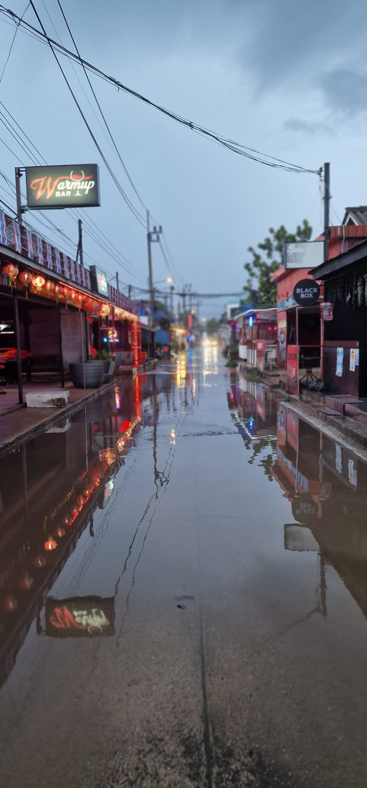
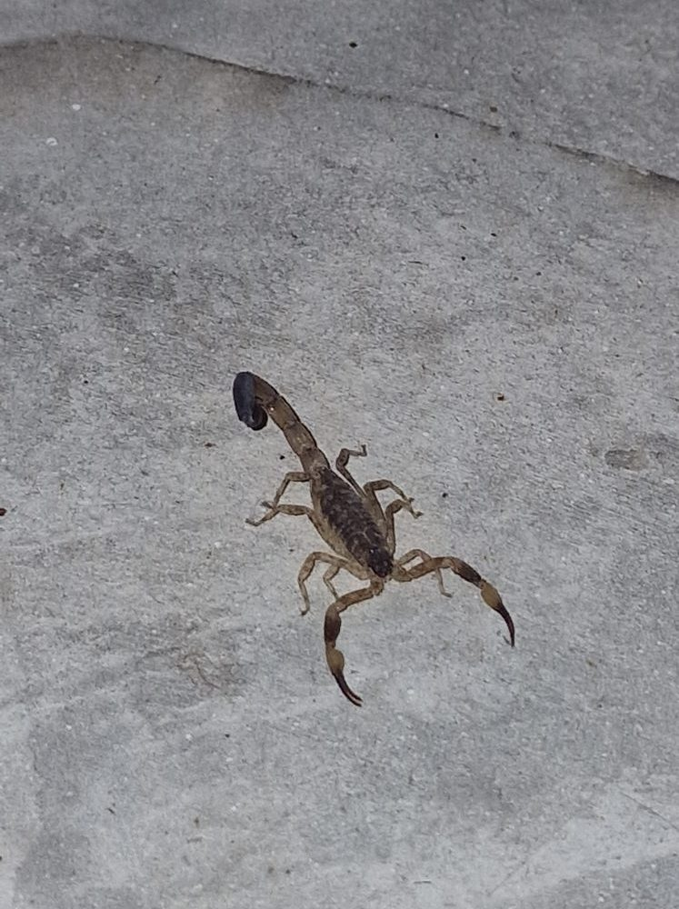
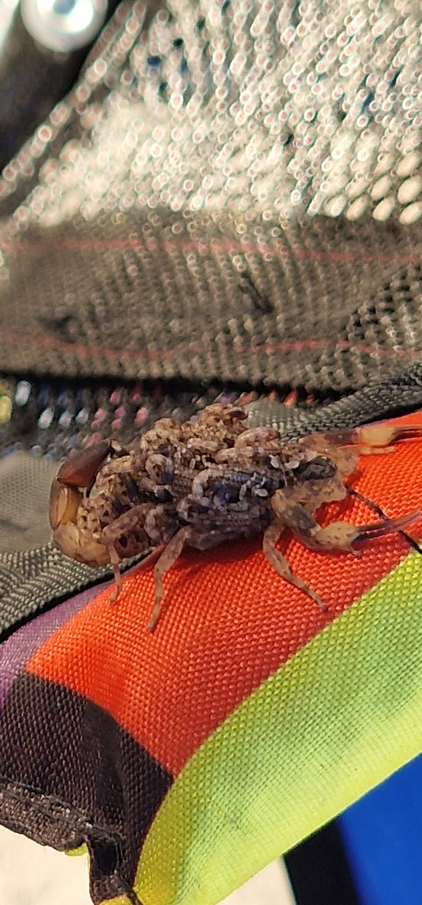
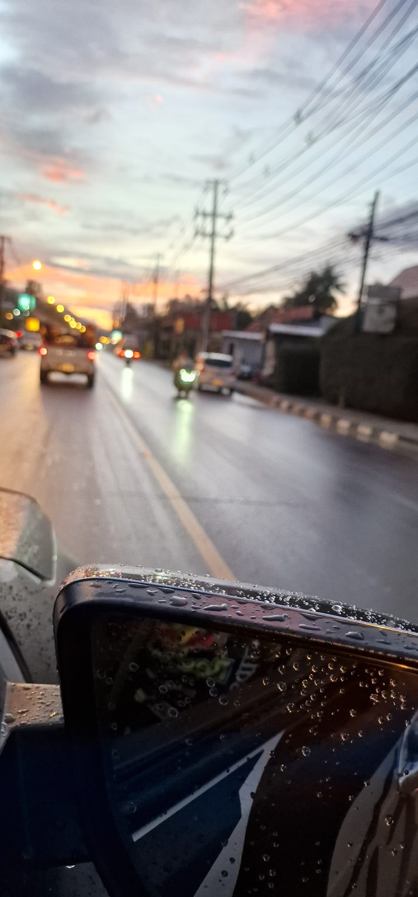

Es ist Sonntag auf Koh Samui und wir wissen nicht, was wir mit uns anfangen sollen. Seit Wochen regnet es immer wieder heftig, der Himmel ist grau und so langsam fällt uns zu Hause die Decke auf den Kopf.

Ich kann mir vorstellen, wie viel Mitleid uns gerade aus Deutschland entgegenschlägt. Dort ist November, für viele einer der unangenehmsten Monate des Jahres. Und ich sitze auf einer tropischen Insel bei knapp 30 Grad und beschwere mich über schlechtes Wetter.

Aber so schön das Leben auf Koh Samui auch ist, die Regenzeit hat durchaus ihre Tücken. Inzwischen trocknet unsere Wäsche kaum noch, im Haus ist alles klamm und wir haben innerhalb weniger Wochen ungefähr fünf Skorpione entdeckt. Auf die erste Schlange warten wir eigentlich auch schon.

Langweilig wird es hier also zumindest nicht in jeder Hinsicht.

## Wenn man auf einer tropischen Insel nichts unternehmen kann

Regenzeit in Thailand klingt für viele nach einem kräftigen Schauer am Nachmittag, der nach ein oder zwei Stunden wieder vorbei ist. Anschließend kommt die Sonne heraus und alles ist gut. Solche Tage gibt es tatsächlich, auch auf Koh Samui. Aber gerade erleben wir eine andere Seite der Regenzeit.

Es regnet teilweise über Stunden, dann hört es wieder auf, bevor der nächste Schauer kommt. Dazwischen bleibt der Himmel häufig bedeckt. Wenn man aus dem Fenster schaut, erinnert das Wetter manchmal tatsächlich an einen deutschen Novembertag. Mit dem Unterschied, dass hier alles üppig grün ist. Während die Vegetation in Deutschland im Herbst langsam verschwindet, blüht auf Koh Samui durch den vielen Regen gerade alles auf.

Das sieht wunderschön aus, ändert aber nichts daran, dass wir am Wochenende oft nicht wissen, was wir unternehmen sollen. Wenn es hier regnet, dann häufig so heftig, dass man draußen wirklich nichts machen kann. Dazu kommen immer wieder Gewitter, sodass selbst ein Strandbesuch zum Baden keine vernünftige Alternative ist.

Wir sind einfach keine Familie, die gerne den ganzen Tag zu Hause verbringt. Ich persönlich kann das besonders schlecht. Natürlich können wir mal einen Film schauen, ein Buch lesen oder gemütlich auf der Couch liegen. Aber spätestens am nächsten Tag möchte ich wieder etwas unternehmen.

Auf Koh Samui gibt es zwar Kinos, Cafés, Restaurants und auch ein paar Indoor-Angebote für Kinder. Aber wir leben inzwischen seit über einem Jahr wieder hier, haben schon unglaublich viel gesehen und möchten auch nicht jedes Wochenende ins nächste Café fahren.

Neulich hatten wir samstags Besuch und saßen sogar am Lagerfeuer, während immer wieder Regen und Wind aufzogen. Das war richtig schön. Aber am Sonntag wollten wir dann gerne wieder raus. Und standen vor demselben Problem wie so oft in den vergangenen Wochen.

Das ist tatsächlich etwas, das mich an die Wintermonate in Deutschland erinnert. Man sitzt sonntagmorgens zusammen und überlegt, was man heute machen könnte. Nur dass wir hier eigentlich von einem Leben ausgehen, das überwiegend draußen stattfindet.

## Wenn die Wäsche einfach nicht mehr trocken wird

Mit der Regenzeit kommt noch etwas, das wir bereits aus dem vergangenen Jahr kennen: die enorme Feuchtigkeit.

Damals wohnten wir noch in unserem Bungalow und hatten erhebliche Probleme mit Schimmel. Einige Dinge, die wir gerade erst angeschafft hatten, waren nach kurzer Zeit betroffen. Deshalb wollten wir vor der nächsten Regenzeit unbedingt in ein richtiges Haus umziehen.

Wir hatten gehofft, dass sich das Problem damit weitgehend erledigen würde. Tatsächlich ist die Situation etwas besser, aber auch unser jetziges Haus fühlt sich an vielen Tagen feucht und klamm an. Manchmal laufe ich sogar mit Socken herum, weil ich das Gefühl des feuchten Bodens unter den Füßen so unangenehm finde.

Besonders nervig ist die Wäsche. Die trocknet kaum noch richtig. Wir haben einen großen Abstellraum, in dem wir sie aufhängen können, aber dort herrscht teilweise ein Klima wie in einem Tropenhaus im Zoo. Es ist warm, die Luft steht und die Feuchtigkeit bleibt im Raum. Deshalb läuft inzwischen regelmäßig ein Ventilator, der die Wäsche wenigstens einigermaßen trocken bekommt.

Immerhin hat die Regenzeit auch einen Vorteil: Wir haben endlich wieder ausreichend Wasser. Während der Trockenzeit mussten wir teilweise alle vier Tage einen Tankwagen bestellen und haben zeitweise sogar im Fitnessstudio geduscht, um zu Hause Wasser zu sparen.

Dieses Problem haben wir gerade definitiv nicht.

Dafür haben wir jetzt ein anderes. Und das hat acht Beine.

## Skorpione als neue Mitbewohner

Seit wir aus unserem Indonesienurlaub zurück sind, haben wir ungefähr fünf Skorpione im oder unmittelbar am Haus gefunden. Für einen Zeitraum von drei bis vier Wochen finde ich das schon bemerkenswert.

Der erste saß in unserer Küche. Er war ziemlich klein, weshalb wir zunächst vermuteten, dass es sich um einen jungen schwarzen Thai-Skorpion handelt. Inzwischen haben wir uns genauer mit dem Thema beschäftigt und wissen, dass es in Südthailand verschiedene Skorpionarten gibt.

Besonders eindrucksvoll war ein Fund in der Nähe von Hermines Puppenwagen. Dort entdeckten wir einen Skorpion, der zahlreiche winzige Jungtiere auf dem Rücken trug. Das sah durchaus faszinierend aus, aber ich muss so etwas wirklich nicht mitten in unserem Haus haben.

Noch unangenehmer wurde mir die Sache, als Heinrich vor ein paar Tagen Holz für unser Lagerfeuer sammeln wollte. Er nahm einige Äste auf, um sie an eine andere Stelle zu bringen. Unter einem davon saß ein kleiner Skorpion, den man zwischen dem Holz kaum erkennen konnte.

Wir entfernten das Tier aus dem unmittelbaren Bereich. Als Heinrich kurze Zeit später weitermachen wollte, war der Skorpion allerdings wieder da.

Seitdem sind wir deutlich vorsichtiger.

Wir laufen zu Hause normalerweise barfuß herum, tragen draußen meistens Flip-Flops und die Kinder spielen selbstverständlich auch im Garten. Inzwischen schauen wir lieber zweimal hin, bevor wir irgendwo hineingreifen, und kontrollieren unsere Schuhe, bevor wir sie anziehen.

Skorpione suchen bei starkem Regen geschützte Rückzugsorte. Deshalb können sie während der Regenzeit vermehrt in Häusern auftauchen. Wie gefährlich ein Stich ist, hängt von der jeweiligen Art und der individuellen Reaktion ab. Gerade bei Kindern sollte man das nicht unterschätzen.

Bisher wurde zum Glück niemand von uns gestochen und ich hoffe sehr, dass das so bleibt.

Trotzdem verändert sich der Alltag ein bisschen, wenn man weiß, dass irgendwo hinter einem Möbelstück oder unter einem Holzstapel ein Skorpion sitzen könnte.

## Und dann wären da noch die Schlangen

Während der Regenzeit kommen auch Schlangen häufiger in die Nähe von Häusern. Durch den vielen Regen werden ihre natürlichen Verstecke teilweise überflutet und sie suchen trockenere Plätze oder Nahrung.

Wir wohnen direkt neben einem unbebauten Grundstück, auf dem jede Menge Laub liegt und Bananenstauden wachsen. In unserem Garten gibt es außerdem Kröten, unzählige Insekten und kürzlich hatten wir eine riesige Spinne in einem Netz direkt am Haus.

Eigentlich bietet unsere unmittelbare Nachbarschaft alles, was sich eine Schlange wünschen könnte.

Deshalb rechne ich mittlerweile fast täglich damit, irgendwann eine zu entdecken. Bisher ist uns das zum Glück erspart geblieben.

Auf Koh Samui gibt es viele harmlose Schlangenarten, aber eben auch giftige Arten wie Kobras und Königskobras. Ich würde jedenfalls nicht versuchen, eine Schlange selbst einzufangen. Dafür gibt es auf der Insel Menschen, die sich mit solchen Tieren auskennen und sie professionell entfernen.

Auch längere Spaziergänge durch dicht bewachsene Gebiete finde ich während der Regenzeit nicht besonders verlockend. Die Wege können aufgeweicht und rutschig sein und im hohen Gras sieht man ohnehin nicht, was sich dort bewegt.

Das bedeutet natürlich nicht, dass man in der Regenzeit ständig Angst haben muss. Aber wir sind inzwischen etwas aufmerksamer geworden.

## Wann ist eigentlich Regenzeit auf Koh Samui?

Was mich immer wieder überrascht, ist, wie viele Menschen davon ausgehen, dass in ganz Thailand zur gleichen Zeit Regenzeit herrscht.

Dabei gibt es deutliche regionale Unterschiede. Während viele Teile Thailands ihre ausgeprägte Regenzeit während der europäischen Sommermonate erleben, ist das auf Koh Samui und den Nachbarinseln Koh Phangan und Koh Tao anders.

Hier liegt die Hauptregenzeit normalerweise zwischen Oktober und Mitte Dezember. Beginn, Dauer und Intensität können natürlich von Jahr zu Jahr variieren. Aber grundsätzlich ist das die Zeit, in der man auf diesen Inseln mit besonders viel Regen rechnen muss.

Dass das so ist, war übrigens der Grund, weshalb wir vor vielen Jahren überhaupt zum ersten Mal nach Koh Samui gereist sind.

Heinrich war damals noch im Kindergarten und wir mussten unseren Urlaub in die dreiwöchige Sommerschließzeit legen. Wir wollten gerne nach Asien, wussten aber, dass in vielen unserer Wunschregionen im Juli und August Regenzeit herrscht. Bei meiner Recherche stieß ich schließlich auf Koh Samui.

Wir flogen im Sommer hin und hatten herrliches Wetter.

Bis heute werde ich immer wieder gefragt, ob man im deutschen Sommer überhaupt nach Thailand reisen sollte. Für Koh Samui, Koh Phangan und Koh Tao kann man das grundsätzlich bejahen.

Wer dagegen im November dem deutschen Herbst entfliehen möchte, sollte sich lieber andere Regionen Thailands ansehen. In Chiang Mai beispielsweise herrschen zu dieser Jahreszeit normalerweise deutlich günstigere Wetterbedingungen.

## Welche Monate ich für einen Koh-Samui-Urlaub empfehlen würde

Meine persönlichen Favoriten sind Mai, Juni und September. In diesen Monaten kann man auf Koh Samui erfahrungsgemäß sehr gutes Urlaubswetter haben. Gleichzeitig ist die Insel häufig weniger voll als während der Hauptsaison und auch Unterkünfte sind oft günstiger.

Juli und August sind ebenfalls eine gute Reisezeit. Allerdings fallen diese Monate in die europäischen Sommerferien, was sich unter anderem auf die Flugpreise auswirken kann.

April ist auch eine Möglichkeit, allerdings gehört er zu den heißesten Monaten des Jahres. Wer mit hohen Temperaturen Schwierigkeiten hat, sollte das bei seiner Reiseplanung berücksichtigen.

Natürlich gibt es keine Wettergarantie. Auch im Februar, mitten in der Hauptreisezeit, kann man Pech haben und mehrere Regentage erwischen. Aber die regional unterschiedlichen Regenzeiten sollte man bei einer Thailandreise unbedingt berücksichtigen.

## Jammern auf hohem Niveau

Bei allem Genörgel über das Wetter ist mir selbstverständlich bewusst, dass wir uns über vergleichsweise harmlose Dinge beschweren.

In anderen Teilen Thailands haben die Menschen während der Regenzeit mit massiven Überschwemmungen zu kämpfen. Im vergangenen Jahr bekamen wir beispielsweise Videos von Bekannten aus Nakhon Si Thammarat auf dem Festland. Dort waren ganze Straßen überflutet und Menschen brachten mit kleinen Booten Lebensmittel zu den Betroffenen.

Auf Koh Samui gibt es ebenfalls gelegentlich überflutete Straßen. Wir persönlich haben bisher aber keine vergleichbaren, länger anhaltenden Überschwemmungen erlebt.

Unsere größten Probleme sind momentan also eine Wäsche, die nicht trocken wird, ein paar ungebetene tierische Gäste und die Frage, was wir am Wochenende unternehmen sollen.

Das lässt sich verschmerzen.

Vor Kurzem hatten wir endlich wieder einen richtig schönen Sonntag und waren zum ersten Mal seit unserer Rückkehr aus Indonesien am Strand. Nach mehreren Wochen, in denen wir kaum etwas draußen unternommen hatten, war das eine echte Wohltat.

Genau diese Tage sind es, die ich während der Regenzeit vermisse. Einfach spontan losfahren, irgendwo anhalten, die Insel erkunden oder am Meer sitzen. Das gehört für uns ganz wesentlich zum Leben auf Koh Samui dazu.

Zum Glück ist die intensive Regenzeit nur ein vergleichsweise kurzer Abschnitt des Jahres. Spätestens wenn das Wetter im Dezember wieder besser wird, können wir unseren Alltag wieder stärker nach draußen verlagern.

Bis dahin arrangieren wir uns mit der Feuchtigkeit, dem Regen und hoffentlich nicht allzu vielen weiteren Skorpionen.

Und sollte tatsächlich irgendwann die erste Schlange bei uns auftauchen, gibt es vermutlich schon wieder genug Stoff für eine neue Podcastfolge.

---

**Wie fühlt sich die Regenzeit auf Koh Samui im Alltag wirklich an?** In der dazugehörigen Folge von *DLIZKFI – Das Leben ist zu kurz für irgendwann* erzähle ich noch ausführlicher von unseren Erfahrungen mit Dauerregen, Skorpionen und der manchmal etwas eingeschränkten Freizeitgestaltung auf einer tropischen Insel. Außerdem erfährst du mehr über die regional unterschiedlichen Regenzeiten in Thailand und unsere persönlichen Empfehlungen für einen Urlaub auf Koh Samui.

Du kannst die vollständige Folge auf [Spotify](https://open.spotify.com/show/0m7DHiEhXuUZJPDkmtmWb0), [Apple Podcasts](https://podcasts.apple.com/us/podcast/dlizkfi-das-leben-ist-zu-kurz-f%C3%BCr-irgendwann/id1821004400) oder [YouTube](https://www.youtube.com/@DLIZKFIPodcast) anhören.
