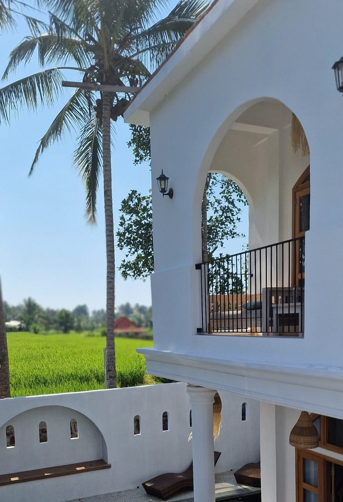

Es gibt Entscheidungen, bei denen man schon im Vorfeld ein ungutes Gefühl hat. Manchmal hört man darauf und manchmal redet man sich ein, dass man vielleicht einfach zu kritisch ist.

Bei uns ging es um 8.000 Euro. So viel sollte eine Unternehmensberatung kosten, die uns dabei helfen wollte, mithilfe künstlicher Intelligenz neue Kunden zu gewinnen, mein Business weiterzuentwickeln und verschiedene Prozesse zu automatisieren.

Das Angebot klang spannend. Die Technik dahinter war beeindruckend und es gab sogar eine Geld-zurück-Garantie. Eigentlich hatten wir also wenig zu verlieren. Zumindest dachten wir das.

Drei Monate später hatten Hagen und ich unzählige Stunden Arbeit investiert, uns mehrfach über die Zusammenarbeit geärgert und waren bereit, auf 4.000 Euro zu verzichten, nur um aus dem Vertrag herauszukommen.

Und trotzdem würde ich nicht behaupten, dass alles umsonst war.

## Eine Akquise-Mail, die tatsächlich meine Aufmerksamkeit bekam

Wer selbstständig ist, kennt vermutlich diese Nachrichten: Irgendjemand möchte einem mehr Kunden, höhere Umsätze oder ein sechsstelliges Business versprechen. Meistens haben sich die Absender nicht einmal die Mühe gemacht, herauszufinden, was man überhaupt anbietet.

Solche Nachrichten lösche ich normalerweise ungelesen.

Doch eines Tages landete eine E-Mail in meinem Postfach, die anders war. Der Absender schien sich tatsächlich mit meiner Website beschäftigt zu haben. Er wusste, dass ich mit kleinen und mittelständischen Unternehmen zusammenarbeite und auch Trainings anbiete. Außerdem enthielt die Nachricht eine Videovorschau, die den Eindruck vermittelte, als würde sich jemand persönlich meine Website ansehen.

Das war clever gemacht und weckte meine Neugier.

Ich vereinbarte einen Gesprächstermin. Schließlich kann es nie schaden, sich neue Möglichkeiten anzusehen.

## Das erste Verkaufsgespräch hätte eigentlich das letzte sein müssen

Meine anfängliche Begeisterung hielt nicht besonders lange.

Schon das erste Telefonat verlief merkwürdig. Statt eines echten Kennenlernens hatte ich das Gefühl, dass mein Gesprächspartner einen vorgefertigten Verkaufsleitfaden abarbeitete. Besonders unangenehm wurde es, als er auf meine Umsätze zu sprechen kam und sinngemäß erklärte, dass man sich damit doch kein schönes Leben aufbauen könne.

Ich musste innerlich ziemlich lachen.

Wir leben als vierköpfige Familie in Thailand. Mein Business finanziert uns das Leben, für das wir uns ganz bewusst entschieden haben. Ich arbeite ortsunabhängig, kann mir meine Zeit weitgehend selbst einteilen und habe endlich die Freiheit, die ich mir immer gewünscht habe.

Natürlich könnte ich mehr verdienen. Aber seit wann lässt sich die Qualität eines Lebens ausschließlich am monatlichen Umsatz messen?

Ich erklärte meinem Gesprächspartner ziemlich deutlich, dass mir diese Art der Kommunikation überhaupt nicht gefiel und ich unter solchen Voraussetzungen nicht zusammenarbeiten wollte.

Damit war die Angelegenheit für mich eigentlich erledigt.

## Warum wir der Unternehmensberatung trotzdem eine zweite Chance gaben

Einige Zeit später erhielt ich eine weitere E-Mail. Diesmal mit kostenfreiem Informationsmaterial, darunter ein einstündiges Video über automatisierte Kundengewinnung mit KI.

Hagen und ich schauten es uns gemeinsam an.

Und plötzlich sah die Sache anders aus.

Das vorgestellte System war technisch komplex, aber unglaublich interessant. Verschiedene Programme und KI-Anwendungen sollten miteinander verbunden werden, um potenzielle Kunden zu identifizieren und die Akquise systematischer zu gestalten.

Wir waren beide begeistert von den Möglichkeiten.

Bis dahin hatte ich meine Kunden überwiegend über Empfehlungen, persönliche Kontakte und eher sporadische Akquise gewonnen. Das funktionierte zwar, aber ich wollte mich langfristig weniger auf den Zufall verlassen.

Also meldete ich mich erneut bei der Unternehmensberatung.

Das war für mich ungewöhnlich. In meiner Selbstständigkeit habe ich gelernt, dass sich ein schlechtes Bauchgefühl zu Beginn einer Zusammenarbeit häufig bestätigt. Trotzdem wollte ich wissen, wie dieses System funktionierte.

Vielleicht war genau das mein Fehler: Ich war so begeistert von der Idee, dass ich bereit war, über Dinge hinwegzusehen, die mich normalerweise sofort abgeschreckt hätten.

## 8.000 Euro investieren – mit Geld-zurück-Garantie

In einem weiteren Gespräch, diesmal gemeinsam mit Hagen, erfuhren wir die Einzelheiten.

Für 8.000 Euro sollten wir sechs Monate lang begleitet werden. Versprochen wurde eine persönliche 1:1-Betreuung durch einen festen Ansprechpartner, der sich nicht nur um die Kundengewinnung kümmern, sondern auch mein bestehendes Business analysieren und Optimierungsmöglichkeiten aufzeigen sollte.

Dazu kam eine sogenannte Return-on-Investment-Garantie: Sollten wir innerhalb von 90 Tagen keine Kundenaufträge im Wert unserer Investition gewinnen, sollten wir unter bestimmten vertraglichen Voraussetzungen unser Geld zurückbekommen.

Wir prüften den Vertrag, ließen uns wichtige Punkte schriftlich bestätigen und entschieden uns für eine Zahlung in zwei Raten zu jeweils 4.000 Euro.

Hinzu kamen monatliche Kosten von ungefähr 500 US-Dollar für die benötigten Programme.

Uns war bewusst, dass wir auch selbst viel Arbeit investieren mussten. Tatsächlich war der Aufwand so groß, dass schnell klar wurde: Alleine würde ich das neben meinen bestehenden Kundenprojekten kaum schaffen.

Damit wurde aus einer Investition in mein Business gleichzeitig ein gemeinsames Projekt von Hagen und mir. Er brachte seine Vertriebserfahrung und sein technisches Interesse ein.

Wir hatten große Lust, loszulegen.

## Wenn schon der Vertragsabschluss zum Geduldsspiel wird

Der nächste Warnschuss kam, bevor die eigentliche Zusammenarbeit überhaupt begonnen hatte.

Für den abschließenden Termin zur Vertragsunterzeichnung hatten wir uns abends um 21 Uhr thailändischer Zeit verabredet. Unsere Kinder waren im Bett, die Laptops standen bereit und wir warteten.

Und warteten.

Der zuständige Mitarbeiter erschien nicht.

Erst ungefähr 20 Minuten später erhielten wir über einen Kollegen die Nachricht, dass er technische Probleme gehabt habe.

Was mich daran besonders ärgerte, war nicht einmal der ausgefallene Termin. Natürlich kann immer etwas dazwischenkommen. Aber ein Kunde, der für mehrere Tausend Euro eine Dienstleistung buchen möchte, sollte zumindest rechtzeitig informiert werden.

Einige Tage später fand der Termin schließlich statt. Auch da hatte ich nicht das Gefühl, dass unser Ärger besonders ernst genommen wurde.

Trotzdem unterschrieben wir.

Schließlich wollten wir dieses System unbedingt kennenlernen.

## Persönliches Coaching oder doch nur ein teurer Videokurs?

Anfang August starteten wir voller Motivation.

Beim ersten offiziellen Termin mit unserem Accountmanager erhielten wir allerdings erneut kurzfristig eine Absage. Diesmal ungefähr zehn Minuten vorher, weil er gesundheitliche Probleme hatte.

Wieder hatten wir unsere Tagesplanung entsprechend organisiert. Wieder saß die Enttäuschung tief.

Der Geschäftsführer übernahm zunächst einige Gespräche und wir begannen, uns durch die technischen Vorbereitungen zu arbeiten.

Was folgte, waren unzählige Lernvideos, verschiedene Softwarelösungen, komplexe Verknüpfungen und immer wieder technische Schwierigkeiten.

Grundsätzlich habe ich nichts gegen Videokurse. Ganz im Gegenteil. Ich lerne gerne selbstständig und habe mir einen großen Teil meines Wissens auf diese Weise angeeignet.

Aber ich hatte keinen Videokurs für 8.000 Euro gekauft.

Wir hatten uns ausdrücklich für diese Unternehmensberatung entschieden, weil wir eine persönliche Begleitung wollten. Jemanden, der sich unser konkretes Geschäftsmodell ansieht, Fragen beantwortet und gemeinsam mit uns Lösungen entwickelt.

Stattdessen wurden wir bei Problemen häufig auf weitere Videos oder Gruppentermine verwiesen. Manche Anleitungen waren inzwischen veraltet und passten nicht mehr zu den aktuellen Versionen der verwendeten Programme.

Wir arbeiteten uns trotzdem durch. Allerdings mit deutlich mehr Eigenleistung, als wir erwartet hatten.

## Das Problem mit einer Verkaufsstrategie von der Stange

Mit zunehmender Dauer wurde noch etwas anderes deutlich: Die Beratung war offenbar stark auf bestimmte Dienstleistungen und Geschäftsmodelle ausgerichtet.

Mein Angebot im Pinterest-Marketing passte nicht ohne Weiteres in diese Schablone.

Wir hatten uns gemeinsam auf Unternehmen aus der Tourismusbranche als Zielgruppe verständigt. Das erschien zunächst sinnvoll, schließlich kommen Hagen und ich beide ursprünglich aus dem Tourismus und Pinterest eignet sich grundsätzlich hervorragend für Reiseinspirationen.

Allerdings benötigt ein Unternehmen bestimmte Voraussetzungen, damit Pinterest-Marketing überhaupt sinnvoll umgesetzt werden kann. Dazu gehören ausreichend Inhalte auf der Website, passende Zielseiten und eine gute Bildauswahl.

Genau daran scheiterte es bei vielen Unternehmen, die uns das System als potenzielle Kunden vorschlug.

Wir hatten diese Kriterien im Vorfeld berücksichtigt. Auf Empfehlung unseres Beraters wurden sie jedoch aufgeweicht, um mehr Kontakte zu generieren.

Das Ergebnis: Zahlreiche Unternehmen, für die unser Angebot schlichtweg nicht geeignet war.

Unsere Rückmeldungen dazu führten kaum zu brauchbaren Lösungen. Besonders frustrierend fand ich, dass die Beratung sich offensichtlich nicht ausreichend mit den Besonderheiten unserer Dienstleistung beschäftigt hatte.

Wie sollte jemand mein Geschäftsmodell optimieren, der dessen grundlegende Voraussetzungen nicht verstand?

## Zwischen Familienurlaub und Kundengewinnung

Währenddessen lief unser Alltag weiter.

Wir leben mit unseren beiden Kindern in Thailand, die zu Hause lernen. Dazu kommen der ganz normale Familienalltag und selbstverständlich meine bestehenden Kunden.

Für September war außerdem ein dreiwöchiger Familienurlaub in Indonesien geplant. Das hatten wir bereits vor Vertragsabschluss kommuniziert.

Eigentlich wollten wir die Arbeit während dieser Zeit pausieren. In einem Techniktermin wurde uns allerdings deutlich gemacht, dass eine mehrwöchige Unterbrechung der Akquise problematisch wäre.

Also arbeiteten wir weiter.

Hagen und ich wechselten uns ab. Während einer mit den Kindern oder meinen Eltern unterwegs war, kümmerte sich der andere um Kundentelefonate und laufende Prozesse.

Es war machbar. Aber es war nicht das, was wir uns für unseren Urlaub vorgestellt hatten.

Besonders ironisch daran: Ich hatte meine Selbstständigkeit unter anderem aufgebaut, um genau diese Freiheit zu haben. Und nun saß ich im Urlaub und orientierte mich an einem Vertriebsplan, den andere für uns aufgestellt hatten.

Immerhin gab es während dieser Zeit auch einen echten Erfolg.

Ich gewann einen neuen Kunden im Wert von 2.800 Euro.

Das war ein wichtiger Moment, denn er zeigte uns, dass das System tatsächlich funktionieren konnte. Wir hatten es verstanden und waren inzwischen in der Lage, selbstständig damit zu arbeiten.

Nur standen diesen 2.800 Euro weiterhin 8.000 Euro Beratungskosten gegenüber.

## Als wir beschlossen, lieber auf 4.000 Euro zu verzichten

Gegen Ende der ersten 90 Tage wollten wir klären, wie es weitergehen sollte und welche Voraussetzungen für die Geld-zurück-Garantie galten.

Auf unsere Fragen erhielten wir zunächst keine Antwort.

Stattdessen kam die Rechnung über die zweite Rate von 4.000 Euro.

Nach weiteren Gesprächen bot uns der Geschäftsführer an, kurzfristig ein ganz neues geschäftliches Konzept zu entwickeln. Dafür wollte er sich sogar am Wochenende mehrere Stunden mit uns zusammensetzen.

Drei Monate lang hatten wir uns genau diese intensive Unterstützung gewünscht. Nun, kurz vor Ablauf der entscheidenden Frist, sollte plötzlich alles innerhalb weniger Tage passieren.

Aber wir wollten nicht unser gesamtes Angebot über den Haufen werfen. Und noch weniger wollten wir ein weiteres Wochenende damit verbringen, uns in eine Richtung drängen zu lassen, die nicht zu uns passte.

Irgendwann ging es nicht mehr darum, wer recht hatte oder welche Leistung vertraglich geschuldet war.

Wir wollten einfach nicht mehr zusammenarbeiten.

Deshalb machten wir einen Vorschlag: Wir verzichten auf die Rückforderung unserer bereits gezahlten 4.000 Euro. Im Gegenzug wird die zweite Rechnung storniert und die Zusammenarbeit vorzeitig beendet.

## War die Unternehmensberatung wirklich ein kompletter Fail?

Wenn ich ausschließlich die Kundenbetreuung und die Zusammenarbeit bewerte, fällt mein Fazit ziemlich eindeutig aus.

Aber es gibt auch eine andere Seite.

Hagen und ich haben in diesen Monaten unglaublich viel gelernt. Wir können inzwischen technische Prozesse umsetzen, von denen wir vorher nicht einmal wussten, dass sie möglich sind.

Wir haben ein komplexes System zur Kundengewinnung aufgebaut, erste Ergebnisse erzielt und können das Ganze künftig eigenständig weiterentwickeln.

Und Hagen ist inzwischen fest in mein Business eingestiegen. Auch das war ursprünglich überhaupt nicht geplant.

Deshalb wäre es falsch, die gesamte Investition als wertlos abzuschreiben. Das Wissen bleibt uns. Ebenso wie die Erfahrung, dass wir uns auch in völlig neue technische Themen einarbeiten können.

Die Frage ist nur, ob wir dafür tatsächlich diese Unternehmensberatung gebraucht hätten.

Vielleicht hätten wir uns mit dem nötigen Wissen über die Möglichkeiten vieles selbst beibringen können. Aber genau dieses Wissen fehlte uns vorher.

## Warum ich mein Business nicht um jeden Preis vergrößern möchte

Was mir diese Geschichte noch einmal deutlich gemacht hat, ist etwas, das ich eigentlich schon lange weiß.

Ich möchte kein Business aufbauen, das mich irgendwann vollständig vereinnahmt.

Natürlich will ich erfolgreich sein. Ich möchte gute Kunden gewinnen, vernünftig verdienen und mein Unternehmen weiterentwickeln. Aber mein Ziel ist nicht, möglichst viele Mitarbeiter zu beschäftigen oder irgendwann eine riesige Agentur zu führen.

Ich möchte ein Leben, in dem Arbeit und Familie zusammenpassen. In dem wir reisen können, ohne vorher drei Wochen Urlaub bei irgendjemandem beantragen zu müssen. Und in dem ich selbst entscheide, wann und wie viel ich arbeite.

Dafür brauche ich keine Verkaufsstrategien, die sich für mich falsch anfühlen. Und auch keine Menschen, die mir erklären, dass mein Leben erst mit einem bestimmten Monatsumsatz lebenswert wäre.

Wir werden das neue System zur Kundengewinnung weiter nutzen. Aber mit unseren eigenen Regeln, unserem eigenen Tempo und einer Ansprache, hinter der wir stehen können.

Was wir aber jetzt schon wissen: Wir sind fachlich weiter als vor drei Monaten. Und wir haben erneut gelernt, wie wichtig es ist, bei der Auswahl von Geschäftspartnern nicht nur auf ein überzeugendes Angebot zu achten.

Manchmal ist das Bauchgefühl eben doch der bessere Unternehmensberater.

**Du möchtest wissen, was hinter unserem 8.000-Euro-Fail steckt?** In der dazugehörigen Folge von *DLIZKFI – Das Leben ist zu kurz für irgendwann* erzählen Hagen und ich die gesamte Geschichte. Mit allen absurden Situationen, zusätzlichen Details und unseren ganz persönlichen Eindrücken aus diesen drei Monaten.

Du kannst die Folge auf [Spotify](https://open.spotify.com/show/0m7DHiEhXuUZJPDkmtmWb0), [Apple Podcasts](https://podcasts.apple.com/us/podcast/dlizkfi-das-leben-ist-zu-kurz-f%C3%BCr-irgendwann/id1821004400) oder [YouTube](https://www.youtube.com/@DLIZKFIPodcast) anhören.
