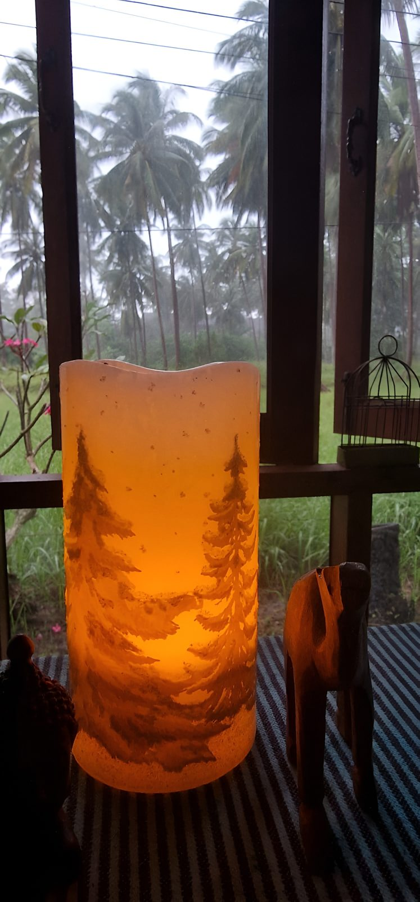
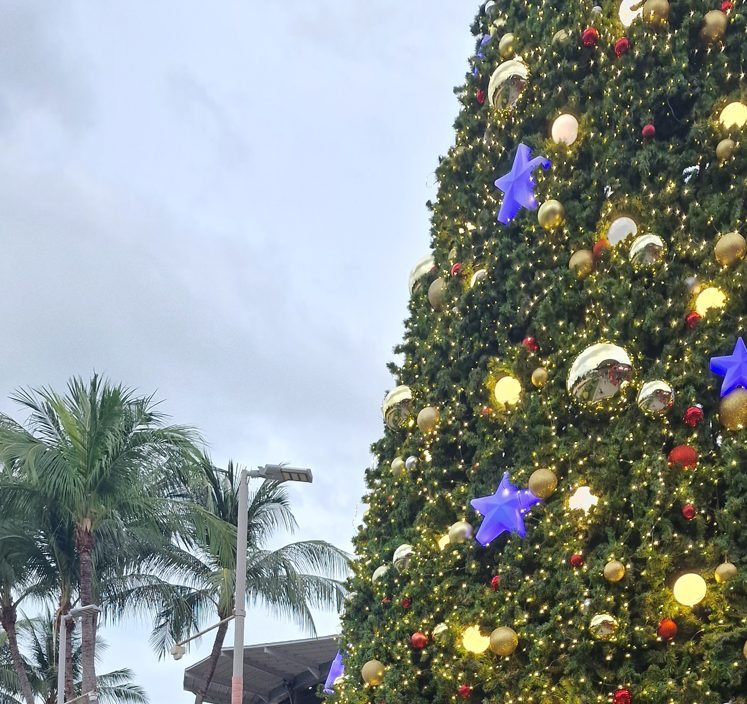
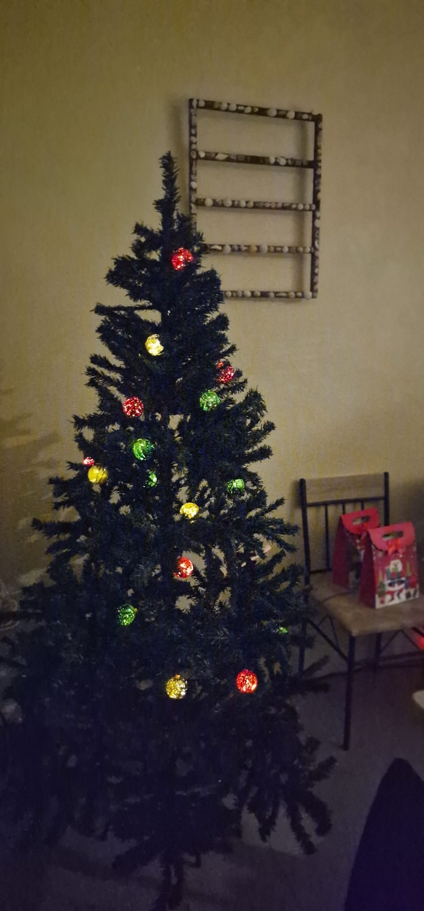
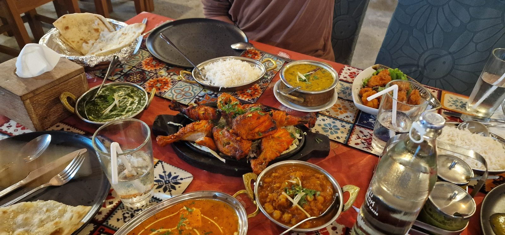

Während in Deutschland die Weihnachtsmärkte geöffnet haben, die ersten Plätzchen gebacken werden und sich viele Menschen auf gemütliche Abende bei Kerzenschein freuen, sitze ich auf Koh Samui bei ungefähr 30 Grad in kurzer Hose. Draußen stehen Palmen, die Sonne scheint und von winterlicher Gemütlichkeit ist hier nicht besonders viel zu spüren.

Weihnachtsstimmung? Bei mir ehrlich gesagt Fehlanzeige.

Allerdings muss ich dazusagen, dass weder Hagen noch ich jemals besonders große Weihnachtsfans waren. Schon in Deutschland gehörten wir nicht zu den Menschen, die sich wochenlang auf Weihnachten gefreut und voller Begeisterung das ganze Haus dekoriert haben. Natürlich fanden wir Weihnachtsmärkte schön und haben auch mit den Kindern verschiedene Traditionen gepflegt. Aber wenn Weihnachten vorbei war, waren wir auch nicht sonderlich traurig darüber.

Jetzt leben wir in Thailand, wo Weihnachten eigentlich überhaupt kein Feiertag ist. Trotzdem steht bei uns ein Weihnachtsbaum, die Kinder haben Adventskalender und am 24. Dezember gibt es natürlich Geschenke. Nur sieht unser Weihnachtsfest inzwischen etwas anders aus, als man es aus Deutschland kennt.

## Weihnachtsbäume unter Palmen – wie weihnachtlich ist Thailand?

Wer glaubt, dass man in Thailand auf Weihnachtsdekoration verzichten muss, täuscht sich. Zumindest auf Koh Samui gibt es davon reichlich.

In einer der großen Malls steht beispielsweise ein riesiger Weihnachtsbaum, ungefähr so groß wie der große Baum im Rostocker KTC. Nur dass er hier draußen steht. Dazu kommen Lichterketten, Kugeln und allerlei Weihnachtsdekoration, die man auch in den Geschäften kaufen kann.

Interessanterweise geht das teilweise ziemlich früh los. Während man in Deutschland im Dezember noch problemlos Weihnachtsschmuck einkaufen kann, werden hier in manchen Geschäften bereits die letzten Reste verkauft.

Was ich dagegen bisher kaum entdeckt habe, sind die klassischen deutschen Weihnachtssüßigkeiten. Stollen, Spekulatius, Lebkuchen oder Glühwein gehören zumindest auf Koh Samui nicht zum normalen Supermarktsortiment. Es gibt zwar westliche Süßigkeiten in weihnachtlichen Verpackungen und sicherlich auch spezielle Geschäfte mit importierten Produkten, aber mit einem deutschen Supermarkt im Advent lässt sich das nicht vergleichen.

Die Weihnachtsdekoration ist hier ohnehin hauptsächlich für die Touristen gedacht. Weihnachten ist in Thailand kein gesetzlicher Feiertag und spielt im Alltag vieler Thailänder keine Rolle. Vor allem außerhalb der touristischen Regionen dürfte man davon entsprechend wenig mitbekommen.

Wir kennen beispielsweise ein ungefähr achtjähriges Mädchen, das erst vor Kurzem aus einer ländlichen Region im Norden Thailands nach Koh Samui gezogen ist. Als sie den großen Weihnachtsbaum in der Mall sah, war das tatsächlich ihr erster Weihnachtsbaum überhaupt.

Thailand hat schließlich seine eigenen Feiertage. Unser persönlicher Favorit ist Songkran, das thailändische Neujahrsfest im April, bei dem sich das ganze Land gegenseitig mit Wasser nass spritzt. Dazu kommen verschiedene buddhistische Feiertage, Anlässe rund um das Königshaus und auch das chinesische Neujahr, das hier vielerorts mit roter Dekoration gefeiert wird.

Weihnachten gehört dagegen nicht zu den traditionellen thailändischen Festen. Dass es auf Koh Samui trotzdem so präsent ist, liegt vor allem daran, dass viele Urlauber aus Ländern kommen, in denen Weihnachten gefeiert wird.

## Unser Weihnachtsbaum wird jeden Tag ein bisschen voller

Auch wenn Hagen und ich selbst nicht besonders weihnachtsbegeistert sind, möchten wir den Kindern natürlich nicht einfach Weihnachten streichen.

Deshalb haben wir in diesem Jahr einen künstlichen Weihnachtsbaum gekauft und uns etwas für die Adventskalender überlegt: Jeden Tag bekommen Heinrich und Hermine einen neuen Weihnachtsbaumanhänger. Den hängen sie dann direkt an den Baum, sodass er im Laufe des Dezembers immer voller wird und am Heiligabend fertig geschmückt ist.

Einige Weihnachtsdekorationen haben wir sogar aus Deutschland mitgebracht. Darunter sind selbst bemalte Holzanhänger, eine Weihnachtskugel mit Hermines Handabdruck aus dem Kindergarten und ein kleines Weihnachtsdorf, das ich von meiner Oma habe.

Es sind nicht viele Dinge, aber eben ein paar Erinnerungsstücke, die ich gerne behalten wollte.

Mit dem künstlichen Weihnachtsbaum ist das übrigens so eine Sache. Ausgerechnet im vergangenen Jahr hatte ich mir in Deutschland erstmals einen gekauft, weil ich keine Lust mehr darauf hatte, jedes Jahr einen echten Baum für zwei oder drei Wochen aufzustellen und danach wegzuwerfen.

Ich dachte damals, wir würden den Baum nun viele Jahre benutzen. Schließlich war ich zu diesem Zeitpunkt noch davon ausgegangen, dass wir nicht auswandern würden.

Am Ende stand er genau ein einziges Weihnachten bei uns. Danach haben wir ihn wieder verkauft. Und jetzt steht eben der nächste künstliche Weihnachtsbaum auf Koh Samui.

## Adventskalender auf Reisen: Warum es nicht immer 24 Geschenke sein müssen

Weihnachten im Ausland ist für unsere Kinder nichts Neues. Wir haben schon mehrfach die Adventszeit oder die Feiertage auf Reisen verbracht.

Einmal sind wir sogar am 24. Dezember mit Heinrich nach Kambodscha geflogen. Damals haben wir die Bescherung einfach einen Tag vorgezogen. Das hatte sogar einen praktischen Vorteil: Der Weihnachtsmann war am 23. Dezember noch nicht besonders ausgebucht.

Überhaupt haben wir nie besonders großen Wert darauf gelegt, dass Weihnachten jedes Jahr exakt gleich abläuft.

Was es bei uns allerdings immer gab, war ein Adventskalender.

Als wir zum ersten Mal während der Adventszeit länger unterwegs waren, habe ich überlegt, wie man das möglichst unkompliziert lösen könnte. Schließlich wollte ich nicht 24 kleine Geschenke im Koffer durch die Welt transportieren. Und genauso wenig wollte ich unterwegs lauter Kleinigkeiten kaufen, die wir anschließend wieder mit nach Hause nehmen mussten.

Also haben wir einen Zettelkalender gemacht.

Hinter jedem Türchen steckte eine kleine Aktivität oder ein Erlebnis. Mal war es ein Eis in einer besonderen Eisdiele, mal ein Ausflug oder der Eintritt zu einer Attraktion, die Heinrich gerne besuchen wollte.

Das passte hervorragend zu unserer Reise, weil wir ohnehin viel unternehmen wollten. Und Heinrich fand es richtig toll.

Seitdem haben wir immer wieder unterschiedliche Varianten ausprobiert. Manchmal gab es kleine Geschenke, manchmal Aktivitäten und manchmal eine Mischung aus beidem.

Im vergangenen Jahr in Deutschland wünschten sich die Kinder dann tatsächlich einmal ganz normale gekaufte Adventskalender. Dieses Jahr sammeln sie eben Weihnachtsbaumschmuck.

Falls du selbst einmal mit Kindern während der Adventszeit verreist, kann ich diese Variante mit den Zetteln wirklich empfehlen. Sie nimmt praktisch keinen Platz weg und lässt sich wunderbar mit den Unternehmungen verbinden, die man vor Ort sowieso geplant hat.

## Kein Backofen, keine Weihnachtsplätzchen – auch nicht schlimm

Was unsere vorweihnachtlichen Aktivitäten betrifft, bleibt es dieses Jahr ansonsten ziemlich überschaubar.

Meine Mutter hat uns ein Paket mit einem selbst gebackenen Stollen geschickt. Darüber habe ich mich natürlich gefreut, wobei ich Stollen ehrlich gesagt zu jeder anderen Jahreszeit genauso gerne essen würde.

Weihnachtsplätzchen backen fällt dagegen aus.

Wir haben nämlich keinen Backofen.

Theoretisch könnte man wahrscheinlich auch im Airfryer ein paar Kekse backen, aber ich muss gestehen, dass ich darüber gar nicht besonders traurig bin. Ich backe für mein Leben gerne, aber ausgerechnet Plätzchenbacken gehört nicht zu meinen Lieblingsbeschäftigungen.

Insofern kommt mir unser fehlender Backofen da durchaus gelegen.

Heinrich hat zwar schon einmal gefragt, ob wir Kekse backen können, aber ansonsten vermissen die Kinder die typischen Weihnachtsaktivitäten bisher erstaunlich wenig. Sie haben jedenfalls nicht ständig gefragt, warum wir keinen Weihnachtsmarkt besuchen oder warum hier alles so wenig weihnachtlich aussieht.

Vielleicht liegt es daran, dass sie Weihnachten auf Reisen bereits kennen. Vielleicht sind ihnen viele der Traditionen auch einfach nicht so wichtig.

## Kartoffelsalat, indisches Essen oder lieber zum Muay Thai?

Was wir am Heiligabend machen werden, steht noch gar nicht vollständig fest.

Die Geschenke gibt es natürlich ganz klassisch am 24. Dezember unter dem Weihnachtsbaum. Hermine glaubt auch noch an den Weihnachtsmann, deshalb gehört das für sie selbstverständlich dazu. Wie lange das noch so bleibt, werden wir sehen.

Beim Weihnachtsessen sind wir dagegen ziemlich flexibel.

Als wir während unseres früheren Aufenthalts auf Koh Samui Weihnachten gefeiert haben, gab es eine Art deutsches Buffet. Mit Salami, Käse, Fleischwurst, Kartoffelsalat, Buletten, eingelegten Gurken und richtigem Brot.

Also im Grunde eine große Brotzeit mit all den Dingen, die wir in Thailand sonst eher selten essen, weil viele deutsche Lebensmittel hier ziemlich teuer sind.

Das könnten wir dieses Jahr wieder machen. Vielleicht gehen wir aber auch einfach zu unserem Lieblingsinder essen.

Auch für den Abend haben wir verschiedene Ideen. Eventuell schauen wir uns gemeinsam einen Muay-Thai-Kampf an oder gehen ins Kino. Beides sind Dinge, die wir im normalen Alltag gar nicht so häufig machen.

Wir möchten den Tag für die Kinder besonders gestalten, aber ich habe nicht das Bedürfnis, dafür unbedingt irgendwelche deutschen Weihnachtstraditionen nachzubauen.

Und damit kommen wir zu einer Entscheidung, die für manche wahrscheinlich ungewöhnlich ist: Den ersten und zweiten Weihnachtsfeiertag haben wir für uns praktisch abgeschafft.

## Warum wir den ersten und zweiten Weihnachtsfeiertag nicht mehr brauchen

Wenn ich an Weihnachten in Deutschland zurückdenke, dann denke ich auch an ziemlich viel Fahrerei.

Meine Familie lebt teilweise in Nordrhein-Westfalen und Thüringen, Hagens Familie in Rostock. Und natürlich wollten wir möglichst viele Menschen über die Feiertage sehen.

Das führte regelmäßig zu der Frage, wann wir eigentlich wo sein sollten.

Manchmal haben wir uns aufgeteilt, sodass ich mit den Kindern bei meiner Familie war und Hagen bei seiner. In anderen Jahren haben wir versucht, Weihnachten komplett bei einer Familie zu verbringen und im nächsten Jahr bei der anderen.

Und gelegentlich sind wir am ersten Weihnachtsfeiertag einfach 400 Kilometer mit dem Auto gefahren, um anschließend bei einem anderen Teil der Familie zu feiern.

Ich fand das ehrlich gesagt nie besonders schön. Den halben Weihnachtstag im Auto zu sitzen, nur damit man möglichst alle Familienmitglieder innerhalb von drei Tagen besucht hat, war für mich nicht unbedingt der Inbegriff eines entspannten Weihnachtsfestes.

Natürlich war es schön, alle wiederzusehen. Aber besonders entspannt war die Organisation nicht immer.

Hier in Thailand haben wir diese Verpflichtungen nicht. Und da Weihnachten für Hagen und mich auch keinen religiösen Hintergrund hat, sehen wir keinen Grund, den 25. und 26. Dezember besonders zu feiern.

Unsere Kinder haben bisher auch überhaupt nicht danach gefragt.

Natürlich könnten wir an diesen Tagen etwas Besonderes unternehmen. Aber genau das können wir hier ohnehin ziemlich häufig tun, unabhängig davon, welcher Tag gerade ist.

Deshalb wird es bei uns am 24. Dezember eine Bescherung und einen schönen gemeinsamen Tag geben. Und danach geht unser Alltag einfach weiter.

## Weihnachten darf bei uns auch einfach Weihnachten sein

Ich weiß, dass viele Menschen Weihnachten lieben. Sie freuen sich schon Wochen vorher darauf, dekorieren ihre Wohnungen, backen Plätzchen, besuchen Weihnachtsmärkte und genießen die besondere Atmosphäre.

Das kann ich auch vollkommen nachvollziehen. Ich fand es schließlich selbst immer schön, über einen Weihnachtsmarkt zu schlendern oder mit den Kindern einen der weihnachtlichen Umzüge anzuschauen.

Wenn ich das alles nicht habe, fehlt es mir aber auch nicht.

Und das ist eigentlich schon immer so gewesen, nicht erst seit unserer Auswanderung.

Vielleicht fällt es mir in Thailand einfach noch leichter, Weihnachten so zu gestalten, wie es für uns passt. Es gibt hier keinen gesellschaftlichen Weihnachtsalltag, an dem wir uns automatisch orientieren. Keine Feiertage, die wir mit Familienbesuchen füllen müssen, und auch keinen besonderen Anspruch daran, dass drei Tage lang alles weihnachtlich ablaufen muss.

Für die Kinder gibt es ihren Adventskalender, den Weihnachtsbaum, den Nikolaus und die Bescherung. Dazu unternehmen wir am Heiligabend vielleicht noch etwas Schönes.

Und für uns reicht das vollkommen.

Ich freue mich jedenfalls auf einen entspannten 24. Dezember mit meiner Familie. Auch wenn wir dabei wahrscheinlich kurze Hosen tragen, anschließend indisch essen gehen und draußen Palmen statt Tannen stehen.

Weihnachtliche Gefühle kommen bei mir dadurch vermutlich trotzdem nicht auf. Aber das müssen sie auch gar nicht.

*In der passenden Folge von „DLIZKFI – Das Leben ist zu kurz für irgendwann“ erzähle ich noch ausführlicher darüber, wie Weihnachten in Thailand aussieht, welche Traditionen wir aus Deutschland mitgenommen haben und warum wir die Feiertage inzwischen ziemlich entspannt angehen. Die vollständige Folge findest du auf Spotify, Apple Podcasts und YouTube.*
